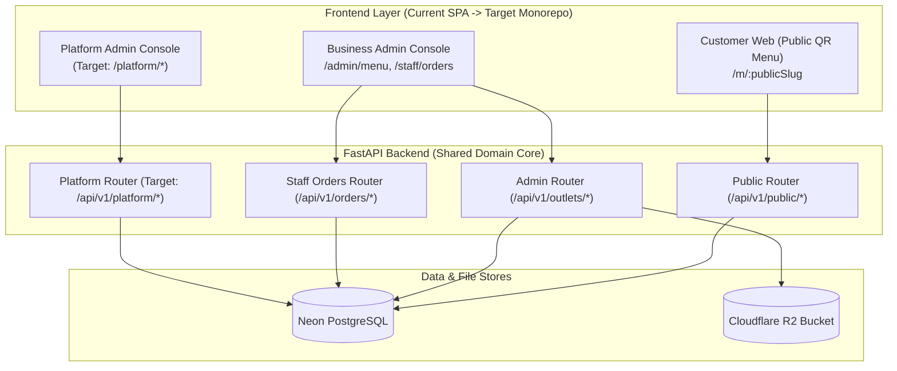

# ROMS — Multi-Application Architecture Audit & Evolution Strategy

> [!NOTE]
> This document provides a thorough, evidence-based repository audit of the current ROMS codebase against the **Multi-Application Architecture AI Audit Brief** (`docs/ROMS_Multi_App_Architecture_AI_Audit_Brief.md`). It details verified code facts, structural gaps, tenant isolation models, and an actionable phased roadmap.

---

## Executive Summary

The current ROMS codebase is a clean, production-ready **modular monolith** with a single FastAPI backend (`backend/app`), Neon PostgreSQL database (`0001`–`0003` migrations), Cloudflare R2 image storage (`boto3`), and a single React + Vite SPA (`frontend/src`).

While the current frontend hosts all screens in a single application bundle, the product requirements call for **three clearly separated user experiences**:
1. **Platform Admin** — SaaS control plane for ROMS operators to manage customer businesses, outlets, subscriptions, and global audit trails.
2. **Business Admin** — Restaurant operations console for owners, managers, kitchen staff, and waiters (Menu, R2 Images, Tables, Orders, Audit Logs).
3. **Customer Website** — Public, multi-tenant digital menu engine opened via QR codes.

**Core Recommendation:**  
Retain **one FastAPI backend**, **one Neon PostgreSQL database**, and **one Cloudflare R2 bucket**, while evolving the architecture into a **multi-frontend monorepo structure** (`apps/platform-admin`, `apps/business-admin`, `apps/customer-web`). This achieves clean UI separation, distinct security boundaries, and independent frontend deployment without adding microservice complexity or secondary caching infrastructure (no Redis required).

---

## 1. Verified Architecture vs. Audit Brief Vision

| Component | Audit Brief Vision | Verified Current State in Codebase | Verification Status |
| :--- | :--- | :--- | :--- |
| **Backend API** | Single FastAPI service with modular domain boundaries | Single FastAPI app (`backend/app/main.py`) with routers (`public_menu`, `auth`, `admin_menu`, `staff_orders`) | **Verified in code** |
| **Database** | Neon PostgreSQL with Alembic migrations | Neon cloud PostgreSQL with Alembic (`0001_initial_r1_schema.py`, `0002_r2_staff_and_audit.py`, `0003_r3_tables_and_orders.py`) | **Verified in code** |
| **Image Storage** | Cloudflare R2, object keys in DB, public URL derivation | Cloudflare R2 via `boto3`, keys in `MenuItem.image_url`, derived via `get_public_image_url()` in `config.py` | **Verified in code** |
| **Frontend UIs** | 3 separate applications (Platform, Business, Customer) | 1 React + Vite SPA with internal client-side routing (`/m/:slug`, `/login`, `/admin/menu`, `/staff/orders`) | **Verified in code** |
| **Platform Admin** | Internal ROMS company console | **0% implemented.** No platform admin endpoints, no `is_platform_admin` flag on `User` | **Verified in code** |
| **Business Admin** | Owner/Manager/Staff ops console | **85% implemented.** Menu management, R2 file uploads, table setup, POS order creation, kitchen Pipeline | **Verified in code** |
| **Customer Web** | Public QR scan digital menu | **90% implemented.** Public menu lookup by slug, derived R2 image URLs, stock status, QR generator endpoint | **Verified in code** |

---

## 2. Deep Component Audit



### A. Data Model & Tenant Isolation Audit
- **Business (`app/modules/businesses/models.py`)**: Root tenant entity (`id`, `name`, `status`).
- **Outlet (`app/modules/outlets/models.py`)**: Physical restaurant location (`id`, `business_id`, `name`, `public_slug`, `currency`, `timezone`, `address`, `status`).
- **User & Membership (`app/modules/staff/models.py`)**:
  - `User`: Global user account (`email`, `password_hash`, `display_name`, `status`).
  - `OutletMembership`: Multi-tenant assignment joining `User` to `Outlet` with role (`owner`, `manager`, `waiter`, `kitchen`). Unique constraint on `(user_id, outlet_id)`.
- **Tenant Isolation Verification**:
  - Backend dependency `RequireOutletRole` ([deps.py](file:///C:/Lakshya/Coding/EquinoLabs/restaurant-ops-system/backend/app/api/deps.py#L41-L65)) verifies that `current_user` has an active `OutletMembership` for the target `outlet_id` before allowing administrative or staff operations.
  - Public menu lookup ([service.py](file:///C:/Lakshya/Coding/EquinoLabs/restaurant-ops-system/backend/app/modules/menus/service.py#L16-L41)) filters strictly by `public_slug` and `status == 'active'`.

### B. Security & Platform Admin Gaps Identified
1. **Missing Platform Admin Role**: Currently, `User` has no `is_platform_admin` boolean flag or global platform role. `OutletMembership` only handles outlet-level roles (`owner`, `manager`, `waiter`, `kitchen`).
2. **Missing Platform API Router**: There are no endpoints to list all businesses across tenants, provision new restaurant businesses, or manage global platform subscriptions.
3. **Missing Database-driven Branding**: `Outlet` and `Business` models lack columns for custom branding (`logo_url`, `cover_image_url`, `primary_color`, `accent_color`). Branding is currently hardcoded in Tailwind CSS themes.
4. **Missing Subscription Entitlement Tracking**: `Business` lacks fields for tracking SaaS tier, subscription status (`trial`, `active`, `past_due`, `cancelled`), and max outlet limits.

---

## 3. User Review Required

> [!IMPORTANT]
> **No Code Changes Are Being Made in This Step.**  
> Per the user request and brief instructions, this is a planning and architecture discovery document. Code modifications will only occur after your review and explicit approval of the proposed phases.

> [!NOTE]
> **Monorepo Strategy Recommendation**:  
> We recommend a **single repository with Vite multi-page / workspace separation** (`apps/customer-web`, `apps/business-admin`, `apps/platform-admin`). This avoids repository fragmentation while ensuring that building or deploying the customer website does not bundle administrative code or credentials.

---

## 4. Phased Implementation Roadmap

### Phase 1: Platform Admin Foundation & Multi-Tenant Entitlements
- **Backend Schema (`0004_platform_and_branding.py`)**:
  - Add `is_platform_admin: bool = False` to `users` table.
  - Add subscription fields to `businesses`: `plan_name` (default: `"free_trial"`), `subscription_status` (default: `"active"`), `max_outlets` (default: 2), `trial_ends_at`.
  - Add branding fields to `outlets`: `logo_url`, `cover_image_url`, `primary_color`, `accent_color`.
- **Backend Platform Router (`app/api/v1/platform.py`)**:
  - `RequirePlatformAdmin` dependency in `deps.py`.
  - `GET /api/v1/platform/businesses`: List all businesses & outlets.
  - `POST /api/v1/platform/businesses`: Provision new restaurant business & initial owner account.
  - `PATCH /api/v1/platform/businesses/{id}/subscription`: Update subscription plan & status manually.
- **Frontend Platform Admin App**:
  - Create `apps/platform-admin` or route section `/platform` for ROMS company owners to manage tenant onboarding and platform metrics.

### Phase 2: Database-Driven Outlet Branding for Customer Web
- **Public Menu Endpoint Enhancement**:
  - Update `PublicOutletMenuResponse` in `schemas.py` to include outlet branding settings (`logo_url`, `cover_image_url`, `primary_color`, `accent_color`).
  - Resolve logo & cover image keys using `get_public_image_url()`.
- **Customer Web Customization**:
  - Update customer web UI (`PublicMenuView.tsx`) to apply dynamic CSS variables for `primary_color` and `accent_color`, and display custom outlet logo / banner header.

### Phase 3: Frontend Monorepo Restructuring & UI Separation
- Reorganize `frontend/` into workspace applications:
  - `apps/customer-web`: Ultra-lightweight customer QR menu SPA (fast initial load, zero admin JS bundled).
  - `apps/business-admin`: Restaurant staff/owner portal (Menu Admin, POS Orders, Tables, R2 Uploads).
  - `apps/platform-admin`: ROMS internal platform console.
  - `packages/shared`: Shared API client, TypeScript types, and UI primitives.

### Phase 4: Subscription Entitlement Enforcement & Manual Billing Controls
- Add backend entitlement guards (e.g. enforcing `max_outlets` check during outlet creation, restricting active menu edits if subscription is `past_due` or `suspended`).

---

## 5. Verification Plan

### Automated Tests
- Backend pytest commands:
  ```powershell
  $env:PYTHONPATH="backend"; .\.venv\Scripts\python.exe -m pytest backend/tests
  ```
- Frontend Vitest & build commands:
  ```cmd
  cd frontend && npm test -- --run && npm run build
  ```

### Manual Verification Steps
1. Verify platform admin provisioning by creating a test platform user and verifying access to cross-tenant business listing.
2. Verify customer menu branding by changing outlet primary/accent colors in DB and asserting dynamic styling on `/m/:publicSlug`.
3. Verify tenant boundary isolation by confirming that a Business A owner cannot access `/api/v1/outlets/{business_b_outlet_id}/admin/menu`.
