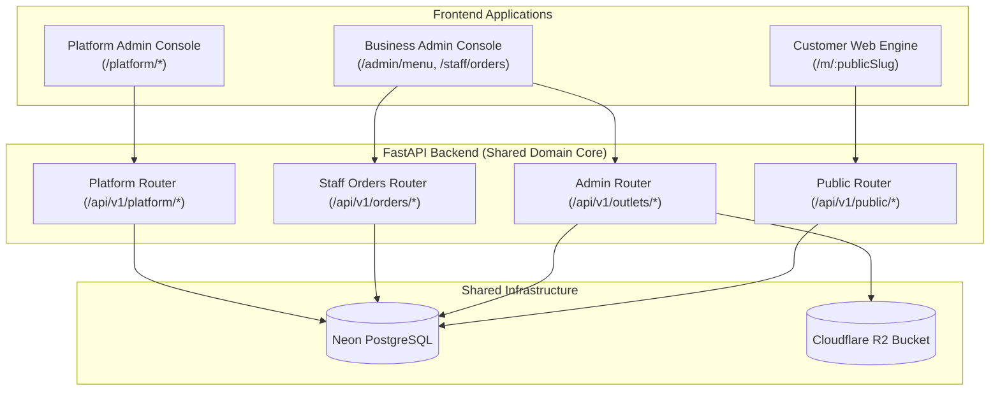

# ROMS — Multi-Application Architecture Audit & Evolution Strategy

> [!NOTE]
> This document provides a thorough, evidence-based repository audit and revised implementation roadmap for ROMS against the **Multi-Application Architecture AI Audit Brief** (`docs/ROMS_Multi_App_Architecture_AI_Audit_Brief.md`). It incorporates all explicit architectural refinements regarding platform admin security, phased migration, subscription model separation, branding hierarchy, code reuse, and targeted verification.

---

## Executive Summary

The current ROMS codebase is a production-ready **modular monolith** with a single FastAPI backend (`backend/app`), Neon PostgreSQL database (`0001`–`0003` migrations), Cloudflare R2 image storage (`boto3`), and a React + Vite SPA (`frontend/src`).

To support scaling ROMS into a multi-tenant restaurant operations SaaS while preserving simplicity and low operating costs, the system will evolve into **three clearly separated frontend applications sharing one FastAPI backend API, one Neon PostgreSQL database, and one Cloudflare R2 bucket**:

1. **Platform Admin** — SaaS control plane for internal ROMS operators to provision businesses, manage outlets, and oversee platform health.
2. **Business Admin** — Restaurant management console for owners, managers, kitchen staff, and waiters (Menu Management, R2 Images, Tables, Orders, Audit Logs).
3. **Customer Website** — Public, multi-tenant digital menu engine opened via QR codes.

---

## 1. Architectural Decisions & Key Refinements

### A. Secure Platform-Admin Provisioning
- **No Public Self-Registration**: Platform admin privileges (`is_platform_admin = True`) can **never** be requested or self-assigned via public registration endpoints or ordinary user APIs.
- **Provisioning Mechanism**:
  1. **Initial Bootstrap CLI**: A dedicated server command line utility (`backend/scripts/create_platform_admin.py`) allows server operators to create or promote the first platform admin user directly in the database.
  2. **Environment Bootstrapping (Optional)**: On server startup, if `INITIAL_PLATFORM_ADMIN_EMAIL` is configured in environment variables, the backend ensures that specific account has `is_platform_admin = True`.
  3. **Subsequent Admin Management**: Existing platform administrators can grant or revoke platform admin privileges for other users via protected platform API routes (`/api/v1/platform/admins`).
- **Authorization Guard**: A backend dependency `get_current_platform_admin` ([deps.py](file:///C:/Lakshya/Coding/EquinoLabs/restaurant-ops-system/backend/app/api/deps.py)) strictly verifies `current_user.is_platform_admin is True`.

### B. Distinct Subscription & Account Status Model
To avoid enforcing unapproved commercial rules, account lifecycle, billing status, and plan limits are clearly separated:
- **Operational Account Status (`Business.status`)**: Controls overall operational state (`"active"`, `"suspended"`). A suspended business cannot access admin features or serve public menus.
- **Subscription Billing Status (`Business.subscription_status`)**: Tracks billing lifecycle (`"trial"`, `"active"`, `"past_due"`, `"cancelled"`).
- **Plan Tier Name (`Business.plan_name`)**: Informational string identifier (e.g. `"starter"`, `"growth"`, `"enterprise"`).
- **Outlet Entitlement Limit (`Business.max_outlets`)**: Nullable integer column. If `null`, no hard limit is enforced. If set (e.g. `2`), backend prevents creating outlets beyond the limit.

### C. Outlet-Level Branding Model & Backward Compatibility
- **Initial Scope (Outlet-Level)**: Branding parameters (`logo_url`, `cover_image_url`, `primary_color`, `accent_color`) will be placed directly on the `outlets` table.
- **Rationale**: Outlets under the same business (such as a traditional sit-down restaurant vs. a casual riverside camp) frequently require distinct visual identity, logos, and accent themes. Placing branding directly on `outlets` allows immediate lookup during public menu queries without extra joins.
- **Migration & Compatibility Guarantee**:
  - All branding columns are nullable.
  - Image fields store R2 object keys and are converted to public URLs using the existing `get_public_image_url()` helper.
  - If branding columns are `null`, the customer website defaults gracefully to standard ROMS themes.
  - Existing public URLs (`/m/:publicSlug`) and printed QR codes remain **100% backward compatible**.

### D. Frontend Strategy: Incremental Separation
Instead of an immediate disruptive folder rewrite, frontend evolution will occur in safe steps:
- **Phase 1–2**: Implement Platform Admin as a dedicated, route-guarded view section (`/platform`) inside the existing SPA layout, reusing existing auth context and HTTP client abstractions.
- **Phase 3**: Transition `frontend/` into a Vite multi-entry or workspace structure (`apps/customer-web`, `apps/business-admin`, `apps/platform-admin`, `packages/shared`) so that the customer QR menu bundle contains zero administrative JavaScript or secret credentials.

### E. Code & Infrastructure Reuse
- **Shared FastAPI Core**: Reuse existing SQLAlchemy models (`Business`, `Outlet`, `User`, `OutletMembership`, `AuditLog`), authentication primitives (`security.py`), error handlers (`errors.py`), and R2 storage helpers (`r2_storage.py`).
- **Shared Frontend Services**: Extend `frontend/src/api/client.ts` and `AuthContext.tsx` without duplicating HTTP header logic or token handling.

---

## 2. Component Structure & Data Flow

---

## 3. Phased Implementation Roadmap

### Phase 1: Platform Admin Foundation (Backend Guard & Business Provisioning)
- **Task 1.1: Database Migration `0004_platform_admin.py`**
  - Add `is_platform_admin: Mapped[bool] = mapped_column(Boolean, server_default="false", nullable=False)` to `users` table.
  - Create CLI script `backend/scripts/create_platform_admin.py` to securely promote initial platform admin accounts.
- **Task 1.2: Backend Platform Authorization & Router (`app/api/v1/platform.py`)**
  - Add `get_current_platform_admin` dependency in `app/api/deps.py`.
  - Implement endpoints:
    - `GET /api/v1/platform/businesses`: List all businesses, outlets, and account statuses across tenants.
    - `POST /api/v1/platform/businesses`: Provision a new business and its primary outlet.
    - `POST /api/v1/platform/businesses/{business_id}/outlets`: Add an outlet to a business.
    - `POST /api/v1/platform/businesses/{business_id}/assign-owner`: Create/assign a restaurant owner user to an outlet.
- **Task 1.3: Minimal Platform Admin UI (`PlatformAdminView.tsx`)**
  - Route `/platform` guarded by `is_platform_admin`.
  - UI to view business list, provision new businesses/outlets, and assign owner credentials.

### Phase 2: Account Status & Subscription Management
- **Task 2.1: Additive Migration `0005_business_subscriptions.py`**
  - Add fields to `businesses`: `subscription_status` (`"trial"`, `"active"`, `"past_due"`, `"cancelled"`), `plan_name` (string), `max_outlets` (nullable int), `trial_ends_at` (nullable datetime).
- **Task 2.2: Platform Subscription Endpoints**
  - `PATCH /api/v1/platform/businesses/{business_id}/subscription`: Update subscription status, plan name, max outlets, or suspend/activate account.
  - Enforce `max_outlets` check when creating new outlets.

### Phase 3: Database-Driven Outlet Branding
- **Task 3.1: Additive Migration `0006_outlet_branding.py`**
  - Add `logo_url`, `cover_image_url`, `primary_color`, `accent_color` to `outlets` table.
- **Task 3.2: Public Menu & Customer Web Integration**
  - Update `PublicOutletMenuResponse` in `schemas.py` to return derived branding URLs and color settings.
  - Update `PublicMenuView.tsx` to render dynamic primary/accent colors and logo/banner header.

### Phase 4: Frontend Workspace Separation
- Reorganize frontend into `apps/customer-web`, `apps/business-admin`, `apps/platform-admin` and `packages/shared` using Vite multi-entry configuration.

---

## 4. Verification & Testing Strategy

### A. Targeted Tests During Implementation
1. **Platform Admin Security Test**:
   - Verify that regular users (owners, managers, waiters) receive `403 Forbidden` when accessing `/api/v1/platform/*` endpoints.
   - Verify that platform admin users can successfully list cross-tenant businesses and provision new outlets.
2. **Cross-Tenant Isolation Test**:
   - Verify that a Business A owner cannot read, update, or upload images for Business B outlets.
3. **QR & Public Menu Regression Test**:
   - Verify that `/api/v1/public/outlets/{slug}/menu` continues to work seamlessly for existing outlets and QR URLs.

### B. Full Test Suite Execution (At Phase Completion)
- Backend Pytest Suite: `$env:PYTHONPATH="backend"; .\.venv\Scripts\python.exe -m pytest backend/tests`
- Frontend Vitest & Build: `cd frontend && npm test -- --run && npm run build`
