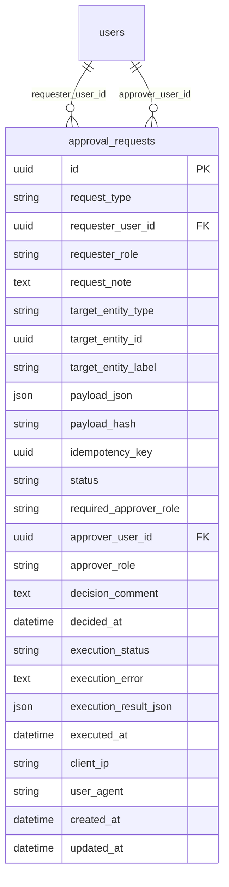
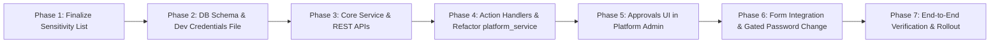

# ROMS — Centralized Approval Workflow: Architecture & Implementation Plan

**Author:** Senior Software Architect  
**Date:** October 2026 (Updated with Confirmed Product Decisions & Reconciled Transaction Architecture)  
**Status:** Architecture Specification & Phased Implementation Plan  
**Target Applications:** Platform Admin Console (`apps/platform-admin`), Backend Core (`backend/app`), Shared Packages (`packages/shared-types`, `packages/api-client`)  
**Authority:** Aligned with [DESIGN.md](file:///C:/Lakshya/Coding/EquinoLabs/restaurant-ops-system/docs/design/DESIGN.md), [roms_owner_decisions.md](file:///C:/Lakshya/Coding/EquinoLabs/restaurant-ops-system/docs/architecture/roms_owner_decisions.md), and [stage_3_ownership_subscriptions_architecture.md](file:///C:/Lakshya/Coding/EquinoLabs/restaurant-ops-system/docs/architecture/stage_3_ownership_subscriptions_architecture.md).

---

## Document Classification Guide

To maintain total transparency during planning and implementation, sections throughout this document are explicitly tagged with one of four governance tiers:

- `[CONFIRMED DECISION]`: Explicitly decided product or technical requirements agreed upon for the current implementation.
- `[RECOMMENDATION]`: Architectural and engineering proposals formulated from repository evidence, awaiting stakeholder adoption.
- `[FUTURE INTENT — NOT FOR CURRENT IMPLEMENTATION]`: Documented long-term product vision that is deliberately deferred from the current scope.
- `[UNRESOLVED PRODUCT POLICY]`: Open policy decisions with documented options, trade-offs, and impacts, requiring explicit business signoff.

---

## 1. Executive Summary & Core Architecture

### 1.1 Architectural Pattern `[CONFIRMED DECISION]`

The Restaurant Operations Management System (ROMS) Platform Admin portal will adopt a **centralized approval workflow** embedded directly within the existing monolithic FastAPI backend and React-based Platform Admin frontend. Rather than fragmenting approval logic across business domains (such as separate approval systems for tenants, billing, and identity), the platform introduces a **unified Approval Engine** with a centralized data model, policy evaluation service, and transaction-safe action execution registry.

```mermaid
flowchart TD
    subgraph UI ["Platform Admin UI (apps/platform-admin)"]
        Requester["Requester (Owner / Admin / Operator)"] -->|1. Fills Action Form (Preserves Existing Inputs)| SubmitAction["Submit Approval Request"]
        Approver["Approver (Owner / Admin)"] -->|4. Reviews in Approvals View| DecisionAction{"Approve or Reject?"}
    end

    subgraph API ["FastAPI Backend (backend/app)"]
        SubmitAction -->|POST /platform/approvals| ApprovalsRouter["Approvals Router (app/api/v1/approvals.py)"]
        ApprovalsRouter -->|Validates Policy & Staged Hash Payload| ApprovalService["Approval Service (app/modules/approvals/)"]
        ApprovalService -->|Persists Request with 'pending' status| DB_Pending[("approval_requests Table")]
        
        DecisionAction -->|POST /platform/approvals/{id}/decide| DecisionRouter["Decision Route (app/api/v1/approvals.py)"]
        DecisionRouter -->|Validates Approver Policy & Row Lock SELECT FOR UPDATE| ExecutionEngine["Approval Execution Engine"]
    end

    subgraph Exec ["Transactional Execution Boundary"]
        ExecutionEngine -->|If Rejected| RejectHandler["Mark 'rejected' + Decision Comment + Audit Log (No Execution)"]
        ExecutionEngine -->|If Approved| ExecTransaction["Caller-Owned DB Transaction"]
        ExecTransaction -->|Re-validate Target State & 14-Day Expiry| StateCheck["TOCTOU & Expiry Check"]
        ExecTransaction -->|Dispatch Action Handler (commit=False)| DomainService["Target Domain Service (platform_service.py)"]
        ExecTransaction -->|Mark 'approved' + 'succeeded'| DB_Approved[("Update approval_requests")]
        ExecTransaction -->|Record Platform Audit Log| AuditSvc["log_audit() (audit_logs Table)"]
        ExecTransaction -->|Commit DB Transaction| DB_Commit["db.commit() (ACID Boundary)"]
    end

    subgraph PostCommit ["Post-Commit Development Side-Effect (Local Dev Only)"]
        DB_Commit -->|Post-Commit Append (Idempotent)| CredFile["backend/.local-user-credentials.txt"]
    end
```

### 1.2 Core Architectural Invariants `[CONFIRMED DECISION]`

1. **Centralized Data Storage:** An `approval_requests` table centrally stores all requests awaiting a decision.
2. **Standardized Request Discriminator:** Each request possesses a `request_type` (e.g., `user_creation`, `business_creation`, `outlet_creation`, `user_role_change`, `subscription_change`). *Note: These types represent architectural patterns validated against existing domain services, not an immediate mandate to implement all types simultaneously.*
3. **Decoupled Request vs. Execution (Two-Phase Pattern):**
   - **Phase A (Submission):** The requester fills in the form and supplies an optional request note. For actions requiring approval, **submitting a request must not create or mutate the target domain entity**. The request enters `pending` status.
   - **Phase B (Decision & Execution):** An eligible approver reviews the request. Rejection terminates the request with a mandatory reason and **must not execute the requested operation**. Approval triggers a centralized dispatcher that invokes the execution handler associated with the request type.
4. **Service & Logic Reuse:** Handlers reuse existing domain services, validation, authorization, and business logic in [`platform_service.py`](file:///C:/Lakshya/Coding/EquinoLabs/restaurant-ops-system/backend/app/modules/businesses/platform_service.py) wherever possible.
5. **Separate Decision and Execution Outcomes:** The approval system tracks approval permissions, decision status (`status`: `pending`, `approved`, `rejected`, `cancelled`), and execution outcomes (`execution_status`: `not_started`, `succeeded`, `failed`) separately. An approved request whose underlying execution fails is **never reported as successfully completed**.
6. **Role & Approval Authority Principles:**
   - **Business Creation Approval:** Platform Admins and the Platform Owner may approve business-creation requests.
   - **Subscription Changes Approval:** Platform Admins may approve routine subscription plan changes. Exceptional commercial entitlement overrides require the Platform Owner.
   - **Request Visibility Policy:** Platform Owners and Platform Admins see requests according to their permissions (Owner sees all requests across the platform; Admins see requests they are eligible to approve plus requests they created). Operators see strictly their own requests and history, and cannot approve requests.
   - **Self-Approval Policy:** Sensitive requests generally restrict self-approval to enforce separation of duties.
   - **Platform Owner Self-Approval Exemption:** The Platform Owner is explicitly permitted to self-approve sensitive requests without imposing a separate-approver requirement.
   - **Platform Admin:** Can approve requests permitted by policy, including their own ordinary requests where permitted, but is restricted from self-approving requests designated as sensitive. Requests designated as Owner-only remain strictly Owner-only.
   - **Platform Operator:** Permitted to create supported requests and view their own request history. Operators **cannot approve or reject any request**; backend endpoints reject decision attempts by Operators with `HTTP 403 Forbidden`.
   - **Automatic Expiration:** Pending requests expire automatically after 14 days.

---

## 2. Account Provisioning, Credentials & Interim Flow

### 2.1 Confirmed Account Creation Invariants `[CONFIRMED DECISION]`

1. **Form Preservation:** Existing email and password inputs in administrative creation forms ([`AddOperatorModal.tsx`](file:///C:/Lakshya/Coding/EquinoLabs/restaurant-ops-system/apps/platform-admin/src/features/platform-admin/AddOperatorModal.tsx), [`BusinessDirectoryPage.tsx`](file:///C:/Lakshya/Coding/EquinoLabs/restaurant-ops-system/apps/platform-admin/src/features/platform-admin/BusinessDirectoryPage.tsx)) are preserved. Submitting the form creates an approval request first.
2. **Deferred Account Creation:** The user account **must not be created in the `users` table** until the request is explicitly approved.
3. **No Plaintext Passwords in Payloads:** Storing plaintext passwords in database payloads (`approval_requests.payload_json`) is strictly prohibited. Payloads stage either:
   - Pre-hashed credentials (`password_hash = hash_password(password)`), or
   - Application-level encrypted secrets using an encryption key, ensuring cleartext credentials are never exposed in database backups, query logs, or replays.
4. **Hashed Persistence on Approval:** Upon approval, the account is created in the `users` table using ROMS's standard bcrypt implementation ([`hash_password()`](file:///C:/Lakshya/Coding/EquinoLabs/restaurant-ops-system/backend/app/core/security.py#L9-L15)). The `users` table stores **only the password hash**, never plaintext.
5. **Manager Provisioning & First-Login Password Change:** For interim workflows where temporary credentials are generated for operators, business owners, or managers, the account must be gated server-side to require a password change on first login before standard platform access is granted.

### 2.2 Temporary Local Development Credential File `[CONFIRMED DECISION]`

- **File Path:** `backend/.local-user-credentials.txt`
- **Git Ignore Requirements:**
  - The repository's [`.gitignore`](file:///C:/Lakshya/Coding/EquinoLabs/restaurant-ops-system/.gitignore) must include `backend/.local-user-credentials.txt` and `.local-user-credentials.txt`.
  - *Planning-phase constraint:* To adhere to the planning-only directive, `.gitignore` is not modified at this time; the entry will be added during implementation Phase 2.
- **Access Restrictions:** The file must never be exposed via static file serving, API endpoints, or frontend assets. Where supported by the operating system, it must be created with restrictive permissions (`0o600` on POSIX systems; restricted ACLs on Windows).
- **Execution Invariants & Transaction Boundaries:**
  A normal operating-system filesystem write **cannot participate atomically in an ACID database transaction**. The plan explicitly separates the database transaction boundary from the post-commit filesystem side-effect:
  
  ```
  +-------------------------------------------------------------------------+
  | DATABASE TRANSACTION BOUNDARY (Atomic & Reversible)                     |
  | 1. Select approval request FOR UPDATE & verify status == 'pending'      |
  | 2. Re-validate target state (TOCTOU) & 14-day expiry check               |
  | 3. Create User in `users` table (password hashed with bcrypt)           |
  | 4. Update `approval_requests`: status='approved', exec_status='succeeded'|
  | 5. Insert `audit_logs` record                                           |
  | 6. COMMIT DATABASE TRANSACTION (`db.commit()`)                           |
  +-------------------------------------------------------------------------+
                                      |
                                      v (Executed ONLY after commit succeeds)
  +-------------------------------------------------------------------------+
  | POST-COMMIT LOCAL DEV FILESYSTEM WRITE (Side-Effect)                    |
  | Append email & temp password to `.local-user-credentials.txt`           |
  +-------------------------------------------------------------------------+
  ```

- **Detailed Failure Scenarios & Recovery Procedures:**

  1. **Failure Before Database Commit:**
     - *Cause:* Target validation fails (e.g. duplicate email in `users`, invalid role, database connection drop).
     - *Behavior:* Database transaction rolls back completely via `db.rollback()`. Zero rows are created or modified in `users`.
     - *Outcome:* The credential file write is **never attempted**. In a separate isolated transaction, the approval request records `execution_status = 'failed'` and captures `execution_error`.

  2. **Failure of Database Commit Itself:**
     - *Cause:* Database deadlock, serializability conflict, or connection termination during `db.commit()`.
     - *Behavior:* The database transaction aborts and rolls back.
     - *Outcome:* The credential file write is **never attempted**. No orphaned user account is created.

  3. **Credential-File Write Failure (Post-Commit):**
     - *Cause:* Filesystem write fails after `db.commit()` has completed (e.g., Windows file lock, permission denied, disk full).
     - *Behavior:* The account creation in the database has already been committed and is valid. **The database transaction cannot and must not be rolled back after commit.**
     - *Outcome:* The error is caught and logged. The request execution outcome remains `execution_status = 'succeeded'` because the user exists in the database, but result metadata records `credential_file_written = false` and `credential_file_error = str(exc)`. A warning is returned in the API response.
     - *Residual Recovery Procedure:* If encrypted credentials were staged in `approval_requests.payload_json`, the developer can decrypt and retrieve them via a secured offline utility.

  4. **Retry After Partial Failure (Idempotency Contract):**
     - *Scenario:* A caller re-submits an approval/execution where a previous attempt created the account but timed out or encountered a credential file error.
     - *Behavior:* The user-creation execution handler is strictly **idempotent**:
       - It first queries `users` by `email`.
       - If the user account **already exists** with the expected profile:
         - The handler **skips account creation** (preventing database `IntegrityError` duplicate user crashes).
         - It inspects `backend/.local-user-credentials.txt` to check if the entry is already present.
         - If missing from the file, it appends the credential entry.
         - It ensures the approval request status reflects `execution_status = 'succeeded'` without duplicate database records or duplicate log entries.

- **Content Format:** Entries record contextual metadata for local identification:
  ```text
  [2026-10-21T01:30:00Z] REQUEST_ID=b8d7a123-e28a-4c91-b472-a1f9e8a5b211 | USER_ID=f47ac10b-58cc-4372-a567-0e02b2c3d479 | EMAIL=arun.ops@example.com | ROLE=operator | DISPLAY_NAME="Arun Kumar" | TEMP_PASSWORD="<credential>"
  ```

---

## 3. Future Password Policy — Not for Current Implementation `[FUTURE INTENT — NOT FOR CURRENT IMPLEMENTATION]`

The following capabilities represent future product intent and **must not be implemented or designed in the current phase**:

1. **Self-Service Password Management:** Operators, business owners, and managers will eventually be provided a self-service workflow (e.g., email-delivered invitation links or password-reset tokens) to set their own passwords upon first login.
2. **Temporary Credential Validity Period:** Temporary credentials generated by the system will eventually have a defined expiration window (e.g., 24 or 72 hours).
3. **Automated Account Purge on Expiry:** If a user fails to log in and change their temporary password within the designated validity period, the account is intended to be automatically removed or purged from the database.

### Unresolved Future Invariants for Later Architecture Review:
- The exact expiration duration for temporary credentials.
- The enforcement architecture (e.g., periodic background worker vs. lazy evaluation during authentication attempts in `backend/app/api/v1/auth.py`).
- Account deletion semantics (e.g., cascading deletion vs. soft-delete, handling orphaned tenant memberships in `outlet_memberships` or `business_memberships`).
- Audit history implications (preserving audit log integrity in `audit_logs` when a provisioned user record is removed).

---

## 4. Verified Current-State Architecture & Repository References

Inspection of the actual repository confirms the following foundations and architectural constraints:

### 4.1 Backend Framework & API Routing
- **Framework:** FastAPI with Python 3.13, SQLAlchemy 2.0 ORM, Pydantic v2 schemas, and Alembic migrations.
- **Top-Level Routing:** [`backend/app/api/v1/router.py`](file:///C:/Lakshya/Coding/EquinoLabs/restaurant-ops-system/backend/app/api/v1/router.py) mounts `platform_router` from [`backend/app/api/v1/platform.py`](file:///C:/Lakshya/Coding/EquinoLabs/restaurant-ops-system/backend/app/api/v1/platform.py).
- **Sub-Router Partitioning:**
  - `governance_router`: Owner-only (`RequirePlatformRole(["owner"])` and `_assert_platform_owner_initialized`).
  - `commercial_router`: Owner and Admin (`RequirePlatformRole(["owner", "admin"])`).
  - `operations_router`: Owner and Admin (`RequirePlatformRole(["owner", "admin"])`).
  - `profile_router`: Owner, Admin, and Operator (`RequirePlatformRole(["owner", "admin", "operator"])`).

### 4.2 Platform Identity & Database Constraints
- **Model:** [`User`](file:///C:/Lakshya/Coding/EquinoLabs/restaurant-ops-system/backend/app/modules/staff/models.py#L14-L35) tracks `platform_role` (`'owner'`, `'admin'`, `'operator'`, or `NULL`), `is_platform_admin` (boolean), and `status` (`'active'`, `'suspended'`).
- **Database Constraints:** Migration [`0012_platform_role_constraints.py`](file:///C:/Lakshya/Coding/EquinoLabs/restaurant-ops-system/backend/alembic/versions/0012_platform_role_constraints.py) enforces consistency check `ck_users_platform_role_consistency` and unique index `ix_users_single_active_platform_owner`.

### 4.3 Service Transaction Semantics & Critical Discrepancy
An audit of [`backend/app/modules/businesses/platform_service.py`](file:///C:/Lakshya/Coding/EquinoLabs/restaurant-ops-system/backend/app/modules/businesses/platform_service.py) revealed **two conflicting transaction management patterns**:
1. **Caller-Owned Transaction Pattern:**
   - Methods: `create_platform_operator` (L1140), `revoke_platform_operator` (L1259), `suspend_platform_user` (L1344), `reactivate_platform_user` (L1422), `transfer_platform_owner` (L1047).
   - Behavior: These methods execute `db.flush()` and **never call `db.commit()` or `db.rollback()`**. The calling route handler manages the transaction commit.
2. **Self-Committing Transaction Pattern:**
   - Methods: `create_platform_business` (L203), `add_outlet_to_business` (L815), `update_business_subscription` (L657), `update_outlet_subscription` (L2130), `grant_platform_admin` (L975), `revoke_platform_admin` (L1033), `assign_owner_to_business` (L907).
   - Behavior: These methods call `db.commit()` directly inside their function bodies.
- **Impact on Approval Workflow:** The approval engine cannot safely invoke self-committing methods within an outer transaction. If a domain method calls `db.commit()` internally, any subsequent failure in the approval engine (e.g., updating request status or writing audit logs) cannot roll back the domain mutation!
- **Required Resolution:** All domain methods invoked by the approval execution engine must be refactored to support caller-owned transactions (e.g., adding `commit: bool = True` or splitting into internal `_do_*` flush routines).

---

## 5. Proposed Data Model & API Design

### 5.1 Database Model: `approval_requests` `[RECOMMENDATION]`

A new table `approval_requests` will be created via Alembic migration `0015_approval_requests_schema.py`.



#### Field Specifications

| Column | Type | Nullable | Description / Constraints |
|---|---|---|---|
| `id` | `UUID` (PK) | No | Default `uuid.uuid4`. |
| `request_type` | `VARCHAR(60)` | No | Action discriminator (e.g. `user_creation`, `business_creation`, `outlet_creation`). Indexed. |
| `requester_user_id` | `UUID` | No | Foreign Key to `users.id` ON DELETE RESTRICT. Indexed. |
| `requester_role` | `VARCHAR(20)` | No | Snapshot of requester role at creation (`owner`, `admin`, `operator`). |
| `request_note` | `TEXT` | Yes | Optional explanation/justification from the requester. |
| `target_entity_type` | `VARCHAR(50)` | Yes | Target classification: `'user'`, `'business'`, `'outlet'`, or `NULL` (for creations). |
| `target_entity_id` | `UUID` | Yes | Target resource identifier. Indexed. |
| `target_entity_label`| `VARCHAR(200)`| Yes | Snapshot display label (e.g. user email, business name) for permanent display. |
| `payload_json` | `JSON` / `JSONB` | No | Serialized parameters for execution. Plaintext passwords strictly excluded. |
| `payload_hash` | `CHAR(64)` | No | SHA-256 integrity hash of canonicalized `payload_json` (integrity verification only). |
| `idempotency_key` | `UUID` | Yes | Client-supplied key to prevent duplicate request creation on network retry. |
| `status` | `VARCHAR(20)` | No | State: `'pending'`, `'approved'`, `'rejected'`, `'cancelled'`. Default `'pending'`. Indexed. |
| `required_approver_role`| `VARCHAR(30)` | No | Evaluated at creation: `'owner'` or `'admin_or_owner'`. |
| `approver_user_id` | `UUID` | Yes | Foreign Key to `users.id` ON DELETE SET NULL. Nullable until decided. Indexed. |
| `approver_role` | `VARCHAR(20)` | Yes | Snapshot of approver role at decision time (`owner`, `admin`). |
| `decision_comment` | `TEXT` | Yes | Mandatory when rejected; optional when approved. |
| `decided_at` | `TIMESTAMP WITH TIME ZONE` | Yes | Timestamp of approval or rejection. |
| `execution_status` | `VARCHAR(20)` | Yes | Outcome: `'not_started'`, `'succeeded'`, `'failed'`. |
| `execution_error` | `TEXT` | Yes | Error message if execution failed. |
| `execution_result_json`| `JSON` | Yes | Snapshot of identifiers produced (e.g. `{"business_id": "...", "user_id": "..."}`). |
| `executed_at` | `TIMESTAMP WITH TIME ZONE` | Yes | Timestamp of operational execution. |
| `client_ip` | `VARCHAR(45)` | Yes | Client IP address at submission for audit attribution. |
| `user_agent` | `VARCHAR(255)` | Yes | Client user-agent string for audit attribution. |
| `created_at` | `TIMESTAMP WITH TIME ZONE` | No | Default `utc_now`. |
| `updated_at` | `TIMESTAMP WITH TIME ZONE` | No | Default `utc_now`, on update `utc_now`. |

#### Database Constraints & Indexes
1. **Check Constraints:**
   - `ck_approval_requests_status`: `status IN ('pending', 'approved', 'rejected', 'cancelled')`.
   - `ck_approval_requests_execution_status`: `execution_status IN ('not_started', 'succeeded', 'failed') OR execution_status IS NULL`.
   - `ck_approval_requests_rejection_comment`: `status != 'rejected' OR (decision_comment IS NOT NULL AND length(trim(decision_comment)) > 0)`.
2. **Indexes:**
   - `ix_approval_requests_status_created`: `(status, created_at DESC)`.
   - `ix_approval_requests_requester_created`: `(requester_user_id, created_at DESC)`.
   - `uq_approval_requests_idempotency`: Partial unique index on `(requester_user_id, idempotency_key)` WHERE `idempotency_key IS NOT NULL`.
   - `uq_approval_requests_pending_target`: Partial unique index on `(request_type, target_entity_id)` WHERE `status = 'pending' AND target_entity_id IS NOT NULL`.

---

### 5.2 REST API Endpoints `[RECOMMENDATION]`

Mounted under `/api/v1/platform/approvals`:

```
POST   /api/v1/platform/approvals                # Create a new approval request
GET    /api/v1/platform/approvals                # List approval requests (filtered by visibility policy)
GET    /api/v1/platform/approvals/{id}           # Get request details with timeline and sanitized payload
POST   /api/v1/platform/approvals/{id}/decide    # Approve or reject a request
POST   /api/v1/platform/approvals/{id}/cancel    # Cancel own pending request (requester or Owner)
```

- **Visibility Policy Enforcement:** 
  - For `GET /approvals` and `GET /approvals/{id}`:
    - Platform Owner: Can access any request.
    - Platform Admin: Can access requests matching their approval authority plus requests they initiated. Direct attempts to query Owner-only requests initiated by others return `HTTP 404 Not Found` (anti-probing).
    - Platform Operator: Can access **only** requests where `requester_user_id == current_user.id`. Direct attempts to query any other request return `HTTP 404 Not Found`.

---

## 6. Security, Concurrency & Transaction-Safety Analysis

### 6.1 Concurrency & Double-Decision Protection `[CONFIRMED DECISION]`
To prevent race conditions where two administrators decide the same request concurrently:
1. **Pessimistic Row Locking:** The decision handler executes within a database transaction and fetches the request using:
   ```python
   request = (
       db.query(ApprovalRequest)
       .with_for_update()
       .filter(ApprovalRequest.id == request_id)
       .first()
   )
   ```
2. **Atomic Status Check & Conflict Response:** If `request.status != 'pending'`, the transaction immediately aborts and returns `HTTP 409 Conflict` (`REQUEST_ALREADY_DECIDED`).
3. **Privilege Advisory Lock:** Privilege-altering executions acquire PostgreSQL advisory lock `_acquire_admin_serialization_lock(db)` (`424242111`).

### 6.2 Target State Re-validation (TOCTOU) & 14-Day Expiration `[CONFIRMED DECISION]`
Immediately prior to executing an approved request:
1. **14-Day Expiration Enforcement:** The decision handler verifies `request.created_at >= utc_now() - timedelta(days=14)`. If older, the handler automatically updates `request.status = 'cancelled'`, commits, and raises `APIException(status_code=409, code="REQUEST_EXPIRED", message="This approval request has expired (14-day limit).")`.
2. **State Re-validation:** The handler re-validates the target entity (verifying that the user remains active, that slugs remain unique, or that the parent business is not suspended).

### 6.3 Payload Integrity vs. Security Boundary `[CONFIRMED DECISION]`
The SHA-256 `payload_hash` is treated **strictly as an integrity check against accidental corruption or internal payload tampering**, not as an external security boundary or authorization mechanism.

### 6.4 Atomic Execution & Failure Isolation `[RECOMMENDATION]`
The execution dispatcher runs domain logic inside a caller-owned transaction:

```python
# Atomic Execution Pattern in app/modules/approvals/engine.py
def decide_and_execute(db: Session, request_id: uuid.UUID, decision: str, comment: str, current_user: User):
    # 1. Acquire pessimistic row lock
    request = db.query(ApprovalRequest).with_for_update().filter(ApprovalRequest.id == request_id).first()
    if not request or request.status != "pending":
        raise APIException(status_code=409, code="REQUEST_ALREADY_DECIDED", message="Request is no longer pending.")

    # 2. Enforce 14-day expiration
    if request.created_at < utc_now() - timedelta(days=14):
        request.status = "cancelled"
        db.commit()
        raise APIException(status_code=409, code="REQUEST_EXPIRED", message="Request has expired.")

    # 3. Re-validate authorization & self-approval rules
    validate_approver_policy(request, current_user)

    if decision == "reject":
        request.status = "rejected"
        request.approver_user_id = current_user.id
        request.approver_role = current_user.platform_role
        request.decision_comment = comment
        request.decided_at = utc_now()
        db.commit()
        log_audit(db=db, action="approval.rejected", entity_type="approval_request", entity_id=request.id)
        return request

    # 4. Decision is APPROVE: Execute within single database transaction boundary
    try:
        request.status = "approved"
        request.approver_user_id = current_user.id
        request.approver_role = current_user.platform_role
        request.decision_comment = comment
        request.decided_at = utc_now()

        # Invoke domain handler refactored for caller-owned transactions (commit=False)
        result = ActionDispatcher.dispatch(db, request, commit=False)

        request.execution_status = "succeeded"
        request.executed_at = utc_now()
        request.execution_result_json = result

        # Record audit log within the same database transaction
        log_audit(db=db, action="approval.executed", entity_type="approval_request", entity_id=request.id)

        # COMMIT the database transaction (ACID boundary)
        db.commit()

    except Exception as exc:
        db.rollback()
        # Record failure outcome durably in a separate transaction
        record_execution_failure(request_id=request.id, error_message=str(exc))
        raise

    # 5. POST-COMMIT Side-Effect: Local development credentials file (Development Only)
    if request.request_type == "user_creation":
        try:
            CredentialsFileWriter.append_dev_credential(
                request_id=request.id,
                user_id=result["user_id"],
                email=result["email"],
                role=result["role"],
                credential_meta=result.get("credential_meta")
            )
        except Exception as file_exc:
            # Database transaction is already committed and valid; do not roll back.
            record_credential_file_warning(request_id=request.id, error_message=str(file_exc))

    return request
```

---

## 7. Approval Policy Matrix

The following matrix documents established rules, confirmed user-creation rules, and unresolved policies:

| Request Type | Who May Create | Eligible Approver | Self-Approval Permitted? | Required Decision Comment | Effect of Approval | Effect of Rejection | Current Implementation Location | Policy Status |
|---|---|---|---|---|---|---|---|---|
| **Add a New Operator** (`user_creation.operator`) | Admin, Owner, *Operator* | Admin or Owner | **Subject to Sensitivity Policy** (Owner: Yes; Admin: Restricted if sensitive) | Optional on approval; **Mandatory on rejection** | Provisions user with hashed credential; logs audit | Request marked `rejected`; no user created | [`platform_service.py#L1131`](file:///C:/Lakshya/Coding/EquinoLabs/restaurant-ops-system/backend/app/modules/businesses/platform_service.py#L1131) | `[CONFIRMED DECISION]` (Operator creation rights unresolved) |
| **Promote Operator to Admin** (`user_role_change.grant_admin`) | Operator, Admin, Owner | **Owner only** | **Owner only** (Admins cannot promote themselves) | Optional on approval; **Mandatory on rejection** | Sets `is_platform_admin=True, platform_role='admin'` | Request marked `rejected`; user remains Operator | [`platform_service.py#L933`](file:///C:/Lakshya/Coding/EquinoLabs/restaurant-ops-system/backend/app/modules/businesses/platform_service.py#L933) | `[CONFIRMED DECISION]` |
| **Demote Admin to Operator** (`user_role_change.revoke_admin`) | Admin, Owner | **Owner only** | **Owner only** (Admins cannot demote themselves) | Optional on approval; **Mandatory on rejection** | Sets `is_platform_admin=False, platform_role='operator'` | Request marked `rejected`; user remains Admin | [`platform_service.py#L980`](file:///C:/Lakshya/Coding/EquinoLabs/restaurant-ops-system/backend/app/modules/businesses/platform_service.py#L980) | `[CONFIRMED DECISION]` |
| **Suspend / Revoke Admin Access** (`user_access.suspend_admin`) | Admin, Owner | **Owner only** | **Owner only** (Admins cannot suspend themselves) | Optional on approval; **Mandatory on rejection** | Sets `status='suspended'` | Request marked `rejected`; user remains active | [`platform_service.py#L1331`](file:///C:/Lakshya/Coding/EquinoLabs/restaurant-ops-system/backend/app/modules/businesses/platform_service.py#L1331) | `[CONFIRMED DECISION]` |
| **Suspend / Revoke Operator Access** (`user_access.suspend_operator`) | Operator, Admin, Owner | Admin or Owner | **Subject to Sensitivity Policy** (Owner: Yes; Admin: Restricted if sensitive) | Optional on approval; **Mandatory on rejection** | Sets `status='suspended'` or revokes operator role | Request marked `rejected`; user retains access | [`platform_service.py#L1250`](file:///C:/Lakshya/Coding/EquinoLabs/restaurant-ops-system/backend/app/modules/businesses/platform_service.py#L1250) | `[CONFIRMED DECISION]` |
| **Create Business** (`business_creation`) | Operator, Admin, Owner | **Admin or Owner** | **Subject to Sensitivity Policy** `[UNRESOLVED DECISION]` | Optional on approval; **Mandatory on rejection** | Provisions Business, Owner User (with hashed password), and BusinessMembership | Request marked `rejected`; no business created | [`platform_service.py#L125`](file:///C:/Lakshya/Coding/EquinoLabs/restaurant-ops-system/backend/app/modules/businesses/platform_service.py#L125) | `[CONFIRMED DECISION]` (Approver role confirmed; Admin self-approval unresolved) |
| **Add Outlet** (`outlet_creation`) | Operator, Admin, Owner | **Admin or Owner** | **Subject to Sensitivity Policy** | Optional on approval; **Mandatory on rejection** | Provisions Outlet, `OutletSubscription`, memberships | Request marked `rejected`; no outlet created | [`platform_service.py#L666`](file:///C:/Lakshya/Coding/EquinoLabs/restaurant-ops-system/backend/app/modules/businesses/platform_service.py#L666) | `[CONFIRMED DECISION]` |
| **Update Subscription Plan** (`subscription_change`) | Operator, Admin, Owner | **Admin or Owner** | **Subject to Sensitivity Policy** | Optional on approval; **Mandatory on rejection** | Updates `OutletSubscription` lifecycle/plan | Request marked `rejected`; subscription unchanged | [`platform_service.py#L1719`](file:///C:/Lakshya/Coding/EquinoLabs/restaurant-ops-system/backend/app/modules/businesses/platform_service.py#L1719) | `[CONFIRMED DECISION]` |
| **Create / Revoke Entitlement Override** (`override_change`) | Admin, Owner | **Owner only** | **Owner only** | Optional on approval; **Mandatory on rejection** | Creates or revokes entitlement override in `business_overrides` | Request marked `rejected`; overrides unchanged | [`platform.py#L393-L424`](file:///C:/Lakshya/Coding/EquinoLabs/restaurant-ops-system/backend/app/api/v1/platform.py#L393-L424) | `[CONFIRMED DECISION]` |
| **Transfer Platform Owner** (`owner_transfer`) | Owner only | *Unresolved (Immediate vs. Approval)* | N/A | Current password required | Direct atomic transfer via `transfer_platform_owner()` | N/A | [`platform_service.py#L1038`](file:///C:/Lakshya/Coding/EquinoLabs/restaurant-ops-system/backend/app/modules/businesses/platform_service.py#L1038) | `[UNRESOLVED PRODUCT POLICY]` |
| **Reactivate Suspended User** (`user_access.reactivate`) | Admin, Owner | Admin or Owner (Owner-only if target is Admin) | **Subject to Sensitivity Policy** | Optional on approval; **Mandatory on rejection** | Sets `status='active'` | Request marked `rejected`; user remains suspended | [`platform_service.py#L1410`](file:///C:/Lakshya/Coding/EquinoLabs/restaurant-ops-system/backend/app/modules/businesses/platform_service.py#L1410) | `[CONFIRMED DECISION]` |

---

## 8. Preserved Unresolved Product Policies `[UNRESOLVED PRODUCT POLICY]`

The following policy topics remain unresolved and require formal stakeholder determination. Options and trade-offs are preserved below:

### 8.1 Categorization of Sensitive vs. Ordinary Request Types
- **Context:** It is confirmed that **sensitive requests generally restrict self-approval**, while the **Platform Owner is explicitly permitted to self-approve sensitive requests**. The exact categorization of which specific request types are deemed "sensitive" remains to be finalized.
- **Unresolved Classification Scope:**
  - *Option A (Broad Sensitivity Classification):* All actions involving user provisioning (`user_creation`), access suspension (`user_access`), business provisioning (`business_creation`), and commercial overrides (`override_change`) are classified as sensitive. Under this classification, Platform Admins **cannot self-approve business creation or operator onboarding**; only the Platform Owner may self-approve them.
  - *Option B (Narrow Sensitivity Classification):* Only direct privilege elevations (`user_role_change`) and commercial entitlement overrides (`override_change`) are classified as sensitive. Routine operator creation and ordinary business provisioning are treated as ordinary operational requests, permitting Admin self-approval where Admin approval is authorized.

### 8.2 Self-Approval of Business Creation for Platform Admins
- **Context:** While Platform Admins and Owners can approve business creation requests submitted by others, whether an Admin who *initiates* a business creation request may approve their own request depends on the sensitivity classification above.
- **Choices & Trade-offs:**
  - *Option A (Restricted — Separate Approver Required):* An Admin submitting a business creation request cannot approve it; another Admin or the Owner must approve. Guarantees two-person oversight over tenant establishment.
  - *Option B (Permitted — Admin Self-Approval):* An Admin can immediately approve their own business creation request, maximizing onboarding throughput.

### 8.3 Temporary Credential Storage & Lifecycle Review
- **Context:** Storing plaintext passwords in approval payloads is rejected. The interim mechanism for staging credentials pending approval remains under review.
- **Choices & Trade-offs:**
  - *Option A (Immediate Bcrypt Hashing at Submission):* The password entered in the form is hashed immediately upon request submission. The hash is stored in `payload_json`. The plaintext password is never stored anywhere in the database.
  - *Option B (Application-Level Encryption at Rest):* The entered password is encrypted using an application-level key (`Fernet` / `AES-GCM`) before writing to `payload_json`, and decrypted only during post-approval execution.

### 8.4 Platform Owner Transfer Handling
- **Options:**
  - *Option A (Exempt from Approval Workflow — Recommended):* Remains an immediate, synchronous, password-reverified operation in `governance_router`.
  - *Option B (Approval Request with Deferred Password Check):* Created as an approval request, requiring the current Owner's password upon final decision.

---

## 9. Phased Implementation Plan



### Phase 1: Finalize Unresolved Product Policies
- **Objective:** Secure formal signoff on the sensitive request categorization list (Section 8.1).
- **Files/Modules:** `docs/architecture/roms_owner_decisions.md`.
- **Acceptance Criteria:** Written record of adopted classification for business creation self-approval.

### Phase 2: Database Schema, Alembic Migration & Dev Credentials Setup
- **Objective:** Create `approval_requests` schema, constraints, indexes, and register `.gitignore` rules.
- **Files/Modules:**
  - `backend/app/modules/approvals/models.py` (New model `ApprovalRequest`).
  - `backend/alembic/versions/0015_approval_requests_schema.py` (Additive migration).
  - `.gitignore` (Add `backend/.local-user-credentials.txt`).
- **Acceptance Criteria:** Migration runs cleanly on PostgreSQL and SQLite; check constraints verified.

### Phase 3: Approval Service & REST APIs
- **Objective:** Implement request creation, filtering, and decision routes with 14-day expiry enforcement.
- **Files/Modules:**
  - `backend/app/modules/approvals/schemas.py`, `policy.py`, `service.py`.
  - `backend/app/api/v1/approvals.py`, `router.py`.
  - `packages/shared-types`, `packages/api-client`.
- **Acceptance Criteria:** Operators restricted to self-requests; Admins restricted by permission; expiry enforced.

### Phase 4: Action Execution Dispatcher & Refactoring `platform_service.py`
- **Objective:** Refactor self-committing methods in `platform_service.py` to support caller-owned transactions; implement execution dispatcher and post-commit credentials file writer.
- **Files/Modules:**
  - `backend/app/modules/businesses/platform_service.py` (Add `commit=False` parameter to `create_platform_business`, `add_outlet_to_business`, `update_business_subscription`).
  - `backend/app/modules/approvals/dispatcher.py`, `credentials_writer.py`.
- **Acceptance Criteria:** Entire database execution runs in one atomic transaction; post-commit credential write is idempotent; retries do not duplicate users.

### Phase 5: Platform Admin Approvals UI
- **Objective:** Implement Approvals sidebar navigation, tabs, request list, and detail drawer according to [DESIGN.md](file:///C:/Lakshya/Coding/EquinoLabs/restaurant-ops-system/docs/design/DESIGN.md).
- **Files/Modules:**
  - `apps/platform-admin/src/features/platform-admin/approvals/` (`ApprovalsPage.tsx`, `ApprovalDetailDrawer.tsx`, `DecisionModal.tsx`).
- **Acceptance Criteria:** Operator sees read-only history; Admins/Owners see decision controls; rejection requires comment.

### Phase 6: Form Integration & Gated Password Change
- **Objective:** Route existing creation and mutation forms through approval submission; gate first-login password changes server-side.
- **Files/Modules:**
  - `apps/platform-admin/src/features/platform-admin/AddOperatorModal.tsx`
  - `apps/platform-admin/src/features/platform-admin/BusinessDirectoryPage.tsx`
  - `backend/app/api/v1/auth.py` (Enforce `must_change_password` check)
- **Acceptance Criteria:** Submitting forms creates pending approval requests; approved accounts require password change on first login.

### Phase 7: Verification, Hardening & Rollout
- **Objective:** Execute full test suite, concurrency stress testing, and staging validation.
- **Files/Modules:** `backend/tests/test_approvals_*.py`, `apps/platform-admin/src/__tests__/ApprovalsView.test.tsx`.
- **Acceptance Criteria:** 100% test pass rate, no regressions in existing direct routes.

---

## 10. Comprehensive Testing Strategy

- **Role & Authorization Tests:**
  - Verify unauthenticated requests return 401.
  - Verify Operators calling `/decide` receive 403 Forbidden.
  - Verify Admins calling `/decide` on Owner-only requests receive 403 Forbidden.
  - Verify self-approval rules: Platform Owner can self-approve sensitive requests; Admins are rejected from self-approving sensitive requests.
  - Verify visibility filtering: Operator sees only self-requests; Admin sees permitted requests; Owner sees all requests.
- **Interim Password & Credential Tests:**
  - Verify plaintext passwords are never stored in `approval_requests.payload_json`.
  - Verify `backend/.local-user-credentials.txt` is appended only after database commit succeeds.
  - Verify credential entry format and absence of credentials when request is rejected.
  - Verify retry behavior: re-executing an existing user creation does not throw duplicate user errors and idempotently appends missing file entries.
- **Concurrency & Transaction Tests:**
  - Fire concurrent approve/reject requests against same pending ID; verify exactly one succeeds and second returns 409 Conflict.
  - Verify failure before commit completely rolls back without leaving uncommitted records.
  - Verify requests older than 14 days cannot be approved and return 409 Conflict.
- **Frontend UI Tests:**
  - Verify rejection button is disabled until a non-empty comment is provided.
  - Verify Operator cannot see decision buttons.

---

## 11. Recommended Next Steps

1. **Adopt Sensitivity List (Phase 1):** Present unresolved sensitivity categorization (Section 8.1) for product owner signoff.
2. **Execute Phase 2 Implementation:**
   - Author migration `0015_approval_requests_schema.py`.
   - Add `backend/.local-user-credentials.txt` to `.gitignore`.
   - Refactor `platform_service.py` self-committing methods to support `commit=False`.

---

*End of Implementation Plan.*
