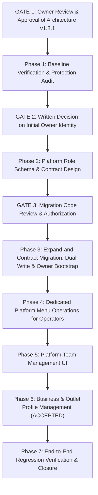

# ROMS Platform Access Control & Team Management Architecture

**Document Version:** 2.0.0
**Status:** Architecture Specification & Phased Execution Progress (Phases 1–6 Accepted & Closed; Task 1.1 Accepted; Stage 1 In Progress). v2.0.0 aligns the document with the approved Stage 3 product decisions (Owner Decisions 002–004); Stage 3 enforcement changes are **not implemented**.
**Target Path:** `docs/architecture/platform-access-control-and-team-management.md`  
**Author:** Senior Product Architect & Platform Security Reviewer  

> **Stage 3 alignment note (2026-10-17):** This document now defers to `docs/architecture/stage_3_ownership_subscriptions_architecture.md` as the primary Stage 3 target-architecture reference. Sections corrected in v2.0.0: §1 (subscriptions are outlet-scoped; Operator is strictly read-only), §3.1/§3.2 (Operator capabilities and the permission matrix), §3.3 (DECISION-OP-01 resolved for business owners). The "Subscriptions Remain Business-Level" invariant of §1 and the Operator write capabilities previously documented here are **superseded** by Owner Decisions 002 and 004 and must not be treated as current policy. Historical detail in §§5–10 concerning the platform-plane three-tier model (Owner/Admin/Operator platform team) remains valid except where it conflicts with the Stage 3 corrections called out here.

---

## Revision History

| Version | Date | Author / Reviewer | Summary of Changes |
| :--- | :--- | :--- | :--- |
| `1.0.0` | 2026-10-12 | Senior Product Architect | Initial proposed three-tier architecture (Owner → Admin → Operator) for platform team governance. |
| `1.1.0` | 2026-10-12 | Senior Product Architect | Replaced blanket tenant route bypass with dedicated platform menu operations; rejected automatic Owner selection; introduced partial unique index and PostgreSQL advisory locking. |
| `1.2.0` | 2026-10-12 | Platform Security Reviewer | Defined safe legacy authorization principles; unified legacy boolean migration policy; extended Owner invariants to account status operations; categorized permission matrix entries. |
| `1.3.0` | 2026-10-12 | Senior Product Architect & Platform Security Reviewer | Closed Owner bootstrap gap with post-bootstrap verification and fail-closed governance; expanded privilege-changing path inventory with implementation-time audit requirements; replaced SQL consistency constraint with PostgreSQL-safe `CASE` formulation immune to `NULL` evaluation traps; reworked rollout dependency ordering across pre-migration, schema migration, Owner bootstrap, role activation, and legacy retirement; clarified permission matrix distinguishing route availability from current and target authorizations; reaffirmed open decisions (DECISION-OP-01 through OP-05). |
| `1.4.0` | 2026-10-12 | Senior Product Architect & Platform Security Reviewer | Reconciled outlet audit-log permissions (tenant route strictly enforces `RequireOutletRole`; dedicated platform endpoint documented as planned); documented compatible legacy-writer transition mapping application versions to schema stages across all writer code paths; clarified Owner authority scope as SaaS governance and control-plane operations (preserving separation from tenant APIs); clarified Owner invariant terminology distinguishing database-enforced upper bound ($\le 1$) from application-enforced lower bound ($\ge 1$); added deployment stop/rollback behavior for Owner bootstrap; verified system-wide consistency across definitions, matrix, gates, and tests. |
| `1.5.0` | 2026-10-12 | Senior Product Architect & Platform Security Reviewer | Reconciled Owner authority with tenant isolation across all sections; made the zero-Owner bootstrap exception and service-layer 503 enforcement explicit; corrected Owner deletion-protection claims by specifying trigger mechanics vs application limits; defined a safe, ordered writer-compatibility rollout with instance draining, pre-constraint data reconciliation, and schema rollback risk warnings; made ownership transfer side effects strictly post-commit transaction-safe; clarified Owner-only reactivation policy for all platform roles (Admins and Operators); updated verification matrix with zero-Owner governance tests, failed-transfer notification suppression tests, writer compliance tests, and Owner-tenant route isolation tests. |
| `1.6.0` | 2026-10-12 | Senior Product Architect & Platform Security Reviewer | Corrected schema/application rollout sequence into an expand-and-contract framework (Preflight → Schema Expansion → Dual-Write Deployment → Drain/Verify → Backfill/Reconcile → Constraint Enforcement → Owner Bootstrap → Role Activation → Legacy Retirement); reconciled Owner-protection trigger with ownership transfer by identifying trigger-transfer contradictions, rejecting unauthenticated session flags, establishing service-layer primary enforcement, and recording database-level trigger as an unresolved Phase 2/3 design decision with documented residual risk; corrected audit-event durability wording to reflect transactional consistency (and rollback on abort) rather than separate persistent storage; reinforced post-commit notification guarantees; globally verified consistency across definitions, matrix, gates, and tests. |
| `1.7.0` | 2026-10-12 | Senior Product Architect & Platform Security Reviewer | Replaced unsafe Stage 5 backfill with safe reconciliation policy preserving valid Operator (`'operator'`, `FALSE`), Admin (`'admin'`, `TRUE`), and Owner (`'owner'`, `TRUE`) pairs; added explicit detection query and quarantine policy for contradictory pairs; eliminated all claims of guaranteed or separate immutable audit persistence in favor of transactional consistency (rolls back on abort) and post-commit notifications; resolved bootstrap / zero-Owner paradox by decoupling dedicated bootstrap initialization from ordinary service-layer zero-Owner assertion (`_assert_platform_owner_initialized`); updated writer matrix, rollout stages, failure gates, and test matrix with Operator preservation, contradictory pair gates, atomic bootstrap rollback, and audit consistency criteria; reaffirmed DECISION-OP-01 through OP-05. |
| `1.8.0` | 2026-10-12 | Senior Product Architect & Platform Security Reviewer | Explicitly documented quarantine and migration-blocking policy for contradictory records that cannot be confidently resolved from available audit evidence; prohibited heuristic guessing or field precedence; required documented, explicitly authorized resolution based on verified evidence; reinforced that Stage 5 failure gate unconditionally blocks Stage 6 constraint enforcement while unresolved records remain; preserved safe legacy-admin backfill and valid-pair preservation logic; reaffirmed DECISION-OP-01 through OP-05. |
| `1.8.1` | 2026-10-12 | Senior Product Architect & Platform Security Reviewer | Corrected audit durability wording in §6.2 to require a committed, auditable record without claims of indelibility or permanent persistence, aligning with §5.4; clarified the operational meaning of quarantine in §6.2 and §6.4 as exclusion from successful reconciliation and fail-closed gate blocking without implying a separate database table or subsystem; preserved no-guessing, no-precedence, and valid role pair preservation rules; reaffirmed DECISION-OP-01 through OP-05. |
| `1.9.0` | 2026-10-13 | Senior Product Architect & Platform Security Reviewer | Formally recorded Phase 6 (Business & Outlet Profile Management) acceptance and closure; resolved security findings M-01 (API data exposure) and L-01 (Frontend card visibility); verified 138/138 backend and 76/76 frontend tests passing; recorded final read-only authorization audit PASS; confirmed draft migration 0011 remains unapplied (zero live DB migrations); reaffirmed open decisions OP-01 through OP-05. |
| `1.9.1` | 2026-10-13 | Senior Product Architect & Platform Security Reviewer | Formally recorded Task 1.1 acceptance (Migration 0011 structural & execution test harness, CLI dual-write promotion & Owner protection); verified 146/146 backend tests passing (33/33 in focused suites); noted SQLite test boundary for PostgreSQL advisory locks and partial unique indexes; confirmed migration 0011 remains unapplied draft with zero live DB operations; reaffirmed OP-01 through OP-05 strictly OPEN; confirmed initial Owner identity unresolved and Stage 1 remains in progress. |
| `2.0.0` | 2026-10-17 | Senior Product Architect & Platform Security Reviewer | Stage 3 alignment with Owner Decisions 002–004 and `stage_3_ownership_subscriptions_architecture.md`: (1) corrected §1 "Subscriptions Remain Business-Level" invariant — subscriptions are strictly **outlet-scoped**, with no business-level plan selection or propagation (Decision 002); (2) redefined the Platform Operator as **strict read-only** over approved read pages (Overview, Businesses, details, Subscriptions, Plans, Audit Logs) with backend-enforced restrictions, removing all previously documented Operator write capabilities including the platform-menu write exception (Decision 004); (3) documented exactly-one-owner-per-business, manager assignment boundaries, owner access to all business outlets, explicit auditable ownership transfer (`platform.business_owner.transfer`, previous owner demoted to manager), and inactive-target rejection (Decision 003); (4) documented the initial owner-password decision (administrator-set password at business creation; no forced first-login change; email/invite/reset flows out of scope) and resolved DECISION-OP-01 for business owners; (5) updated §3.2 permission matrix Operator columns and audit-log visibility. No implementation, migration, or enforcement change is authorized or completed by this revision. |

---

## 1. Executive Summary & Architectural Intent

ROMS is an enterprise multi-tenant restaurant operations platform featuring a centralized SaaS control plane alongside distributed restaurant-level operations (Point of Sale, Kitchen Display Systems, waiter ordering, and customer QR menus).

As ROMS scales from initial administrative bootstrapping to multi-operator SaaS governance, the current binary platform administrator model (`User.is_platform_admin: bool`) must be formalized into a **Three-Tier Platform Access Control Model**:
1. **Platform Owner:** Authoritative platform custodian with full authority over authorized platform governance and SaaS control-plane operations, protected from accidental self-demotion, self-revocation, deactivation, suspension, or deletion, with ownership transfer guarded by strong re-authentication. Platform Owner privileges are strictly scoped to authorized platform-level SaaS control-plane operations and do not grant implicit tenant membership (`OutletMembership`), automatic access to tenant-scoped endpoints, or bypass of tenant route boundaries.
2. **Platform Admin:** Commercial and operational administrator capable of provisioning tenants, managing subscriptions, plans, and entitlement overrides, and managing platform Operators, but strictly barred from modifying, demoting, or revoking other Admins or the Owner.
3. **Platform Operator:** Read-only support specialist permitted to view approved platform pages (Overview, Businesses, business/outlet details, Subscriptions, Plans, and Audit Logs) but strictly barred from mutating any business, outlet, subscription, plan, ownership, platform team membership, audit record, or platform menu data. Previously documented Operator write capabilities (business/outlet provisioning, profile edits, menu content management) are removed by Owner Decision 004; the enforced restriction must live in backend router dependencies, not only in frontend navigation filtering.

### Preservation of Core Product Invariants
- **Subscriptions Are Outlet-Scoped (Owner Decision 002 — supersedes the former "Subscriptions Remain Business-Level" invariant):** Every outlet has its own independent subscription; different outlets in the same business may have different plans and lifecycle statuses. Business creation creates no outlet, subscription, or trial; outlet creation requires plan selection (Trial default, 30-day duration preserved); there is no business-level plan selection and no propagation of business-level subscription changes to outlets. The `free_qr` plan code provides non-expiring Free QR Menu semantics without any schema change. The former instruction that "any future transition to outlet-level subscriptions remains explicitly out of scope" is removed; see `docs/architecture/stage_3_ownership_subscriptions_architecture.md` for the authoritative target.
- **Exactly One Owner per Business (Owner Decision 003):** Each business has exactly one owner at a time, enforced by the planned partial unique index `uq_business_one_owner` (migration `0015`, planned — not applied) plus application-level transfer-under-lock. The owner has access to all outlets of the business; managers access only explicitly assigned outlets. Ownership transfer is explicit, atomic, and auditable (`platform.business_owner.transfer`, distinct from the platform-plane `platform.owner.transfer`), and demotes the previous owner to manager. Suspended or inactive users are rejected as owner/manager targets. Existing zero-owner businesses are report-only.
- **Initial Owner Password (Owner Decision 003):** Business creation requires mandatory owner details; the authorized platform administrator sets the initial owner password via the Platform Admin portal. There is no forced password-change-on-first-login flow. Email-based reset, invitation, or credential-delivery flows are future scope. Passwords and password hashes are never logged, never written to audit metadata, and never exposed in error messages.
- **Tenant Membership Isolation:** Platform roles remain decoupled from restaurant-level staff roles (`OutletMembership`). Platform roles do not confer implicit tenant membership or automatic access to tenant-scoped routes. No blanket bypass of tenant route guards will be introduced for any platform role, including the Platform Owner.
- **Backend as Authoritative Source of Truth:** All security and privilege checks execute strictly server-side, with server-derived actor identity.
- **Zero Automatic Guessing of Owner Identity:** Migration must never guess or assign the Owner role based on account creation timestamp or implicit conventions. Initial ownership requires explicit, verified written authorization.
- **Strict Boundary Notice:** This document is purely an architectural specification. Approval of this document does not authorize implementation, schema migrations, database mutations, deployments, or Git operations.

---

## 2. Current Implementation Audit & Ground Truth

A code-level audit of the existing codebase was conducted to establish ground truth, alongside identifying code paths that require verification prior to implementation.

### 2.1 Identity Establishment & Authentication
- **Authentication Flow:** Authenticated requests supply an HTTP Bearer JWT token in the `Authorization` header (`backend/app/api/deps.py:15-38`).
- **Token Decoding:** `decode_access_token` verifies token cryptographic integrity, expiry, and extracts the user identity UUID from the `sub` claim.
- **Actor Hydration:** `get_current_user` queries `User` by `id == UUID(sub)`. Inactive accounts (`user.status != "active"`) are rejected immediately with `AuthenticationError(401)`.
- **Platform Admin Dependency:** `get_current_platform_admin` (`backend/app/api/deps.py:41-47`) asserts `current_user.is_platform_admin is True`. Non-platform users receive `ForbiddenError(403)`.
- **Finding:** The platform currently evaluates identity as a boolean flag. There is no concept of platform sub-roles, permission scopes, or ownership levels in the authentication token or user model.

### 2.2 Current Platform User Model
- **Database Schema:** Defined in `backend/app/modules/staff/models.py:13-26`:
  ```python
  class User(Base, TimestampMixin):
      __tablename__ = "users"
      email: Mapped[str] = mapped_column(String(254), unique=True, index=True, nullable=False)
      password_hash: Mapped[str] = mapped_column(String(255), nullable=False)
      display_name: Mapped[str] = mapped_column(String(150), nullable=False)
      status: Mapped[str] = mapped_column(String(20), default="active", nullable=False)
      is_platform_admin: Mapped[bool] = mapped_column(Boolean, default=False, server_default="false", nullable=False)
  ```
- **Migration History:** Column `is_platform_admin` was introduced in Alembic migration `0004_platform_admin_identity.py`. No intermediate roles or tier metadata currently exist in the database.

### 2.3 Verification of Task A Implementation & `revoke_platform_admin` Callers
The callers of `revoke_platform_admin` were inspected to verify actor identity handling:
- **Service Signature:** Located in `backend/app/modules/businesses/platform_service.py:874`:
  ```python
  def revoke_platform_admin(
      db: Session, target_user_id: uuid.UUID, actor_user_id: uuid.UUID
  ) -> User:
  ```
- **Actor Identity Verification:**
  - `actor_user_id` is a mandatory positional parameter.
  - Runtime validation `if not actor_user_id: raise ValidationError("Actor user ID is required...")` blocks omission or falsy values.
  - Self-revocation protection `if target_user_id == actor_user_id: raise ValidationError("Platform administrators cannot revoke their own privileges.")` prevents accidental or deliberate self-demotion.
  - Last-admin protection `if len(active_admins) <= 1: raise ValidationError("Cannot revoke platform admin privileges from the last active platform administrator.")` guarantees $\ge 1$ active administrator.
- **Router Caller:** Located in `backend/app/api/v1/platform.py:92-101`:
  ```python
  @router.post("/admins/{user_id}/revoke", response_model=PlatformAdminUserOut)
  def revoke_admin(
      user_id: uuid.UUID,
      current_user: User = Depends(get_current_platform_admin),
      db: Session = Depends(get_db)
  ):
      user = platform_service.revoke_platform_admin(
          db, target_user_id=user_id, actor_user_id=current_user.id
      )
      return PlatformAdminUserOut.model_validate(user)
  ```
  **Audit Confirmation:** The authenticated actor identity is sourced directly from `current_user.id` injected by FastAPI via `Depends(get_current_platform_admin)`. The client cannot omit, tamper with, or forge `actor_user_id`.
- **Test Callers:** `backend/tests/test_platform_admin_management.py` calls the endpoint via HTTP and tests raw service validation when `actor_user_id=None`. No other callers exist in the codebase.

### 2.4 Privilege-Changing Path Inventory & Pre-Implementation Audit Requirements

To ensure complete coverage of privilege-modifying logic, all potential paths that grant, revoke, modify platform roles, toggle `is_platform_admin`, change user account `status`, delete users, or execute password recovery were audited.

```
┌────────────────────────────────────────────────────────────────────────────────────────┐
│               PRIVILEGE-CHANGING CODE PATHS AUDIT & VERIFICATION MATRIX                │
├──────────────────────────────────┬──────────────────────┬──────────────────────────────┤
│ Code Path / Operation            │ Location / Target    │ Verification Status          │
├──────────────────────────────────┼──────────────────────┼──────────────────────────────┤
│ Grant Platform Admin             │ platform.py:80-90    │ [Verified Repository Finding]│
│ Revoke Platform Admin            │ platform.py:92-101   │ [Verified Repository Finding]│
│ List Platform Admins             │ platform.py:72-78    │ [Verified Repository Finding]│
│ Assign Tenant Owner Role         │ platform.py:165-176  │ [Verified Repository Finding]│
│ CLI Admin Bootstrap              │ create_platform_admin│ [Verified Repository Finding]│
│ User Authentication & Login      │ auth.py:15-40        │ [Verified Repository Finding]│
│ User Registration & Creation     │ auth / staff modules │ [Requires Pre-Impl Audit]    │
│ Account Status Changes (Suspend) │ staff service        │ [Requires Pre-Impl Audit]    │
│ User Soft/Hard Deletion Paths    │ staff models/service │ [Requires Pre-Impl Audit]    │
│ Password Reset & Recovery Flows  │ auth module          │ [Requires Pre-Impl Audit]    │
│ Database Seed Script             │ seed.py:170-228      │ [Verified Repository Finding]│
│ Test Fixtures (User Creation)    │ backend/tests/*.py   │ [Verified Repository Finding]│
└──────────────────────────────────┴──────────────────────┴──────────────────────────────┘
```

#### 1. Verified Repository Findings
1. `POST /api/v1/platform/admins/{user_id}/grant`:
   - Invokes `platform_service.grant_platform_admin(db, target_user_id, actor_user_id=current_user.id)`.
   - Sets `user.is_platform_admin = True`.
   - **Vulnerability Under Role Model:** If left un-upgraded, an Admin could promote any user directly to broad administrative access.
2. `POST /api/v1/platform/admins/{user_id}/revoke`:
   - Invokes `platform_service.revoke_platform_admin(db, target_user_id, actor_user_id=current_user.id)`.
   - Sets `user.is_platform_admin = False`.
   - **Vulnerability Under Role Model:** Currently checks last-active-admin and self-revocation, but lacks horizontal protection (an Admin could revoke another Admin).
3. `GET /api/v1/platform/admins`:
   - Lists all users where `is_platform_admin == True`. Excludes password hashes.
4. `POST /api/v1/platform/businesses/{business_id}/assign-owner`:
   - Creates a new user with `is_platform_admin = False` (default) and assigns `OutletMembership(role="owner")`.
5. `backend/scripts/create_platform_admin.py`:
   - CLI bootstrap function `promote_user_to_platform_admin(email)`. Directly mutates `user.is_platform_admin = True`.
6. `backend/app/db/seed.py`:
   - Seeds initial tenant users (`owner@himachal.com`, `manager@riverside.com`, `waiter@riverside.com`) with `is_platform_admin` defaulting to `False` and assigns `OutletMembership`.
7. `backend/tests/*.py`:
   - Multiple test files (e.g. `test_platform_admin_management.py`, `test_platform_admin_subscriptions.py`) directly mutate `user.is_platform_admin = True` to construct test fixtures.

#### 2. Paths Requiring Implementation-Time Verification
Before any implementation task is undertaken, an exhaustive audit must verify:
1. **User Registration & Account Creation:** Confirm whether public or administrative endpoints create `User` records, and ensure they cannot accept `is_platform_admin` or `platform_role` in request payloads.
2. **Account Status Modifications:** Verify whether any endpoint or service allows changing `User.status` to `suspended` or `inactive`, ensuring none can bypass Owner status protection.
3. **User Deletion:** Verify whether cascade deletes or soft-delete mechanisms exist in `User` models, ensuring foreign keys or application logic prevent deleting the active Owner.
4. **Password Reset & Recovery:** Verify whether password reset flows exist, ensuring that recovering credentials cannot reactivate suspended administrators or bypass authorization checks.

> [!IMPORTANT]
> **Source Verification Disclaimer:** While platform router paths, seed scripts, and test files were inspected directly, an exhaustive audit of all authentication and staff modules remains a mandatory prerequisite during the authorized implementation phase before new role policies are activated.

### 2.5 Separation of Tenant Roles vs Platform Roles
- **Tenant Model:** Restaurant-level staff privileges are managed via `OutletMembership` (`backend/app/modules/staff/models.py:30-52`):
  ```python
  class OutletMembership(Base, TimestampMixin):
      __tablename__ = "outlet_memberships"
      user_id: Mapped[uuid.UUID] = mapped_column(UUID, ForeignKey("users.id"))
      outlet_id: Mapped[uuid.UUID] = mapped_column(UUID, ForeignKey("outlets.id"))
      role: Mapped[str] = mapped_column(String(30))  # owner, manager, waiter, kitchen
  ```
- **Tenant Route Protection:** Protected by `RequireOutletRole(["owner", "manager"])` (`backend/app/api/deps.py:50-78`).
- **Critical Architectural Invariant & Tenant Audit-Log Protection:**
  - Platform administrators (`is_platform_admin == True`) have **no implicit access** to outlet-scoped routes unless they possess an explicit row in `outlet_memberships` for that specific outlet.
  - Specifically, the existing tenant audit-log route `GET /api/v1/admin/outlets/{outlet_id}/audit-logs` (`backend/app/api/v1/admin_menu.py:186-207`) is protected strictly by `RequireOutletRole(["owner", "manager"])`.
  - Platform Owner and Platform Admin tokens calling this route are **rejected with `HTTP 403 Forbidden`** unless they possess an explicit outlet membership.
  - Platform roles and restaurant memberships operate on completely distinct authorization boundaries. Platform roles will NOT be granted blanket bypasses to tenant routes. Cross-tenant platform visibility must be implemented through dedicated platform endpoints.

### 2.6 Current Provisioning & Profile APIs
- `POST /api/v1/platform/businesses`: Provisions a new `Business`, primary `Outlet`, and initial 30-day trial `BusinessSubscription` in a single transaction (`platform_service.py:118-219`).
- `POST /api/v1/platform/businesses/{business_id}/outlets`: Adds an outlet to a business, validating against subscription `max_outlets` capacity (`platform_service.py:242-273`).
- `POST /api/v1/platform/businesses/{business_id}/assign-owner`: Provisions a tenant owner by creating an `OutletMembership(role="owner")` (`platform_service.py:808-834`).
- **Profile Management Gap:** Currently, there are no endpoints for updating business details (contact name, email, phone, billing address) or outlet profiles (operating hours, phone, address). These capabilities were planned in Task B and are documented as an independent phase.

### 2.7 Subscription Lifecycle & Entitlement Authorization
- **Lifecycle Engine:** `update_business_subscription` (`backend/app/modules/businesses/platform_service.py:221-580`) handles conversions, annual renewals, mid-term plan changes, cancellations, and status transitions.
- **Entitlement Service:** `EntitlementService` (`backend/app/modules/subscriptions/service.py`) evaluates effective entitlements with fail-closed semantics, computes outlet capacity, and manages overrides (`SubscriptionEntitlementOverride`).
- **Current Route Guard:** All subscription and override endpoints are mounted under `router = APIRouter(prefix="/platform", dependencies=[Depends(get_current_platform_admin)])`. Any active platform administrator currently has full commercial authority.

### 2.8 Existing Team Management UI & Audit Events
- **Frontend UI:** `frontend/src/features/platform-admin/PlatformAdminManagement.tsx` displays active platform administrators.
  - Displays a disabled `Current User (Self)` badge for the signed-in administrator.
  - Provides `Grant Access` and `Revoke Access` buttons for other users.
  - Does NOT support user creation, invitations, or role assignment.
- **Audit Logging:** System operations emit audit logs via `log_audit()` (`backend/app/modules/audit/service.py:14-48`), capturing `action`, `actor_user_id`, `business_id`, `outlet_id`, `entity_type`, `entity_id`, and `metadata_json`.
  - Existing audit actions: `platform.admin.grant`, `platform.admin.revoke`, `platform.business.create`, `platform.business.update_subscription`, `platform.outlet.create`, `platform.owner.assign`, `subscription.override.create`, `subscription.override.revoke`.

### 2.9 Database Schema & Working Tree State
- **Migrations Baseline:** 10 migrations applied up to `0010_subscription_entitlements_schema.py`. No pending migration files.
- **Working Tree:** 10 tracked modified files and 2 untracked files representing the uncommitted Phase C3 subscription work and Task A self-revocation fix. All 112 backend tests and 58 frontend tests are passing. All changes must remain preserved.

---

## 3. Proposed Role Model & Formalized Permission Boundaries

```
                  ┌────────────────────────────────────────┐
                  │             Platform Owner             │
                  │   • Full SaaS control & governance     │
                  │   • Manages Admins and Operators       │
                  │   • Ownership transfer ceremony        │
                  │   • Single active owner invariant      │
                  └───────────────────┬────────────────────┘
                                      │
                   Can create/demote  │  Cannot demote/revoke
                   Admin & Operator   │  Owner or another Admin
                                      ▼
                  ┌────────────────────────────────────────┐
                  │             Platform Admin             │
                  │   • Tenant provisioning & config       │
                  │   • Subscription lifecycle & plans     │
                  │   • Entitlement overrides & audits     │
                  │   • Can create/manage Operators        │
                  └───────────────────┬────────────────────┘
                                      │
                   Can create/manage  │  Cannot manage Subscriptions,
                   Operators only     │  Plans, Overrides, or Platform Users
                                      ▼
                  ┌────────────────────────────────────────┐
                  │           Platform Operator            │
                  │   • READ-ONLY (Owner Decision 004)     │
                  │   • View approved pages only           │
                  │   • No mutations anywhere              │
                  │   • Backend-enforced restriction       │
                  └────────────────────────────────────────┘
```

### 3.1 Role Definitions & Invariants

#### 1. Platform Owner
- **Scope:** Full authority over authorized platform governance and SaaS control-plane operations. Platform Owner privileges are strictly scoped to the platform control plane and do not grant implicit tenant membership (`OutletMembership`) or automatic access to tenant-scoped endpoints. Calling tenant routes without an explicit row in `outlet_memberships` results in `HTTP 403 Forbidden`.
- **Invariants:**
  - Exactly **one active Platform Owner** exists across the system at any time during normal operation (`single_active_owner` constraint).
  - Protected from ordinary role-management operations: no Admin or Operator can modify, demote, or revoke the Owner.
  - Protected from accidental self-revocation: the Owner cannot demote or revoke their own role via standard endpoints.
  - **Account-Status Immunity:** The Owner account cannot be deactivated, suspended, or deleted via standard administrative endpoints.
  - **Ownership Transfer:** Supported exclusively via a dedicated, strongly authenticated transfer operation requiring current Owner re-authentication.

#### 2. Platform Admin
- **Scope:** Commercial tenant lifecycle and operational administration.
- **Capabilities:**
  - Create and configure businesses and outlets.
  - Manage subscription lifecycles: trials, annual renewals, mid-term plan changes, past-due handling, cancellations.
  - Issue and revoke feature entitlement overrides.
  - Onboard, manage, and revoke **Platform Operators**.
- **Invariants & Restrictions:**
  - **Horizontal Protection:** An Admin **cannot revoke, demote, or edit another Admin**.
  - **Vertical Protection:** An Admin **cannot modify, demote, revoke, or deactivate the Owner**.
  - **No Privilege Escalation:** An Admin cannot promote any user (including themselves or Operators) to Admin or Owner.

#### 3. Platform Operator `[Target — strictly read-only per Owner Decision 004]`
- **Scope:** Read-only support access to approved Platform Admin pages for inspection and customer support.
- **Capabilities (read-only):**
  - View the Overview dashboard.
  - View the Businesses directory and business/outlet detail pages (profiles, outlets, effective features).
  - View outlet Subscriptions and the Plans catalog (read-only).
  - View platform Audit Logs through a redacted read-only serializer (minimum necessary fields; actor email and free-form metadata payloads are redacted).
- **Invariants & Strict Restrictions:**
  - **No Mutations of Any Kind:** Cannot create, update, or delete businesses, outlets, subscriptions, entitlement overrides, plans, ownership or manager assignments, platform team membership, audit records, or platform menu data. The previously documented platform-menu write exception is removed; platform menu access is read-only for Operators.
  - **Backend Enforcement Required:** Restrictions are enforced by backend router dependencies (`RequirePlatformRole`); frontend navigation filtering alone is insufficient. Any shipped route that currently permits Operator writes (e.g. the outlet-profile `PATCH` reachable via the profile router) is a gap to be corrected under Stage 3.
  - **No Commercial Authority:** Cannot execute renewals, change plans, cancel accounts, or issue entitlement overrides.
  - **No Platform User Governance:** Cannot view the platform user management directory or manage platform users (Owner, Admin, or Operator). Team administration is unavailable to Operators.
  - **No Non-Destructive Boundary Assumption:** Because writes are prohibited entirely, delete-specific restrictions are subsumed by the general no-mutation rule.
  - **No Operational Scope Creep:** Cannot manage restaurant dining tables, generate/download customer QR codes, or manage restaurant staff memberships.

---

### 3.2 Audited Permission Matrix

The matrix distinguishes **current route/service availability**, **current authorization guard**, and **intended target authorization** under the three-tier model. No future Operator capability is classified as existing behavior.

| Domain | Action / Capability | Current Implementation Status | Current Authorization Guard | Target Owner | Target Admin | Target Operator | Tenant Owner/Mgr |
| :--- | :--- | :--- | :--- | :---: | :---: | :---: | :---: |
| **Platform Governance** | Transfer Platform Ownership | Planned Feature (`platform_service`) | None (Feature does not exist) | ✅ (Explicit) | ❌ | ❌ | ❌ |
| | Create / Promote Platform Admin | Implemented (`/admins/{id}/grant`) | `is_platform_admin == True` | ✅ | ❌ | ❌ | ❌ |
| | Demote / Revoke Platform Admin | Implemented (`/admins/{id}/revoke`) | `is_platform_admin == True` | ✅ | ❌ | ❌ | ❌ |
| | Create / Onboard Platform Operator | Planned Feature (New Endpoint) | None (Feature does not exist) | ✅ | ✅ | ❌ | ❌ |
| | Demote / Revoke Platform Operator | Planned Feature (New Endpoint) | None (Feature does not exist) | ✅ | ✅ | ❌ | ❌ |
| | Reset Password for Platform Operators | Planned Feature (Open Decision) | None (Feature does not exist) | ❓ Pending | ❓ Pending | ❌ | ❌ |
| | Reactivate Suspended Platform Account | Planned Feature (Open Decision) | None (Feature does not exist) | ✅ (Owner Only) | ❌ | ❌ | ❌ |
| | View Platform Users Directory | Implemented (`GET /admins`) | `is_platform_admin == True` | ✅ | ✅ | ❌ | ❌ |
| **Commercial & Subscriptions** | View Platform Subscription History | Implemented (`/businesses/{id}/subscriptions`) | `is_platform_admin == True` | ✅ | ✅ | ✅ (read-only) `[Target]` | ❌ |
| | View Tenant Subscription Details | Planned Feature (Open Decision) | None (Feature does not exist) | ✅ | ✅ | ✅ (read-only) `[Target]` | ❓ Pending |
| | Update Subscription (Renew, Plan Change) | Implemented (`/businesses/{id}/subscription`) | `is_platform_admin == True` | ✅ | ✅ | ❌ | ❌ |
| | Cancel Subscription (Scheduled/Immediate) | Implemented (`/businesses/{id}/subscription`) | `is_platform_admin == True` | ✅ | ✅ | ❌ | ❌ |
| | Create / Revoke Entitlement Overrides | Implemented (`/subscriptions/overrides`) | `is_platform_admin == True` | ✅ | ✅ | ❌ | ❌ |
| | Suspend / Reactivate Business Account | Implemented (`/businesses/{id}`) | `is_platform_admin == True` | ✅ | ✅ | ❌ | ❌ |
| **Tenant Provisioning & Profiles** | Provision New Business Tenant | Implemented (`POST /businesses`) | `is_platform_admin == True` | ✅ | ✅ | ❌ `[Target]` | ❌ |
| | Add Outlet to Business | Implemented (`POST /businesses/{id}/outlets`) | `is_platform_admin == True` | ✅ | ✅ | ❌ `[Target]` | ❌ |
| | Assign Initial Tenant Owner (`role="owner"`) | Implemented (`POST /businesses/{id}/assign-owner`) | `is_platform_admin == True` | ✅ | ✅ | ❌ `[Target]` | ❌ |
| | Transfer Business Ownership (demote previous owner to manager) | Planned Feature (Stage 3; audit action `platform.business_owner.transfer`) | None (Feature does not exist) | ✅ | ✅ | ❌ | ❌ |
| | Edit Business / Outlet Profile | Planned Feature (Task B) | None (Feature does not exist) | ❓ Task B | ❓ Task B | ❌ `[Target]` | ❓ Task B |
| | Permanently Delete Business / Outlet | Planned Feature (Non-MVP) | None (Feature does not exist) | ❌ (MVP) | ❌ (MVP) | ❌ | ❌ |
| **Tenant Menu Operations** | View Outlet Menu via Platform Endpoint | Planned Platform Route (`GET /platform/outlets/{id}/menu`) | Domain service exists; Platform route Planned | ✅ | ✅ | ✅ (read-only) | ✅ (Own Tenant) |
| | Create / Update Menu Categories via Platform | Planned Platform Route (`POST/PATCH /platform/outlets/{id}/menu/categories`) | Domain service exists; Platform route Planned | ✅ | ✅ | ❌ `[Target]` | ✅ (Own Tenant) |
| | Create / Update Menu Items via Platform | Planned Platform Route (`POST/PATCH /platform/outlets/{id}/menu/items`) | Domain service exists; Platform route Planned | ✅ | ✅ | ❌ `[Target]` | ✅ (Own Tenant) |
| | Toggle Item Availability via Platform | Planned Platform Route (`PATCH .../availability`) | Domain service exists; Platform route Planned | ✅ | ✅ | ❌ `[Target]` | ✅ (Own Tenant) |
| | Upload Menu Item Images via Platform | Planned Platform Route (`POST .../image`) | Domain service exists; Platform route Planned | ✅ | ✅ | ❌ `[Target]` | ✅ (Own Tenant) |
| **Tenant Operations Excluded from Operator** | Manage Dining Tables & Layouts | Implemented (`/api/v1/tables/...`) | `RequireOutletRole(["owner", "manager"])` | ❌ (Platform) | ❌ (Platform) | ❌ | ✅ (Own Tenant) |
| | Generate / Download Physical QR Codes | Implemented (`/api/v1/qr/...`) | `RequireOutletRole(["owner", "manager"])` | ❌ (Platform) | ❌ (Platform) | ❌ | ✅ (Own Tenant) |
| | Manage Restaurant Staff (`OutletMembership`) | Implemented (`/api/v1/staff/...`) | `RequireOutletRole(["owner"])` | ❌ (Platform) | ❌ (Platform) | ❌ | ✅ (Own Tenant) |
| **Audit & Compliance** | View Plans Catalog (read-only) | Implemented (`GET /platform/plans`) | `is_platform_admin == True` | ✅ | ✅ | ✅ (read-only) `[Target]` | ❌ |
| | View Platform Audit Logs | Implemented (`/api/v1/platform/audit-logs`) | `is_platform_admin == True` | ✅ | ✅ | ✅ (redacted serializer) `[Target]` | ❌ |
| | View Outlet Audit Logs (Tenant Route) | Implemented (`/api/v1/admin/outlets/{id}/audit-logs`) | `RequireOutletRole(["owner", "manager"])` | ❌ (No Implicit Access) | ❌ (No Implicit Access) | ❌ | ✅ (Own Outlet) |
| | View Outlet Audit Logs (Platform Route) | Planned Platform Route (`GET /platform/outlets/{id}/audit-logs`) | None (Feature does not exist) | ✅ | ✅ | ❌ | ❌ |

*Clarifications on Implementation Status & Tenant Audit Boundary:*
0. **Stage 3 Operator Read Access (Owner Decision 004):** Operator read access to Businesses, business/outlet details, Subscriptions, Plans, and Audit Logs is a **target** capability requiring dedicated read endpoints or extended guards plus a redacted audit serializer (minimum necessary fields; actor email and free-form metadata redacted). Where current guards block Operators (e.g. `is_platform_admin == True` checks), backend changes are required; frontend-only visibility is insufficient. Operator **write** access, previously shown as ✅ for provisioning and menu operations, is removed from this matrix.
1. **Reconciliation of Outlet Audit Log Permissions:**
   - The existing tenant endpoint `GET /api/v1/admin/outlets/{outlet_id}/audit-logs` enforces `RequireOutletRole(["owner", "manager"])`. Platform Owner and Admin tokens calling this route receive `HTTP 403 Forbidden` unless they possess an explicit outlet membership.
   - If cross-tenant platform audit inspection is desired, it must be provided through a **dedicated platform endpoint** (`GET /api/v1/platform/outlets/{outlet_id}/audit-logs`) guarded by `RequirePlatformRole(["owner", "admin"])`. This endpoint is documented as **planned functionality** and is not currently implemented.
   - Under no circumstances will tenant routes be modified with blanket platform bypasses.
2. **Planned Platform Menu Operations:** While internal domain functions exist in `backend/app/modules/menus/admin_service.py` to service restaurant managers, **no platform router endpoints currently exist** for menu management. These endpoints are planned under Phase 4 and must not be treated as existing behavior.
3. **Tenant Subscription Visibility (DECISION-OP-05):** No tenant router currently exposes subscription details or history to `RequireOutletRole` users. This is an open decision requiring explicit business approval.
4. **Platform Operator Role:** The Operator role is not currently implemented in any database model, schema, or route guard.

---

### 3.3 Open Product Decisions Table

The following product decisions remain open and require explicit platform owner approval:

| Decision Identifier | Architectural Context | Options Under Review | Trade-offs & Security Impact |
| :--- | :--- | :--- | :--- |
| **DECISION-OP-01** | **Operator Onboarding Credential Flow** | **RESOLVED for business owners (Owner Decision 003, 2026-10-17):** the authorized platform administrator sets the initial password for a new business owner during business creation in the Platform Admin portal. No temporary generated credentials, no forced change-on-first-login, and no email invitation/reset flows in this phase; email-based flows are future scope. **Still open for platform Operator provisioning** (whether the same administrator-set pattern applies) and for manager provisioning unless separately confirmed. | The resolved owner pattern reuses the shipped `users` + `password_hash` flow and avoids email infrastructure; password values are never logged, audited, or echoed. |
| **DECISION-OP-02** | **Ownership Transfer Protocol** | **A:** Single-step re-authenticated transfer by Owner.<br>**B:** Two-phase proposal & target acceptance handshake. | Option A is simpler and immediate; Option B prevents accidental transfer to an inactive or unwilling Admin. |
| **DECISION-OP-03** | **Emergency Break-Glass Recovery Protocol** | **A:** CLI tool restricted to direct server access.<br>**B:** Out-of-band database runbook requiring multi-party signoff. | Option A provides automated validation and advisory locking; Option B avoids deploying automated privilege-override scripts. |
| **DECISION-OP-04** | **Initial Owner Identity Selection** | **Prerequisite Decision:** Explicit selection of initial Owner account identifier. | Cannot be automated or guessed; requires explicit written designation prior to migration execution. |
| **DECISION-OP-05** | **Tenant Subscription Self-Inspection** | **A:** Expose read-only subscription summary to tenant owners.<br>**B:** Retain subscriptions exclusively in platform admin portal. | Option A gives restaurant owners self-service billing awareness; Option B avoids creating new tenant-facing endpoints in this phase. |

---

## 4. Tenant Authorization Boundary & Operator Menu Access Design

> **Owner Decision 004 supersession:** The platform-menu write design below (Operators included in `RequirePlatformRole(["owner", "admin", "operator"])` on mutating menu routes) is **superseded**. Under Stage 3, platform menu access is read-only for Operators; mutating menu routes are restricted to `["owner", "admin"]`, and the broader no-mutation rule for Operators applies. The architectural rationale in this section (dedicated platform endpoints over blanket tenant-route bypasses) remains valid and is preserved.

### 4.1 Rejection of the Blanket Tenant Route Bypass
The earlier proposal to modify `_verify_item_membership` in `backend/app/api/v1/admin_menu.py` to allow any platform user to bypass `OutletMembership` checks is **rejected**. 

**Rationale:**
1. **Breach of Tenant Isolation Boundary:** Injecting platform-role bypasses into tenant-facing routers weakens the architectural multi-tenancy model. A bug in a tenant router could inadvertently expose cross-tenant capabilities to unauthorized actors.
2. **Audit Context Conflation:** Mutations routed through tenant endpoints emit tenant audit actions (e.g. `CATEGORY_UPDATE`) that do not clearly identify platform-assisted operations versus restaurant staff actions.
3. **Privilege Creep:** Giving platform roles access to tenant routes risks exposing unrelated tenant management endpoints (e.g., dining tables, orders, staff management) that Operators must not touch.

---

### 4.2 Architecture Comparison: Dedicated Platform Endpoints vs Shared Services

```
┌────────────────────────────────────────────────────────────────────────────┐
│                    DEDICATED PLATFORM ROUTER DESIGN                        │
│                                                                            │
│   Client (Platform UI)                                                     │
│        │                                                                   │
│        ▼                                                                   │
│   FastAPI Router: /api/v1/platform/outlets/{outlet_id}/menu                │
│   ├── Route Guard: RequirePlatformRole(["owner", "admin", "operator"])     │
│   └── Resource Check: Outlet exists & belongs to active Business           │
│        │                                                                   │
│        ▼ Reuses domain logic directly                                      │
│   Internal Service: backend/app/modules/menus/admin_service.py             │
│   ├── create_category(...)                                                 │
│   ├── update_menu_item(...)                                                │
│   └── toggle_item_availability(...)                                        │
│        │                                                                   │
│        ▼ Structured platform audit trail                                   │
│   Audit Logger: log_audit(action="platform.outlet.menu_item.update", ...) │
└────────────────────────────────────────────────────────────────────────────┘
```

#### Comparison of Architectural Approaches

| Architectural Criterion | Approach 1: Dedicated Platform Endpoints (Recommended) | Approach 2: Shared Service with Dual-Context Routing |
| :--- | :--- | :--- |
| **Routing Separation** | Dedicated routes under `/api/v1/platform/outlets/{outlet_id}/menu/...`. | Same endpoints under `/api/v1/admin/menu/...` accepting both token types. |
| **Authorization Check** | Enforces `RequirePlatformRole(["owner", "admin", "operator"])` at the router boundary. | Complex composite dependency checking either `RequireOutletRole` OR `RequirePlatformRole`. |
| **Tenant Route Impact** | **Zero impact** on `admin_menu.py`. Existing tenant authorization remains completely untouched. | Requires modifying `_verify_item_membership` and every tenant endpoint. |
| **Audit Differentiation** | Emits `platform.outlet.category.update` with `actor_user_id` and outlet context. | Emits generic tenant audit logs, requiring extra metadata flags to distinguish actors. |
| **Blast Radius & Leakage** | Isolated to dedicated platform routes. Operators have no access to tenant staff/orders. | High risk of unintended privilege leakage across other tenant endpoints. |
| **Code Duplication** | Reuses internal service functions in `admin_service.py` directly; zero business logic duplication. | No duplication, but high coupling. |

---

### 4.3 Concrete Recommended Design

#### 1. Router Architecture
Mount dedicated platform menu operations under `backend/app/api/v1/platform.py` (or a dedicated submodule `backend/app/api/v1/platform_menu.py` included into the platform router):
- `GET /api/v1/platform/outlets/{outlet_id}/menu`: Returns full outlet menu structure.
- `POST /api/v1/platform/outlets/{outlet_id}/menu/categories`: Provisions category.
- `PATCH /api/v1/platform/outlets/{outlet_id}/menu/categories/{category_id}`: Updates category.
- `POST /api/v1/platform/outlets/{outlet_id}/menu/items`: Creates menu item.
- `PATCH /api/v1/platform/outlets/{outlet_id}/menu/items/{item_id}`: Updates menu item.
- `PATCH /api/v1/platform/outlets/{outlet_id}/menu/items/{item_id}/availability`: Toggles availability.
- `POST /api/v1/platform/outlets/{outlet_id}/menu/items/{item_id}/image`: Uploads menu item image.

#### 2. Resource Validation & Service Reuse
Every platform menu endpoint:
1. Validates the caller via `current_user = Depends(RequirePlatformRole(["owner", "admin", "operator"]))`.
2. Validates that `outlet_id` belongs to an existing `Business`.
3. Calls the existing domain function in `backend/app/modules/menus/admin_service.py` directly (e.g. `create_category`, `update_category`, `create_menu_item`, `update_menu_item`).
4. Logs an explicit platform audit event:
   ```python
   log_audit(
       db=db,
       business_id=outlet.business_id,
       outlet_id=outlet.id,
       actor_user_id=current_user.id,
       action="platform.outlet.menu_item.update",
       entity_type="menu_item",
       entity_id=item.id,
       metadata_json={"source": "platform_operator", "changes": changes}
   )
   ```

#### 3. Strict Boundary Guarantee
Operators calling these endpoints can mutate menu content for any outlet, but have **no ability** to view or modify subscriptions, change plans, issue overrides, inspect audit logs, or access tenant staff configurations.

---

## 5. Single-Owner Invariants, Safeguards & Ownership Transfer Reconciliation

### 5.1 The Comprehensive Owner Invariants

1. **Explicit Initial Identification:** The initial Platform Owner must be explicitly selected and authorized in writing prior to migration execution. Under no circumstances may an automated migration select the Owner based on `created_at` or arbitrary database sorting.
2. **Database Prevention of Multiple Active Owners:** The database must enforce that no more than one active user can hold `platform_role = 'owner'` ($\le 1$).
3. **Preservation of an Active Owner in Normal Operation:** Normal platform application operations must preserve exactly one active Owner during normal operation ($\ge 1$), preventing demoting, revoking, deactivating, suspending, or deleting the Owner without an atomic transfer to another active administrator.
4. **Account-Status Safeguards:** The current Owner account cannot have its `status` changed to `'suspended'` or any non-active state via standard administrative operations.
5. **Deletion Safeguards:** Soft-deletion or hard-deletion of the current Owner record must be strictly rejected at the application service layer.
6. **Distinct, Authorized Ownership Transfer:** Ownership transfer must be an isolated, high-security transaction requiring current Owner re-authentication and target verification.
7. **Secure Ownership Recovery:** A break-glass procedure must exist for disaster recovery when the Owner is incapacitated, without introducing an unauthenticated or ordinary API backdoor.

---

### 5.2 Clarification of Database Constraints vs Application Safeguards & Trigger Reconciliation

#### 1. What the PostgreSQL Partial Unique Index Guarantees (Database Safeguard)
```sql
CREATE UNIQUE INDEX uq_single_active_platform_owner 
ON users (platform_role) 
WHERE platform_role = 'owner' AND status = 'active';
```
- **Upper-Bound Guarantee ($\le 1$):** Guarantees that at most one active user can have `platform_role = 'owner'`. Any transaction attempting to insert or update a second active user to `platform_role = 'owner'` will be rejected immediately by PostgreSQL with a unique constraint violation.
- **Lower-Bound Limitation:** A unique index **does NOT guarantee $\ge 1$ owner**. It permits 0 rows matching the condition. It cannot prevent a direct database query (e.g. `UPDATE users SET status = 'suspended' WHERE platform_role = 'owner'` or `DELETE FROM users WHERE platform_role = 'owner'`) from leaving zero active owners.

#### 2. Reconciling Owner-Protection Trigger with Ownership Transfer (Unresolved Design Decision)
An architectural contradiction arises when attempting to enforce Owner non-demotion at the PostgreSQL trigger level:
- **The Trigger-Transfer Contradiction:** A naive database trigger blocking `UPDATE users SET platform_role = 'admin' WHERE platform_role = 'owner'` will **abort legitimate ownership transfers**, because demoting the previous Owner to `'admin'` is an indispensable requirement of the atomic transfer workflow.
- **Insecurity of Caller-Controlled Session Settings:** Attempting to bypass a trigger using connection-local configuration variables (e.g., `SET LOCAL roms.allow_owner_demotion = 'true'`) does **not** provide cryptographic or server-verified security. Any untrusted code, arbitrary SQL query, or compromised database connection could issue that same command to deactivate or demote the Owner.
- **Constraint Triggers at Commit Time:** A `DEFERRABLE INITIALLY DEFERRED` constraint trigger evaluated at transaction commit can verify that the final count of active owners equals 1 ($\text{count} = 1$). However, it cannot verify the caller's authorization (i.e., whether the demotion was initiated by the authenticated current Owner using valid re-authentication versus an unauthorized caller who simultaneously promoted an accomplice).
- **Architectural Resolution & Documented Residual Risk:**
  - **Primary Enforcement at Service Layer:** Authoritative protection against Owner demotion, status changes, and deletion is enforced strictly within application service functions executing inside PostgreSQL advisory-locked transactions.
  - **Trigger Architecture Left Unresolved for Phase 2/3:** Database-level trigger mechanisms for Owner protection are **explicitly recorded as an unresolved technical design decision**. The trigger is NOT presented as ready for implementation.
  - **Residual Database-Level Risk:** Without a database-level trigger, direct SQL mutations executed outside the application service layer (e.g. by a database superuser, DBA, or un-gated data migration script) could delete or demote the Owner row without triggering a database constraint violation.

#### 3. Mandatory Application-Layer Invariants to Preserve Lower Bound ($\ge 1$)
Because database constraints enforce only the upper bound, the application service layer must enforce the lower bound during normal operation:
- **Demotion Block:** The service layer must explicitly reject any call to demote or revoke a user whose `platform_role == 'owner'`.
- **Status Change Block:** The service layer must explicitly reject any administrative call to update `user.status` to any value other than `'active'` when `user.platform_role == 'owner'`.
- **Self-Suspension Block:** The Owner cannot deactivate or suspend themselves.
- **Atomic Transfer Requirement:** The only mechanism permitted to change the Owner's role or status is `transfer_platform_ownership`, which atomically promotes a target Admin to Owner while demoting the previous Owner to Admin within a single, advisory-locked transaction.
- **Implementation-Time Audit Requirement:** Before implementing role updates, audit every service method and database query that modifies `User.status` or `User.platform_role` to ensure this lower-bound enforcement cannot be bypassed.

---

### 5.3 Safe Bootstrap & Migration Strategy (The Zero-Owner Transitional State)

To guarantee zero accidental lockouts and zero arbitrary role guessing during deployment, schema migration and Owner bootstrap are strictly separated into distinct, controlled operations.

```
Stage 2: Schema Expansion (Alembic)
┌────────────────────────────────────────────────────────┐
│ Add nullable `platform_role` column to `users`.        │
│ No consistency constraint or unique index enforced yet.│
│ Existing App v1 instances operate normally.            │
└───────────────────────────┬────────────────────────────┘
                            │
Stage 5-6: Backfill, Reconciliation & Constraints
┌───────────────────────────▼────────────────────────────┐
│ Backfill legacy admins to 'admin'; preserve Operators. │
│ Reconcile data; enforce CHECK constraint & unique index│
│ (Zero active owners exist in the system).              │
└───────────────────────────┬────────────────────────────┘
                            │
Transitional State: Zero-Owner Fail-Closed Governance
┌───────────────────────────▼────────────────────────────┐
│ System operates with Admins only (Zero active owners). │
│ Governance operations requiring Owner return HTTP 503. │
│ Normal business/subscription operations remain active. │
└───────────────────────────┬────────────────────────────┘
                            │
Stage 7: Explicit Owner Bootstrap Execution & Verification
┌───────────────────────────▼────────────────────────────┐
│ Dedicated bootstrap command promotes target to 'owner'.│
│ Mandatory verification: Count of active owners == 1.   │
│ If verification fails, deployment halts / rolls back.  │
└────────────────────────────────────────────────────────┘
```

#### 1. Distinction Between Normal Invariants and Transitional State Exception
- **Normal Operation Invariant:** The system invariant requires exactly one active Platform Owner ($\text{count} = 1$).
- **Transitional State Exception:** During the explicit window between schema migration backfill and Owner bootstrap, the system intentionally exists in an authorized **zero-Owner transitional state** ($\text{count} = 0$).

#### 2. Enumeration of Governance Operations Requiring an Initialized Owner (Returning HTTP 503)
During the zero-Owner transitional state, all operations requiring Platform Owner authority must fail closed with `HTTP 503 Service Unavailable` (`{"detail": "Platform Owner not initialized. Bootstrap required."}`):
1. Promoting a user or Admin to Platform Admin (`POST /api/v1/platform/admins/{id}/grant` or equivalent)
2. Demoting or revoking a Platform Admin (`POST /api/v1/platform/admins/{id}/revoke` or equivalent)
3. Onboarding / creating a Platform Operator (`POST /api/v1/platform/operators` or equivalent)
4. Demoting or revoking a Platform Operator (`POST /api/v1/platform/operators/{id}/revoke` or equivalent)
5. Platform ownership transfer (`POST /api/v1/platform/owner/transfer` or equivalent)
6. Reactivating any suspended platform-role account (Owner, Admin, Operator)
7. Any role-policy update or privilege-modifying administrative operation

#### 3. Service-Layer Enforcement for Ordinary Governance Operations
During the zero-Owner transitional state, the initialization check cannot be bypassed by calling a service directly. All ordinary role-mutation service functions (`grant_platform_admin`, `revoke_platform_admin`, `create_platform_operator`, `revoke_platform_operator`, `transfer_platform_ownership`, and account reactivation) must invoke a centralized assertion at the service layer:
```python
def _assert_platform_owner_initialized(db: Session) -> None:
    active_owner_exists = db.query(User).filter(
        User.platform_role == "owner",
        User.status == "active"
    ).first() is not None
    if not active_owner_exists:
        raise ServiceUnavailableError("Platform Owner not initialized. Bootstrap required.")
```
Calling ordinary role-mutation functions directly (from API routers, CLI utilities, background tasks, or worker processes) will raise `ServiceUnavailableError` (mapped to `HTTP 503`), failing closed.

#### 4. Compatibility of Bootstrap with the Zero-Owner Assertion (Narrow Initialization Path)
To resolve the paradox where bootstrap must execute precisely while no active Owner exists:
- **Dedicated Initialization Path:** The explicitly authorized bootstrap procedure (`backend.scripts.bootstrap_platform_owner` calling an internal initialization function `bootstrap_initial_platform_owner`) is a **separate, narrowly scoped initialization path** specifically designed and permitted to create the initial Owner in the zero-Owner transitional state.
- **Bypass Isolation (No General Bypass):** The bootstrap path deliberately does NOT call `_assert_platform_owner_initialized`. However, this exception is strictly isolated to the dedicated bootstrap command. It does **not** grant a general-purpose bypass to ordinary service callers, Admins, Operators, or arbitrary scripts.
- **Mandatory Guardrails for Bootstrap Execution:**
  1. **Written Prerequisite (DECISION-OP-04):** Requires an explicit, written designation of the initial Owner's identifier (`--user-id <UUID>`). Automated scripts fail closed if the parameter is missing.
  2. **Target Account Verification:** Verifies that the target account exists, is active (`status == 'active'`), and currently holds `platform_role == 'admin'`.
  3. **Advisory-Locked Atomic Execution:** Acquires the PostgreSQL serialization advisory lock (`_acquire_admin_serialization_lock`) to serialize execution against any concurrent administrative operations.
  4. **Post-Bootstrap Verification Query:** Executes `SELECT count(*) FROM users WHERE platform_role = 'owner' AND status = 'active';` within the transaction.
  5. **Atomic Rollback on Failure:** If `count != 1` (or any exception occurs), the entire transaction aborts and rolls back immediately. Target account remains `admin`, active owner count remains 0, and no partial role promotion or governance activation occurs.
  6. **Transition to Normal Operation:** Only upon a verified commit ($\text{count} = 1$) does the system transition from the zero-Owner transitional state to normal operation, allowing `_assert_platform_owner_initialized` to succeed for subsequent governance operations.

#### 5. Preservation of Commercial Continuity
Commercial operations remain fully functional during the zero-Owner state under the authority of existing administrators (`platform_role = 'admin'`):
- Tenant business provisioning (`POST /api/v1/platform/businesses`)
- Adding outlets to a business (`POST /api/v1/platform/businesses/{id}/outlets`)
- Assigning tenant owner membership (`POST /api/v1/platform/businesses/{id}/assign-owner`)
- Business subscription updates (renewals, plan changes, cancellations)
- Feature entitlement override creation and revocation
- Business account status updates (suspending / reactivating customer businesses)

#### 6. Explicit Bootstrap Command Workflow
1. **Written Prerequisite (DECISION-OP-04):** The platform owner provides written authorization designating a specific user identifier (UUID or email) as the initial Owner. Automated scripts reject execution if this parameter is missing.
2. **Bootstrap Command Execution:** An operator runs `python -m backend.scripts.bootstrap_platform_owner --user-id <UUID>`.
3. **Validation:** Validates that target exists, is active, and currently holds `platform_role == 'admin'`.
4. **Advisory-Locked Promotion:** Promotes target to `platform_role = 'owner'` inside an advisory-locked transaction.
5. **Mandatory Post-Bootstrap Verification:**
   ```sql
   SELECT count(*) FROM users WHERE platform_role = 'owner' AND status = 'active';
   ```
   If `count != 1`, transaction aborts and rolls back immediately. If `count == 1`, commits and logs audit event.
6. **Deployment Stop & Rollback Behavior:** If bootstrap fails, deployment halts immediately. The release pipeline does NOT activate role-based authorization. Discrepancies must be resolved forward without automatic fallback.

---

### 5.4 Ownership Transfer Protocol & Transaction-Safe Side Effects

| Protocol Option | Workflow Description | Security & Operational Trade-offs |
| :--- | :--- | :--- |
| **Option A: Direct Transfer with Re-Authentication** *(Recommended for Review)* | Current Owner submits target Admin UUID and current Owner password. System verifies password, validates target is an active Admin, acquires lock, and executes atomic transfer in a single transaction. | **Pros:** Immediate certainty, single transaction, zero orphan proposal state.<br>**Cons:** If target Admin is unaware or unavailable, ownership is transferred immediately without target acceptance. |
| **Option B: Two-Phase Proposal & Acceptance Handshake** | 1. Owner creates a transfer proposal with 24-hour expiry.<br>2. Target Admin logs in and explicitly accepts with their own password. | **Pros:** Guarantees target willingness and availability.<br>**Cons:** Requires proposal storage table, expiry job, state machine, and leaves pending proposal in limbo if target does not accept. |

*Note: DECISION-OP-02 remains an open decision. The implementation details below apply to whichever protocol is approved.*

#### Transaction-Safe Execution & Side-Effect Ordering
To ensure transactional integrity and prevent emitting false notifications upon rollback:

```python
# 1. Within advisory-locked transaction:
_acquire_admin_serialization_lock(db)

# Validate re-authentication password
if not verify_password(current_owner_password, current_owner.password_hash):
    # Log security failure event in an independent transaction or operational stream
    log_security_event_outside_transaction("platform.owner.transfer_failed.invalid_password", current_owner.id)
    raise AuthenticationError("Invalid password for ownership transfer.")

# Validate target user
if target_user.status != "active" or target_user.platform_role != "admin":
    raise ValidationError("Target user must be an active Platform Admin.")

# Atomic role transition
current_owner.platform_role = "admin"
target_user.platform_role = "owner"
db.flush()

# Verify single active owner invariant inside transaction
active_owner_count = db.query(User).filter(
    User.platform_role == "owner",
    User.status == "active"
).count()
if active_owner_count != 1:
    db.rollback()
    raise InvariantViolationError("Ownership transfer failed: expected exactly 1 active owner.")

# Write successful-transfer audit record (Transactionally consistent: rolls back if transaction aborts)
log_audit(
    db=db,
    actor_user_id=current_owner.id,
    action="platform.owner.transferred",
    entity_type="user",
    entity_id=target_user.id,
    metadata_json={"previous_owner_id": str(current_owner.id), "new_owner_id": str(target_user.id)}
)

# Commit the transaction
db.commit()

# 2. POST-COMMIT SIDE EFFECTS (Strictly outside the transaction or via transactional outbox):
dispatch_ownership_transfer_notifications(previous_owner=current_owner, new_owner=target_user)
```

**Key Transactional Principles:**
1. **Audit-Event Transactional Consistency:** The success audit event `platform.owner.transferred` is written within the transfer transaction and commits or rolls back together with the role mutation. If the transaction rolls back or aborts, the audit row is also rolled back, ensuring database state and audit history never diverge into phantom success records. Failed attempts that must survive transaction rollback (e.g., authentication failures or invariant violations) are recorded through a separate, dedicated logging transaction or out-of-band operational security stream.
2. **Notifications Dispatched Strictly Post-Commit:** Notifications, emails, and external webhooks must never be triggered inside the database transaction. If the transaction rolls back for any reason, zero external success notifications are dispatched. Alternatively, a transactional outbox table pattern may be used where notification records are committed with the transaction and processed asynchronously.
3. **Re-Authentication Required:** The current Owner must supply their password at transfer execution. Cached JWT tokens alone are insufficient.
4. **Advisory Locking:** Serializes concurrent transfer attempts, preventing race conditions.

---

### 5.5 Emergency Break-Glass Recovery Protocol
If the Platform Owner's account is permanently lost, compromised, or the Owner is incapacitated:
- **No API Backdoor:** There is no unauthenticated or backdoor HTTP endpoint for ownership recovery.
- **Operational Requirement:** Recovery must be an out-of-band operational capability requiring direct server infrastructure shell access.
- **Safeguards Required for a Break-Glass Utility:**
  - Must not be an unrestricted script that arbitrarily promotes any email.
  - Requires explicit confirmation flag (e.g. `--confirm-break-glass-recovery`).
  - Target user must exist and hold active administrator status (`status == 'active'`).
  - Serializes execution using PostgreSQL advisory locking (`_acquire_admin_serialization_lock`).
  - Emits an audit event `platform.owner.break_glass_recovery` committed with the recovery transaction.
  - Fails closed if multiple active administrators are matched without specific UUID designation.

---

## 6. Schema Evolution & Expand-and-Contract Rollout Sequence

### 6.1 Authoritative Target Model
The authoritative target representation is a single column:
```python
platform_role: Mapped[Optional[str]] = mapped_column(
    String(20), nullable=True, index=True
)
```
- Allowed Values: `'owner'`, `'admin'`, `'operator'`, or `None` (standard restaurant users).
- Validation: Enforced via SQLAlchemy Check Constraint:
  `CHECK (platform_role IN ('owner', 'admin', 'operator') OR platform_role IS NULL)`

---

### 6.2 Explicit Migration & Reconciliation Policy for Legacy User Records

To eliminate any ambiguity between active, inactive, and dual-written accounts during migration:

1. **Active Legacy Users with `is_platform_admin == True` (`status == 'active'` and `platform_role IS NULL`):**
   - Backfilled to `platform_role = 'admin'`.
   - `is_platform_admin` remains `True`.
   - *Rationale:* Ensures all active administrators maintain continuity and zero accidental lockout during migration.
2. **Inactive / Suspended Legacy Users with `is_platform_admin == True` (`status != 'active'` and `platform_role IS NULL`):**
   - Backfilled to `platform_role = 'admin'` with their existing inactive `status` preserved.
   - `is_platform_admin` remains `True`.
3. **Valid Platform Operators Created by App v2 (`platform_role == 'operator'` and `is_platform_admin == False`):**
   - **Preserved intact.** Their `platform_role` is NOT set to `NULL` or overwritten.
   - *Rationale:* Legitimate Operators created during App v2 dual-write must not have their roles erased by migration backfills.
4. **Users with `is_platform_admin == False` and `platform_role IS NULL` (All Restaurant Staff):**
   - Remain `platform_role = NULL` and `is_platform_admin = False`.
5. **Strict Quarantine and Remediation Policy for Contradictory Pairs:**
   - *No Heuristic Guessing or Field Precedence:* Contradictory combinations (e.g. `('operator', TRUE)`, `('admin', FALSE)`, `('owner', FALSE)`) must **never** be resolved by heuristic guessing or by blindly favoring either `platform_role` or `is_platform_admin`.
   - *Quarantine Mechanism Defined:* Operationally, "quarantine" means that any contradictory record detected by the verification query is excluded from successful reconciliation, causing the migration and release gate to fail closed until authorized remediation is completed. This operational quarantine state does not imply the existence of a dedicated database quarantine table, database status field, or automated quarantine subsystem.
   - *Handling Insufficient Evidence:* If available audit logs, provisioning records, and other authoritative evidence are insufficient to establish the intended role with certainty, the record **must remain quarantined and unresolved**. Automated scripts or migrations must not force resolution.
   - *Blocking Invariant:* The reconciliation migration gate remains blocked, and progression to Stage 6 constraint enforcement is strictly prohibited while any unresolved contradictory records remain.
   - *Documented Authorized Resolution & Auditable Logging:* Resolution requires a documented, explicitly authorized remediation decision based on verified evidence, resulting in a committed, auditable record of the decision, remediation action, and rationale within the platform audit system. Consistent with §5.4, this audit record commits transactionally with the remediation update without guaranteeing indelibility or permanent persistence beyond the documented capabilities of the audit system.
   - *Preservation of Valid Pairs:* The reconciliation process must never silently overwrite valid Operator (`('operator', FALSE)`), Admin (`('admin', TRUE)`), or Owner (`('owner', TRUE)`) role pairs.
6. **Platform-Account Reactivation Policy (Applies to Admins and Operators):**
   - *Policy Definition:* Account reactivation for **any user with `platform_role IS NOT NULL`** (both Platform Admins and Platform Operators) is an explicitly audited operation restricted exclusively to the Platform Owner.
   - *Admins Cannot Reactivate Operators:* Standard Platform Admins **cannot reactivate suspended Operators**.
   - *Distinction from Implemented Behavior:* In the existing codebase, no reactivation endpoint or policy exists. This is an explicit proposed security governance policy for Phase 2/3.
7. **Authoritative Source of Truth:**
   - `platform_role` is the single authoritative source of truth for all role-based authorization.
   - The legacy boolean `is_platform_admin` never independently confers privileges; it acts strictly as a read-only compatibility flag.

---

### 6.3 Proposed PostgreSQL-Safe Consistency Constraint

In PostgreSQL, standard SQL `CHECK` constraints evaluate expressions such that rows pass if the condition evaluates to `TRUE` **or `NULL`**. If a check constraint expression contains sub-clauses that evaluate to `NULL`, contradictory data could pass validation.

To prevent contradictory states from passing due to three-valued SQL logic (`NULL` evaluation), the constraint must be formulated using a deterministic `CASE` expression where every unhandled condition strictly evaluates to `FALSE`:

```sql
ALTER TABLE users ADD CONSTRAINT chk_users_platform_role_boolean_consistency
CHECK (
    CASE
        WHEN platform_role = 'owner'    THEN is_platform_admin IS TRUE
        WHEN platform_role = 'admin'    THEN is_platform_admin IS TRUE
        WHEN platform_role = 'operator' THEN is_platform_admin IS FALSE
        WHEN platform_role IS NULL      THEN is_platform_admin IS FALSE
        ELSE FALSE
    END
);
```

#### Why This Formulation is Airtight
1. **Immunity to NULL Evaluation Traps:** By using `is_platform_admin IS TRUE` and `is_platform_admin IS FALSE`, the resulting expression is guaranteed to be a concrete non-null boolean (`TRUE` or `FALSE`).
2. **Complete State Coverage:**
   - `platform_role = 'owner'` requires `is_platform_admin` to be `TRUE`.
   - `platform_role = 'admin'` requires `is_platform_admin` to be `TRUE`.
   - `platform_role = 'operator'` requires `is_platform_admin` to be `FALSE`.
   - `platform_role IS NULL` requires `is_platform_admin` to be `FALSE`.
   - Any other value or unexpected state hits `ELSE FALSE` and is rejected.
3. **Application Enforcement vs Constraint Violations:**
   - Database check constraints act strictly as a safety net against data corruption.
   - **Application logic must never rely on constraint violations or unhandled `HTTP 500` database errors as an enforcement mechanism.**
   - All role mutations must be validated and authorized in application service code prior to executing database operations.
4. **Proposal Boundary:** This constraint is solely an architectural proposal and does NOT constitute authorization to create or apply a migration.

---

### 6.4 Expand-and-Contract Rollout Sequence

To ensure backward compatibility, avoid broken dependencies, and eliminate constraint violations across mixed application versions, rollout execution follows a strict 9-stage expand-and-contract sequence:

```
┌──────────────────────────────────────────────────────────────────────────────────────────────────┐
│                         EXPAND-AND-CONTRACT ROLLOUT SEQUENCE                                     │
├────────┬──────────────────────────────────┬──────────────────┬───────────────────────────────────┤
│ Stage  │ Milestone Description            │ Schema Revision  │ Compatible Application Versions   │
├────────┼──────────────────────────────────┼──────────────────┼───────────────────────────────────┤
│ Stage 1│ Preflight & Inventory            │ Schema 0010      │ App v1 (Legacy)                   │
│ Stage 2│ Schema Expansion (Column added)  │ Schema 0011-exp  │ App v1 (Legacy) & App v2 (Dual)   │
│ Stage 3│ Dual-Write Deployment            │ Schema 0011-exp  │ App v2 (Dual-Write)               │
│ Stage 4│ Drain and Verify Old Writers     │ Schema 0011-exp  │ App v2 (Zero App v1 remaining)    │
│ Stage 5│ Backfill and Data Reconciliation │ Schema 0011-exp  │ App v2 (Dual-Write)               │
│ Stage 6│ Constraint & Index Enforcement   │ Schema 0012-cnst │ App v2 (Dual-Write)               │
│ Stage 7│ Owner Bootstrap Execution        │ Schema 0012-cnst │ App v2 (Dual-Write)               │
│ Stage 8│ Role Authorization Activation    │ Schema 0012-cnst │ App v3 (Role-Authoritative)       │
│ Stage 9│ Legacy Retirement (Contract)     │ Schema 0013-cln  │ App v4 (Clean Architecture)       │
└────────┴──────────────────────────────────┴──────────────────┴───────────────────────────────────┘
```

#### Detailed Stage Specifications:

1. **Stage 1: Preflight & Inventory**
   - *Schema State:* `0010_subscription_entitlements_schema.py` (baseline; only `is_platform_admin` exists).
   - *Application State:* App v1 (legacy).
   - *Actions:* Inventory all running application instances, workers, background tasks, CLI tools (`create_platform_admin.py`), seed scripts (`seed.py`), and test fixtures. Verify migration head and database connectivity during the future authorized implementation phase.
   - *Compatibility:* App v1 only.

2. **Stage 2: Schema Expansion (Alembic Migration A)**
   - *Schema State:* `0011_add_platform_role_column.py` (expanded schema).
   - *Application State:* App v1 (legacy).
   - *Actions:* Add nullable column `platform_role: Optional[str] = mapped_column(String(20), nullable=True, index=True)` to `users`.
   - *Strict Boundary:* Do NOT apply check constraints or unique indexes in this migration. Do NOT backfill data yet.
   - *Compatibility:* Both App v1 and App v2 are compatible. Existing App v1 instances continue reading and writing only `is_platform_admin`; the new nullable column has zero impact on legacy queries.

3. **Stage 3: Dual-Write Application Deployment (App v2)**
   - *Schema State:* `0011_add_platform_role_column.py`.
   - *Application State:* App v2 (dual-write).
   - *Actions:* Deploy App v2 application code only after the `platform_role` column exists. App v2 writers update both `platform_role` and `is_platform_admin` consistently. Valid Operators are dual-written with `platform_role = 'operator'` and `is_platform_admin = FALSE`. Updated CLI scripts, seed utilities, and test helpers are packaged with App v2.
   - *Compatibility:* App v1 and App v2 coexist safely without database errors because no consistency constraint is enforced yet.

4. **Stage 4: Drain and Verify Old Writers**
   - *Schema State:* `0011_add_platform_role_column.py`.
   - *Application State:* App v2 exclusively.
   - *Actions:* Drain and terminate all old App v1 application instances, background workers, and legacy scripts. Verify through logs and metrics that zero App v1 writers remain active.
   - *Compatibility:* App v2 exclusively.

5. **Stage 5: Backfill and Data Reconciliation**
   - *Schema State:* `0011_add_platform_role_column.py`.
   - *Application State:* App v2.
   - *Actions:*
     - **Safe Idempotent Data Backfill:**
       Only unmigrated legacy admin rows (`is_platform_admin IS TRUE AND platform_role IS NULL`) are backfilled to `'admin'`. Already-valid pairs—including Operators (`platform_role = 'operator'`, `is_platform_admin = FALSE`) created by App v2 during dual-write, existing Admins (`platform_role = 'admin'`, `is_platform_admin = TRUE`), and non-platform staff (`platform_role IS NULL`, `is_platform_admin = FALSE`)—are preserved intact and never overwritten:
       ```sql
       UPDATE users
       SET platform_role = 'admin'
       WHERE is_platform_admin IS TRUE
         AND platform_role IS NULL;
       ```
     - **Run Explicit Reconciliation Verification Query:**
       Detect any invalid, unmigrated, or contradictory pairs violating the target consistency constraint:
       ```sql
       SELECT id, email, status, is_platform_admin, platform_role
       FROM users
       WHERE NOT (
           CASE
               WHEN platform_role = 'owner'    THEN is_platform_admin IS TRUE
               WHEN platform_role = 'admin'    THEN is_platform_admin IS TRUE
               WHEN platform_role = 'operator' THEN is_platform_admin IS FALSE
               WHEN platform_role IS NULL      THEN is_platform_admin IS FALSE
               ELSE FALSE
           END
       );
       ```
     - **Contradictory Pair Quarantine & Explicit Remediation Policy:**
       - *Prohibition of Guessing and Blind Precedence:* The migration pipeline must never silently guess or coerce roles, nor blindly favor either `platform_role` or `is_platform_admin` over the other when contradictory pairs are detected (e.g. `('operator', TRUE)` or `('admin', FALSE)`).
       - *Preservation of Valid Roles:* The reconciliation process must not overwrite or modify valid Operator (`'operator'`, `FALSE`), Admin (`'admin'`, `TRUE`), Owner (`'owner'`, `TRUE`), or restaurant staff (`NULL`, `FALSE`) records.
       - *Quarantine Mechanism Defined:* Operationally, "quarantine" means that contradictory records are excluded from successful reconciliation and the migration/release gate fails closed until authorized remediation is completed. This operational mechanism does not require or imply a separate database table, database status field, or automated quarantine subsystem.
       - *Mandatory Quarantine on Insufficient Evidence:* If platform audit trails and authoritative operational evidence are insufficient to establish the user's authentic role with complete confidence, the record **must remain quarantined and unresolved**. Automated scripts or migrations must not force resolution.
       - *Strict Gate Block:* Stage 5 reconciliation remains completely blocked from passing its migration gate, and Stage 6 constraint enforcement must **not** proceed under any circumstances while any contradictory records remain unresolved.
       - *Documented Authorization & Auditable Record:* Final resolution requires a documented, explicitly authorized decision approved by designated administrators based on verified historical evidence. The remediation update, authorization, and rationale must be recorded as a committed, auditable record within the platform audit system (committed transactionally with the update, without claiming indelibility or permanent persistence beyond platform capabilities) before re-running the verification query.
     - **Timing & Preconditions:** Run reconciliation only after all legacy App v1 instances and scripts have been fully drained and verified terminated in Stage 4.
     - **Failure Gate:** Assert that the reconciliation verification query returns **exactly 0 rows** after legacy writers have been fully drained in Stage 4. Stage 6 constraint enforcement is blocked until zero invalid pairs are confirmed. Any unresolved or quarantined records unconditionally block progression to Stage 6.

6. **Stage 6: Constraint Enforcement & Index Application (Alembic Migration B)**
   - *Schema State:* `0012_platform_role_constraints.py`.
   - *Application State:* App v2.
   - *Preconditions:* Writer verification confirms zero App v1 writers remain; data reconciliation confirms zero non-conforming rows.
   - *Actions:*
     - Apply partial unique index `uq_single_active_platform_owner`.
     - Apply PostgreSQL check constraint `chk_users_platform_role_boolean_consistency`.
   - *Compatibility:* App v2 is fully compatible. Old App v1 instances would fail this constraint, but Stage 4 guarantees all App v1 instances have been decommissioned.

7. **Stage 7: Owner Bootstrap Execution**
   - *Schema State:* `0012_platform_role_constraints.py`.
   - *Application State:* App v2.
   - *Prerequisite:* Explicit written designation of initial Owner identity (DECISION-OP-04).
   - *Actions:* Execute `bootstrap_platform_owner` CLI command via dedicated initialization path. Promotes target to `platform_role = 'owner'`. Verification query asserts `count == 1`.
   - *Failure Gate:* If bootstrap fails, deployment halts. The entire transaction rolls back; target remains Admin, 0 owners active, role governance operations remain fail-closed (`HTTP 503`); commercial operations continue for Admins.

8. **Stage 8: Role-Based Authorization Activation (App v3)**
   - *Schema State:* `0012_platform_role_constraints.py`.
   - *Application State:* App v3 (role-authoritative).
   - *Preconditions:* Schema migration B, writer verification, data reconciliation, Owner bootstrap, and verification query have all succeeded.
   - *Actions:* Deploy App v3 activating `RequirePlatformRole(["owner"])` on governance endpoints, `RequirePlatformRole(["owner", "admin"])` on commercial endpoints, and mounting dedicated platform menu routes (`["owner", "admin", "operator"]`).
   - *Compatibility:* App v3 is role-authoritative. Operators have `is_platform_admin = False`.

9. **Stage 9: Legacy Authorization Retirement (Alembic Migration C + App v4)**
   - *Schema State:* `0013_retire_legacy_platform_admin_boolean.py` (contracted schema).
   - *Application State:* App v4 (clean architecture).
   - *Actions:*
     - Deprecate and remove `get_current_platform_admin` dependency (App v4).
     - Drop `is_platform_admin` column from `users` and drop `chk_users_platform_role_boolean_consistency`.
     - Executed only in a later, separately reviewed phase after extensive operational stability.

---

#### Comprehensive Writer Status Matrix Across Rollout Stages

```
┌────────────────────────────────────────────────────────────────────────────────────────────────────────┐
│                                WRITER STATUS ACROSS ROLLOUT STAGES                                     │
├──────────────────────────┬─────────────────┬───────────────────┬───────────────────┬───────────────────┤
│ Writer / Code Path       │ Stage 1-2 (Pre) │ Stage 3-5 (Dual)  │ Stage 6-7 (Boot)  │ Stage 8 (Activate)│
├──────────────────────────┼─────────────────┼───────────────────┼───────────────────┼───────────────────┤
│ POST /admins/{id}/grant  │ Active (Legacy) │ Updated (Dual)    │ Locked (HTTP 503) │ Active (Owner)    │
│ POST /admins/{id}/revoke │ Active (Legacy) │ Updated (Dual)    │ Locked (HTTP 503) │ Active (Owner)    │
│ POST /operators (Create) │ Unimplemented   │ Updated (Dual:op) │ Locked (HTTP 503) │ Active (Adm/Own)  │
│ create_platform_admin.py │ Active (Legacy) │ Updated (Dual)    │ Updated (Dual)    │ Deprecated / Owner│
│ POST .../assign-owner    │ Active (Tenant) │ Updated (NULL)    │ Active (NULL)     │ Active (NULL)     │
│ User Registration Flows  │ Active (Tenant) │ Updated (NULL)    │ Active (NULL)     │ Active (NULL)     │
│ Account Status Changes   │ Active (Tenant) │ Owner-Protected   │ Owner-Protected   │ Owner-Protected   │
│ User Deletion Paths      │ Active (Tenant) │ Owner-Protected   │ Owner-Protected   │ Owner-Protected   │
│ Password Reset Flows     │ Active (Tenant) │ Role-Preserved    │ Role-Preserved    │ Role-Preserved    │
│ Database Seed (seed.py)  │ Active (Legacy) │ Updated (Dual)    │ Updated (Dual)    │ Updated (Dual)    │
│ Test Fixtures (tests)    │ Active (Legacy) │ Updated Helpers   │ Updated Helpers   │ Updated Helpers   │
└──────────────────────────┴─────────────────┴───────────────────┴───────────────────┴───────────────────┘
```

---

#### Explicit Failure Gates & Rollback Risk Analysis
- **Schema Rollback Risk:**
  - **A schema rollback is NOT automatically safe once role data has been written.**
  - If Schema Migration A is rolled back after App v2 or App v3 has written role data, dropping the `platform_role` column permanently destroys all role assignments (`operator`, `admin`, `owner`).
  - Reverting application code from App v2 to App v1 after Schema Migration A is safe only because App v1 ignores the nullable column, but reverting the schema itself causes irreversible data loss.
- **Recommended Recovery Strategy:**
  - Take a full database snapshot immediately prior to Stage 2 (Migration A), Stage 6 (Migration B), and Stage 7 (Bootstrap).
  - If bootstrap fails (Stage 7), halt deployment; the system safely remains in the zero-Owner transitional state where standard Admins continue normal commercial work, while governance endpoints return `HTTP 503`.
  - Fix discrepancies forward using administrative scripts or updated configuration rather than reverting database schema.

---

## 7. Platform Team Onboarding Architecture

### 7.1 Separation of Tenant Staff vs Platform Team Onboarding
- **Tenant Staff Onboarding:** Handled via `POST /api/v1/platform/businesses/{id}/assign-owner` and tenant management routes, establishing `OutletMembership`.
- **Platform Team Onboarding:** Governed strictly by platform team endpoints, establishing SaaS control plane credentials without any `OutletMembership`.

---

### 7.2 Comparison of Platform Team Onboarding Flows

| Onboarding Mechanism | Workflow Architecture | Security & Operational Trade-offs |
| :--- | :--- | :--- |
| **Approach 1: Temporary Passwords with Mandatory Change** | 1. Admin/Owner creates user with temporary password.<br>2. Record flagged with `must_change_password = True`.<br>3. Auth middleware intercepts login; rejects all routes with `HTTP 403 (PASSWORD_CHANGE_REQUIRED)` until password changed.<br>4. User changes password; flag cleared to `False`. | **Pros:** Self-contained; does not depend on email delivery infrastructure.<br>**Cons:** Requires secure initial credential sharing out-of-band; requires session-interception middleware to enforce password change. |
| **Approach 2: Cryptographic Email Invitations** | 1. Admin/Owner enters email and role.<br>2. System generates secure token with 48h expiry stored in `platform_invitations`.<br>3. User receives email link, opens registration UI, sets personal password. | **Pros:** Zero credential sharing; user sets own password directly; token expires automatically.<br>**Cons:** Requires external transactional email service; requires invitation table, token cleanup jobs, and token revocation mechanisms. |

#### Session Restrictions for Approach 1 (If Selected)
If temporary passwords are used:
1. `users` table requires `must_change_password: bool = False`.
2. When `must_change_password is True`, `get_current_user` rejects requests to any endpoint except `POST /api/v1/auth/change-password` with `HTTP 403 (PASSWORD_CHANGE_REQUIRED)`.
3. The password change endpoint must require current temporary password + new compliant password.

---

## 8. Phased Implementation Roadmap & Governance Gates



### Governance Gates Across Implementation
- **Gate 1:** Formal owner review and acceptance of this architecture document.
- **Gate 2:** Written owner designation of the initial Owner identity.
- **Gate 3:** Explicit review and authorization of migration code prior to execution.
- **Local vs Staging/Production Boundary:** Local migration execution in development does not authorize staging or production database execution. Staging and production migrations require separate, dedicated operational authorization.

---

### Detailed Phase Specifications

#### Phase 1: Baseline Verification & Protection Audit
- **Scope:** Verify Task A implementation, self-revocation tests, and existing 112 backend tests. Complete implementation-time audit of privilege-modifying paths across auth, staff, seed, and script modules.
- **Design Work:** Baseline audit documentation and verification checklist.
- **Application Code:** None (read-only verification).
- **Database / Migrations:** None.
- **Acceptance Criteria:** Full test suites pass; working tree preserved; privilege paths verified.

#### Phase 2: Platform Role Schema & Contract Design
- **Scope:** Formalize Pydantic request/response schemas and prepare draft migration during authorized implementation task.
- **Prerequisite:** Written designation of initial Owner identity (DECISION-OP-04).
- **Design Work:** Document exact API schemas (`PlatformUserOut`, `PlatformUserCreate`, `PlatformRoleUpdate`, `OwnershipTransferRequest`).
- **Application Code:** Pydantic schemas in `backend/app/modules/businesses/schemas.py`.
- **Database / Migrations:** Draft migration script for `platform_role` column, partial unique index, and consistency constraints. (Drafting only; inspection of migration history head required during authorized task; no hardcoded revision numbers).
- **Acceptance Criteria:** Schemas reviewed; migration draft confirmed non-breaking.

#### Phase 3: Expand-and-Contract Migration, Dual-Write & Owner Bootstrap Execution
- **Scope:** Implement role dependencies, service logic, horizontal demotion blocks, single-owner invariant, deploy compatible dual-write code, execute schema migration, run safe Stage 5 reconciliation, and execute Owner bootstrap.
- **Design Work:** Concurrency locking details for role transitions.
- **Application Code:**
  - `backend/app/api/deps.py`: Add `RequirePlatformRole(allowed_roles)`.
  - `backend/app/modules/businesses/platform_service.py`: Add role mutation services with advisory locking.
  - `backend/app/api/v1/platform.py`: Upgrade commercial endpoints to `RequirePlatformRole(["owner", "admin"])`.
- **Database / Migrations:**
  - Execute schema expansion migration locally in development.
  - Execute Stage 5 backfill updating only `is_platform_admin IS TRUE AND platform_role IS NULL` to `'admin'`.
  - Verify Stage 5 data reconciliation query returns exactly 0 rows (valid Operators preserved, 0 contradictory pairs).
  - Apply consistency check constraint and partial unique index.
  - Execute dedicated bootstrap command for confirmed Owner; assert active owner count == 1.
- **Acceptance Criteria:**
  - Unit tests verify Owner/Admin/Operator permission matrix.
  - Admins cannot demote Admins or Owner.
  - Stage 5 backfill preserves valid Operator roles written by App v2 (`platform_role = 'operator'`, `is_platform_admin = FALSE`).
  - Stage 5 reconciliation query verifies zero contradictory pairs before applying Stage 6 constraints; any unresolved quarantined records unconditionally block Stage 6 progression.
  - Dedicated bootstrap initialization succeeds in zero-Owner state, enforces atomic rollback on any failure, and verifies active owner count == 1.
  - Ordinary role-mutation services fail closed with HTTP 503 during zero-Owner state.

#### Phase 4: Dedicated Platform Menu Operations for Operators
- **Scope:** Implement dedicated platform menu endpoints for Operators under the platform router.
- **Design Work:** API contracts for platform menu management.
- **Application Code:** Add platform menu routes reusing `backend/app/modules/menus/admin_service.py` functions with platform audit logging.
- **Database / Migrations:** None.
- **Acceptance Criteria:** Operators can manage menu items without `OutletMembership` and without access to subscriptions or tenant staff.

#### Phase 5: Platform Team Management UI
- **Scope:** Upgrade Platform Admin frontend to support three-tier team management.
- **Design Work:** UI component mockups for team directory, operator creation, and ownership transfer.
- **Application Code:**
  - `frontend/src/features/platform-admin/PlatformTeamManagement.tsx`.
  - `frontend/src/features/platform-admin/CreateOperatorModal.tsx`.
  - `frontend/src/features/platform-admin/TransferOwnershipModal.tsx`.
- **Database / Migrations:** None.
- **Acceptance Criteria:** UI enforces permission matrix (Operators cannot see user directory; Admins cannot demote Admins).

#### Phase 6: Business & Outlet Profile Management (ACCEPTED & CLOSED)
- **Status:** **ACCEPTED & CLOSED** (Formally accepted on 2026-10-13 following M-01 / L-01 Security Remediation & Read-Only Authorization Audit).
- **Scope Completed:** Dedicated business and outlet profile reading and update capabilities across backend platform control plane (`/api/v1/platform`) and frontend `OutletDetailDrawer`.
- **Approved Decisions Implemented:**
  - **Decision D-01 (Option A):** Business profile name editing restricted to Platform Owners and Admins; Platform Operators attempting mutations receive `HTTP 403 Forbidden`. Outlet profile editing permitted for Owners, Admins, and Operators.
  - **Decision D-02 (Option B):** Profile metadata and branding colors only (`primary_color`, `accent_color`). Zero binary image uploads, logo/cover file flows, or R2 mutations. Existing image URLs remain viewable without new upload mechanisms.
- **Security Remediation (Findings M-01 & L-01 Resolved):**
  - **Finding M-01 Resolved:** Server-side role-scoped serialization implemented for `GET /api/v1/platform/businesses/{business_id}` returning `PlatformBusinessProfileOut` for Operators (strictly omitting `subscription_status`, `plan_name`, `max_outlets`, and `trial_ends_at`) and `PlatformBusinessOut` for Owners, Admins, and legacy Admins (`platform_role IS NULL` and `is_platform_admin == True`). Unauthorized requests, missing/unrecognized non-null roles, and standard tenant users fail closed (`HTTP 403`).
  - **Finding L-01 Resolved:** Frontend `OutletDetailDrawer` evaluates fail-closed `isAuthorizedCommercial` check. Commercial subscription badge, Plan Tier card, Outlet Capacity card, Trial Status card, and commercial tab views are completely hidden from Operators.
- **Test Verification:** Full backend test suite passing at **138 / 138 tests**; full frontend test suite passing at **76 / 76 tests**. All role-scoped business response schemas, Operator commercial data restrictions, and frontend fail-closed behaviors are covered by automated tests.
- **Authorization Audit:** Final read-only authorization audit reported **PASS** across all 6 verification criteria.
- **Database / Migrations Boundary:** Zero database schema modifications executed. Migration `0011_add_platform_role_column.py` remains an unapplied draft; zero live database migrations or schema mutations were performed.
- **Decisions OP-01 through OP-05:** Remain strictly **OPEN** (see Section 3.3).

#### Phase 7: End-to-End Regression Verification & Closure
- **Scope:** Final security audit, full test suite execution, and documentation closure.
- **Design Work:** Final closure report.
- **Application Code:** Test updates and verification scripts.
- **Database / Migrations:** None.
- **Acceptance Criteria:** All role/action matrix tests pass; full backend and frontend regression suites pass; zero regressions.

---

## 9. Comprehensive Testing Strategy

### 9.1 Role & Action Matrix Tests (`test_platform_access_control.py`)
A dedicated test suite executing every operation against each role:
1. **Platform Owner:**
   - Can create Admin and Operator.
   - Can demote Admin to Operator or revoke.
   - Can execute all authorized platform-scoped governance, subscription lifecycle, entitlement override, tenant-provisioning, and operational profile management operations (strictly via platform control-plane endpoints; calling tenant-scoped routes without `OutletMembership` is rejected with `HTTP 403 Forbidden`).
   - Ordinary self-demotion is rejected (`HTTP 422`).
   - Account deactivation/suspension is rejected (`HTTP 422`).
   - Account deletion is rejected (`HTTP 422`).
   - Ownership transfer with valid password succeeds; transfers single-owner status.
   - Ownership transfer with invalid password fails (`HTTP 401`).
2. **Platform Admin:**
   - Can create and revoke Operator.
   - Cannot create Admin or Owner (`HTTP 403`).
   - Cannot demote or revoke another Admin (`HTTP 403`).
   - Cannot demote or revoke Owner (`HTTP 403`).
   - Cannot deactivate or suspend Owner (`HTTP 403`).
   - Cannot transfer ownership (`HTTP 403`).
   - Can manage subscriptions, plans, overrides, and tenant provisioning.
3. **Platform Operator:**
   - Can provision business and outlet.
   - Can edit outlet menu items and categories via platform endpoints.
   - Cannot update subscriptions (`HTTP 403`).
   - Cannot create or revoke overrides (`HTTP 403`).
   - Cannot create, edit, or revoke platform users (`HTTP 403`).
   - Cannot view platform user directory (`HTTP 403`).
   - Cannot view platform or tenant audit logs (`HTTP 403`).
   - Cannot delete business or outlet (`HTTP 403`).

### 9.2 Direct API Bypass, Rollout, Bootstrap & Data Integrity Tests
- **Valid Operator Role Preservation in Stage 5 Test:** Verify that an Operator account created during Stage 3 dual-write (`platform_role = 'operator'`, `is_platform_admin = FALSE`) is preserved intact across Stage 5 backfill and data reconciliation. Its `platform_role` is NOT set to `NULL` or altered, and the record satisfies the consistency check constraint query.
- **Legacy Admin Backfill Test:** Verify that a legacy Platform Admin account (`platform_role IS NULL`, `is_platform_admin = TRUE`) created under App v1 is correctly backfilled in Stage 5 to `platform_role = 'admin'`, preserving `is_platform_admin = TRUE` and account `status`.
- **Contradictory Pair Reconciliation Blocking Test:** Verify that contradictory pairs (e.g., `('operator', TRUE)`, `('admin', FALSE)`, `('owner', FALSE)`, or unbackfilled `(NULL, TRUE)`) are detected by the reconciliation query (returning > 0 rows), triggering the failure gate and halting the migration pipeline, strictly blocking Stage 6 constraint enforcement until resolved via explicit quarantine and manual audit remediation.
- **Unresolved Contradictory Records Quarantine Test:** Verify that when audit logs or authoritative evidence are insufficient to establish a contradictory record's authentic role, the record remains strictly quarantined and unresolved, the reconciliation gate fails closed, Stage 6 constraint enforcement is blocked, and no automated heuristic or default precedence is applied.
- **Authorized Bootstrap Success in Zero-Owner State Test:** Verify that the dedicated bootstrap procedure (`bootstrap_initial_platform_owner`) executes successfully during the transitional zero-Owner state ($\text{count} = 0$), validates the explicitly designated active Admin target, promotes them under advisory lock, asserts post-bootstrap active owner count == 1, and successfully establishes the single-owner invariant without being blocked by the zero-Owner service check.
- **Ordinary Role Services Blocked During Zero-Owner State Test:** Verify that standard role-governance endpoints and service-layer functions (`grant_platform_admin`, `revoke_platform_admin`, `create_platform_operator`, `revoke_platform_operator`, `transfer_platform_ownership`, and account reactivation) invoke `_assert_platform_owner_initialized` and fail closed with `HTTP 503 Service Unavailable` (`ServiceUnavailableError`) during the zero-Owner transitional state.
- **Failed Bootstrap Atomic Rollback Test:** Verify that if bootstrap encounters an error (invalid target, target not active Admin, locking timeout, or post-bootstrap verification failure `count != 1`), the transaction rolls back completely: target user remains an Admin, active owner count remains 0, and no partial role promotion or governance activation occurs.
- **Audit-Event Transactional Consistency & Failure Persistence Test:** Verify that if ownership transfer transaction aborts or encounters a database error, the success audit record `platform.owner.transferred` is rolled back with the transaction (transactional consistency), ensuring zero phantom success records. Also assert that any security-failure audit event for the invalid attempt was persisted via a separate, dedicated logging transaction or out-of-band operational security stream, and zero success notifications are dispatched.
- **Owner-versus-Tenant Route Isolation Test:** Verify Platform Owner token attempting to access tenant-scoped routes (e.g. `GET /api/v1/admin/outlets/{outlet_id}/audit-logs` or `/api/v1/admin/menu/categories`) receives `HTTP 403 Forbidden` unless they possess explicit `OutletMembership`.
- **Zero-Owner Commercial Continuity Tests:** Verify that during the transitional zero-Owner state, commercial operations (`POST /businesses`, `PATCH /businesses/{id}/subscription`, `POST /subscriptions/overrides`) continue to succeed for Admins.
- **Rollout Compatibility Checks:** Verify that all active writers (grant, revoke, assign-owner, user registration, seed script, test helpers) write valid `(platform_role, is_platform_admin)` pairs satisfying the consistency check constraint.
- **Forged Actor ID in Payload:** Verify backend ignores client-supplied actor IDs and resolves identity strictly via server JWT.
- **Direct Requests to Tenant Routes:** Verify Operators attempting to access tenant `/api/v1/admin/menu` without `OutletMembership` receive `HTTP 403`.
- **Legacy Endpoint Privilege Escalation:** Verify Operators attempting legacy endpoints protected by `get_current_platform_admin` receive `HTTP 403`.
- **Legacy Grant Bypass:** Verify standard Admin attempting to invoke legacy grant endpoint cannot promote ordinary users directly to Admin.

### 9.3 Concurrency & Lockout Tests
- **Concurrent Ownership Transfers:** Simulate two simultaneous transfer requests; verify advisory locking serializes execution and leaves exactly one active Owner.
- **Concurrent Admin Revocations:** Verify horizontal revocation blocks remain race-condition free under concurrent execution.

### 9.4 Regression Test Suite Coverage
- **Phase C3 Subscriptions:** Verify all Phase C3 tests remain passing (annual commitments, timely renewals, fail-closed resolution).
- **Task A Self-Revocation:** Verify `test_self_revocation_rejected_when_multiple_admins_exist` and `test_last_active_platform_admin_protection` pass.
- **Tenant Isolation:** Verify tenant menu, table, and order routes remain strictly isolated to authorized `OutletMembership` roles.
- **Full Backend & Frontend Suites:** All applicable existing backend and frontend test suites must pass without regressions.

---

## 10. Strict Boundaries & Governance Notice

This document records architectural specifications and phase completion milestones:
- **Phase 6 Closure:** Formally accepted with security remediation findings M-01 and L-01 resolved, 138/138 backend tests and 76/76 frontend tests passing, and authorization audit verified PASS.
- **Task 1.1 Acceptance (Migration 0011 Test Harness & CLI Dual-Write Safety):** Formally accepted following read-only code review and verification:
  - Alembic migration 0011 structural and upgrade/downgrade execution tests verified against isolated SQLite schema (`backend/tests/test_alembic_migrations.py`), validating nullable `platform_role String(20)` column, non-unique `ix_users_platform_role` index, unconstrained schema expansion, data preservation with `platform_role IS NULL`, and clean downgrade.
  - CLI bootstrap and promotion script (`backend/scripts/create_platform_admin.py`) dual-writes `is_platform_admin = True` and `platform_role = "admin"` atomically under transaction serialization lock, protects Owner targets via safe no-op, and performs explicit transaction rollback on exceptions.
  - Platform identity and management tests updated to assert dual-field persistence; full backend test suite passing at 146/146 (focused suites passing at 33/33).
- **Concurrency & Database Testing Boundaries:** Migration structural and execution tests were validated against isolated SQLite schemas; SQLite testing validates migration logic and dual-field persistence, but does NOT enforce PostgreSQL-specific transaction-scoped advisory locks (`pg_advisory_xact_lock`), row-level locks (`SELECT FOR UPDATE`), or partial unique indexes (`WHERE platform_role = 'owner'`). Concurrency validation for these constructs remains deferred to dedicated PostgreSQL test environments.
- **Database & Migration Boundaries:** Zero database schema modifications executed against shared/staging/production databases. Migration `0011_add_platform_role_column.py` remains an unapplied draft. Applied migration head remains `0010_subscription_entitlements_schema.py`. Zero live databases were accessed or mutated.
- **Open Product Decisions:** All five open product decisions (`DECISION-OP-01` through `DECISION-OP-05`) remain strictly **OPEN** (proposals only).
- **Initial Owner Identity Boundary:** Initial Owner identity remains unresolved and unassigned. Initial ownership requires explicit, verified written designation.
- **Stage 1 Status:** Stage 1 preflight and implementation preparation is IN PROGRESS and is NOT marked fully closed until all preflight verification requirements are evidenced. While open decisions OP-01 through OP-05 remain unresolved proposals that block downstream operational and governance activation stages (e.g., OP-04 blocks Stage 7 Owner bootstrap), they do not block unconstrained schema expansion (Stage 2 / Migration 0011) once Stage 1 preflight requirements are authorized.
- **Phase 7 Boundary:** Formal acceptance of Phase 6 and Task 1.1 does **NOT** constitute authorization to begin Phase 7. Phase 7 requires explicit, separate authorization.
