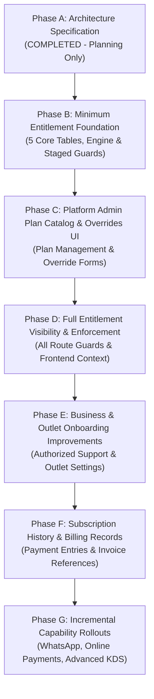

# ROMS Platform Admin & Subscription Implementation Roadmap

> [!IMPORTANT]
> **Implementation Roadmap & Phased Execution Plan (Final Approved Policy Revision)**  
> This roadmap defines the phased rollout schedule, minimum table scope, acceptance criteria, testing strategies, and approval gates for implementing subscription controls, entitlement resolution, and platform administration capabilities in ROMS.

> [!NOTE]
> **Stage 3 Alignment (2026-10-17)** — Phase B was implemented and shipped using the **`outlet_subscriptions`** table (migration `0010`), not the `business_subscriptions` table named in the original Phase B scope below; the Phase B text is retained for history with an inline annotation. A new **Stage 3 planned implementation section** has been added between Phase E and Phase F for ownership, outlet-scoped subscription corrections, and strict read-only Operators (Owner Decisions 002–004, authoritative reference `docs/architecture/stage_3_ownership_subscriptions_architecture.md`). **All Stage 3 steps are planned only and require separate owner authorization**; this documentation task implements nothing.

---

## Roadmap Overview & Staged Rollout Flow

---

## Phase A — Current-State Audit and Architecture Specification

- **Status**: **COMPLETED (Documentation & Planning Task)**
- **Objective**: Audit codebase models, routes, schemas, and UI components to specify target entitlement engine, database schema, precedence rules, time-boundary semantics, and safe migration path.
- **Deliverables**:
  1. `docs/architecture/roms_platform_admin_subscription_architecture.md`
  2. `docs/architecture/roms_platform_admin_implementation_roadmap.md`

---

## Phase B — Minimum Subscription & Entitlement Backend Foundation

### Objective & Scope Justification
Implement ONLY the minimum 5 database tables and backend resolution engine (`EntitlementService`) required for runtime entitlement evaluation:

**Tables Included in Phase B**:
1. `plans`: Catalog of base subscription packages.
2. `features`: Catalog of stable feature codes (`menu.digital`, `ordering.customer`, `ordering.staff`, `kds.enabled`, `outlets.max_count`, `payments.online`, `notifications.whatsapp`).
3. `plan_features`: Mapping of features and numeric limits to plans (`limit_value = NULL` represents explicit unlimited quantity for an included feature).
4. `business_subscriptions`: Authoritative current subscription and historical period log (`is_current = True` partial index). *(`[Shipped]` Implemented as **`outlet_subscriptions`** keyed by `outlet_id` in migration `0010`, per Owner Decision 002 — outlet-scoped subscriptions. The partial unique index `uq_business_current_subscription` shipped on the subscription table; ORM model metadata parity for the index is still missing and is planned as a model-only change.)*
5. `entitlement_overrides`: Audited administrative grants and restrictions (`limit_value = NULL` on grant overrides falls through to legacy scalar/plan limit).

**Explicit Exclusions in Phase B**:
- `add_ons` & `add_on_features` (Deferred to Phase C).
- `subscription_billing_records` (Deferred to Phase F).
- Automated payment gateway processing (Out of scope).

### Database Migration & Atomic Rollback Policy (`0010_subscription_entitlements_schema.py`)
> `[Shipped]` Migration `0010` has been applied. It created `outlet_subscriptions` (not `business_subscriptions`) plus `plans`, `features`, `plan_features`, `entitlement_overrides`, and the partial unique index on the subscription table's current row. The description below is the historical Phase B plan.
- **Schema Creation**:
  - Creates the 5 core tables (`plans`, `features`, `plan_features`, `business_subscriptions`, `entitlement_overrides`).
  - Defines PostgreSQL partial unique index `uq_business_current_subscription` on `business_subscriptions(business_id) WHERE is_current = TRUE`.
- **Atomic Transaction & Unmapped Legacy Plan Protection**:
  - Migration runs within a database transaction managed natively by Alembic.
  - Seeds core plans (`free_qr`, `starter_pos`, `growth_pos`, `pro_kds`, `enterprise`) and feature catalog.
  - Maps known legacy string `plan_name` values (`"starter"` $\rightarrow$ `starter_pos`, `"growth"` $\rightarrow$ `growth_pos`, `"pro"` $\rightarrow$ `pro_kds`, `"enterprise"` $\rightarrow$ `enterprise`) and explicit aliases (`"digital_menu"` $\rightarrow$ `free_qr`, `"free"` $\rightarrow$ `free_qr`).
  - **Mandatory Pre-Check Execution**:
    - The unmapped-plan pre-check query runs as the **very first Python execution step** inside migration `0010` before any DDL, seeding, or backfill calls:
      `SELECT id, plan_name FROM businesses WHERE plan_name IS NULL OR plan_name = '' OR plan_name NOT IN ('starter', 'growth', 'pro', 'enterprise', 'digital_menu', 'free');`
    - If any unmapped rows are found, migration `0010` **MUST raise a Python `RuntimeError`** containing the affected business IDs.
    - Alembic halts execution and PostgreSQL transactional DDL is expected to roll back the migration.
    - *Staging Requirement*: Staging PostgreSQL validation must verify that no migration-created schema objects or data remain after a pre-check failure.
  - Creates active `business_subscriptions` records (`is_current = True`) for all successfully migrated businesses.

### Staged Enforcement Rollout Strategy
1. **Stage 1 (Resolver Unit Tests)**: Standalone unit tests for `EntitlementService` step-by-step precedence logic.
2. **Stage 2 (Inspection Drawer)**: Expose effective entitlement inspection tab in Platform Admin Business Drawer.
3. **Stage 3 (Opt-In Route Guards)**: Apply `RequireEntitlement` guards to new/optional routes (`kds.enabled`, `ordering.customer`).
4. **Stage 4 (Core Route Guards)**: Apply guards to core POS endpoints after verifying all active tenants have been mapped cleanly.

---

## Phase C — Platform Admin Plan Catalog & Overrides UI

### Objective & Scope
Provide Platform Administrators with UI tools in the Platform Admin Portal to create/edit subscription plans, feature catalog mappings, and issue administrative feature overrides.

---

## Phase D — Full Entitlement Visibility & Frontend Integration

### Objective & Scope
Enforce backend route guards across all remaining operational routes and provide live capability context (`useEntitlements()`) to the frontend for dynamic navigation visibility.

---

## Phase E — Business & Outlet Administration Improvements

### Objective & Scope
Enhance onboarding workflows, business detail views (7-tab structure: Overview, Outlets, Menu Support, Subscription, Effective Features, Billing History, Audit Activity), and authorized read-only menu support access.

---

## Phase E3 (Stage 3) — Ownership, Outlet-Scoped Subscriptions & Read-Only Operators `[PLANNED — REQUIRES SEPARATE AUTHORIZATION]`

> **Status:** Planned only. No Stage 3 application code, migrations, or tests have been implemented. Sequencing below follows `docs/architecture/stage_3_ownership_subscriptions_architecture.md` (Owner Decisions 002–004). Documentation updates are complete; implementation must be separately approved and authorized.

### Objective & Scope
Implement the approved Stage 3 product decisions: one-owner-per-business with audited transfer, business creation with mandatory owner details and no automatic outlet/subscription, outlet creation with required plan selection (Trial default), independent outlet subscription management (no propagation), and strict read-only Platform Operators with backend enforcement and redacted audit access.

### Planned Implementation Sequencing
1. **S1 — Ownership foundation (backend + model):** `BusinessMembership` ownership model; exactly-one-owner invariant; transfer service (demote previous owner to manager, `platform.business_owner.transfer`); owner-access-to-all-outlets synthesis preserved (`role="owner"` membership); inactive/suspended target rejection. Audit actions: `platform.business_owner.transfer`, `platform.business_manager.assign`/`revoke`.
2. **S2 — Business creation (backend + portal):** mandatory owner details; administrator-set initial owner password (never logged/audited/echoed); remove automatic primary-outlet and automatic-trial provisioning; no first-login password-change flow; reuse existing users; audit action `platform.business.create` retained.
3. **S3 — Outlet creation (backend + portal):** required plan selection with Trial default (30-day duration preserved); optional manager assignment (owner-as-responsible stores owner role); `free_qr` selectable; audit actions `platform.outlet.create`, `platform.subscription.create`.
4. **S4 — Subscription management (backend + portal):** outlet-scoped subscription mutation only; **delete** business-level subscription propagation (`_propagate_subscription_to_outlets`); `free_qr` non-expiring resolver semantics (no schema change); document and gate the legacy fallback path for removal; `platform.subscription.update`/`cancel` per outlet.
5. **S5 — Operator read-only enforcement (backend):** split router guards so Operators can read Overview/Businesses/details/Subscriptions/Plans/Audit Logs; remove Operator write access everywhere (including the outlet-profile `PATCH` reachable via the profile router and platform menu writes); redacted audit serializer for Operators (minimum necessary fields; actor email and metadata redacted); backend enforcement only — frontend filtering is not sufficient.
6. **S6 — Reconciliation & reporting:** multiple-owner detection report; zero-owner report-only list (no auto-repair); outlets missing subscriptions report; legacy-fallback usage report; denormalized-data drift checks. Reconciliation is a **precondition** for S7.
7. **S7 — Migration `0015` (planned):** adds **only** `uq_business_one_owner` partial unique index on `business_memberships (business_id) WHERE role='owner'` plus ORM model metadata parity for the already-deployed `uq_business_current_subscription` index (model-only, no DDL). **Does not recreate** any deployed index. Requires S6 reconciliation to be clean first.
8. **S8 — Tests & verification:** unit/integration coverage for each slice; re-run full platform-admin frontend suite; verify no planned feature is presented as shipped.

### Explicit Non-Goals (this phase)
- No outlet-count enforcement; plan catalog CRUD remains read-only.
- No email/invitation/password-reset flows; no forced first-login password change.
- No automatic repair of zero-owner businesses; no business-level plan selection or propagation.
- No schema flag for `free_qr`; no recreation of the existing business-subscription index in migration `0015`.

### Authorization Gate
Implementation of S1–S8 requires explicit owner approval of the Stage 3 implementation plan as a separate task. This roadmap section and the associated documentation updates do **not** authorize code, migration, or test changes.

---

## Phase F — Subscription History & Billing Records Administration

### Objective & Scope
Implement `subscription_billing_records` table and Platform Admin UI for logging manual subscription payments, recording invoice reference numbers, and viewing payment history.

---

## Phase G — Incremental Capability Module Rollouts

### Objective & Scope
Roll out individual advanced modules as separate feature-gated releases:
- Module G1: WhatsApp customer notifications (`notifications.whatsapp`).
- Module G2: Online payment gateway integrations (`payments.online`).
- Module G3: Multi-Station advanced KDS workflows (`kds.multistation`).

---

## Test & Verification Requirements

### Required Backend Unit & Integration Tests
Phase B backend implementation requires writing focused unit and integration tests (`backend/tests/test_entitlement_service.py`):

1. **Zero-Day Expiry & Exact Boundary Tests (`now == current_period_end`)**:
   - Verify `now < current_period_end` returns ALLOWED.
   - Verify `now == current_period_end` evaluates as EXPIRED under the approved zero-day grace period policy.
   - Verify scheduled cancellation (`cancel_at_period_end = True`) preserves full access at `now < current_period_end` and revokes access immediately at `now == current_period_end` (no grace period extension).
2. **Scheduled vs. Immediate & Cancellation Timestamp Tests**:
   - Verify `cancelled_at` timestamp recording: scheduled cancellation (`cancel_at_period_end = True`) preserves access until `current_period_end`.
   - Verify immediate cancellation (`cancel_at_period_end = False` with `cancelled_at <= now`) revokes access immediately, independent of `current_period_end`.
   - Verify inconsistent combination (stored `status == "cancelled"` with `cancel_at_period_end == True`) takes precedence as stored status and revokes access immediately.
   - Verify unrecognized or unknown status strings (e.g. `"unknown"`, `"pending"`, `NULL`) fail closed to `"expired"`, denying operational routes while permitting read-only `menu.digital` (unless account status is non-active).
3. **State-Relevant Missing Timestamp & Missing Subscription Row Tests**:
   - Verify `status == "trial"` with `trial_ends_at IS NULL` fails closed to `"expired"`.
   - Verify `status == "active"` with `trial_ends_at IS NULL` and valid `current_period_end` succeeds (irrelevant timestamp NULL does not cause expiration).
   - Verify missing current subscription row (`is_current = True` row missing) fails closed to `"expired"`, denying operational routes while allowing read-only `menu.digital` for active businesses.
   - Verify stale stored `status = "active"` with `now >= current_period_end` dynamically evaluates as `"expired"`.
4. **Authoritative Feature Authorization & Numeric Cap Precedence Tests**:
   - Verify `starter_pos` (plan cap = 1), legacy cap = 3, no override $\rightarrow$ resolves to cap = 1 (legacy scalar cannot inflate plan cap).
   - Verify `growth_pos` (plan cap = 3), legacy cap = 1, no override $\rightarrow$ resolves to cap = 1 (legacy scalar acts as restrictive cap).
   - Verify `starter_pos` (plan cap = 1), explicit grant limit = 5 $\rightarrow$ resolves to cap = 5 (explicit numeric grant override intentionally exceeds plan cap, provided no restriction override or business status denial applies).
   - Verify `free_qr` (plan cap = 1), null-limit grant override, no legacy limit $\rightarrow$ resolves to cap = 1 (override grants capability, but `limit_value = NULL` falls through to 1-outlet fallback cap).
   - Verify multiple active grant overrides resolve to `MAX(limit_value)` (e.g. Grants for 5 and 8 resolve to 8; mixed null and 5 resolve to 5).
   - Verify restriction override at outlet or business scope defeats grant override and plan cap (`403 OUTLET_LIMIT_EXCEEDED`).
5. **Operational Status Tests**:
   - Verify `Business.status == "suspended"` blocks ALL routes including public menu, ignoring any `grant` overrides.
   - Verify unexpected `Business.status` values (e.g. `"unknown"`, `NULL`) fail closed to `403 BUSINESS_SUSPENDED`.
   - Note: Tests for `Business.status == "archived"` are DEFERRED until `archived` is explicitly added to `Business.status` ORM model and logic.
6. **Atomic Migration Rollback Tests**:
   - Verify executing Alembic migration `0010` against a database containing unmapped legacy plan strings raises `RuntimeError` during the pre-check step, causing Alembic to halt and PostgreSQL transactional DDL is expected to roll back the migration.
7. **Cross-Tenant Parent Validation Tests**:
   - Verify creating an outlet override for an outlet belonging to a different business raises `HTTP 400 Bad Request`.

### Testing Environments & Limitations
- **SQLite Unit Tests**: Validate ORM relationships, logic precedence, and FastAPI dependency behavior.
- **Staging PostgreSQL Migration Validation**: Technical pre-deployment requirement prior to production release to validate partial indexes (`WHERE is_current = True`), transactional DDL rollback behavior, and foreign key constraint behavior. *Note: Staging validation has not yet been executed as Phase B implementation has not been authorized.*

---

## Next Action & User Approval Gate

> [!IMPORTANT]
> **Immediate Next Step**: Stop after completing Phase A documentation revision.
> Proceeding to **Phase B Implementation** requires explicit user review and owner approval.
