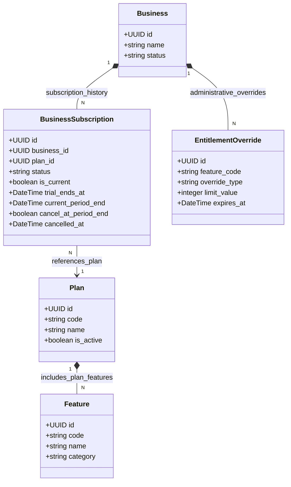

# ROMS Platform Admin & Subscription Architecture Specification

> [!IMPORTANT]
> **Architecture & Planning Specification Only (Final Comprehensive Revision)**  
> This document specifies the target architecture, database schema, precedence resolution engine, subscription lifecycle semantics, audit retention policies, and migration strategy for evolving ROMS into a configurable, multi-tenant restaurant operations platform. No application source code, models, schemas, migrations, or database states have been altered.

---

## 1. Executive Summary

ROMS (Restaurant Operations Management System) is designed to serve a diverse spectrum of restaurant formats on a single shared platform:
- **Small Cafés / Quick-Service**: Digital QR menu viewing only.
- **Full-Service Restaurants**: Customer QR ordering, staff POS order management, and Kitchen Display System (KDS).
- **Food Court / Multi-Outlet Brands**: Prepaid takeaway orders, customer notifications, and outlet-specific operational controls.

Capabilities and operational boundaries are dynamically governed per tenant by four distinct concepts:
1. **Subscription Plans**: Reusable base packages of included features and limits.
2. **Add-Ons**: Independently assignable capability modules (deferred to Phase C).
3. **Administrative Overrides**: Audited feature grants or restrictions applied by Platform Admins.
4. **Centralized Entitlement Resolution Engine (`EntitlementService`)**: A single backend source of truth for runtime feature checks.

---

## 2. Verified Current Architecture & Repository Audit

### Verified Backend Architecture
- **Framework**: FastAPI with Pydantic v2 validation models.
- **ORM & Database**: SQLAlchemy 2.x declarative models with Neon PostgreSQL (`pool_pre_ping=True`).
- **Migrations**: Alembic forward-only migration chain (`0001` through `0009`).
- **Multi-Tenant Hierarchy**: `Business` (1) $\rightarrow$ `Outlet` (N) $\rightarrow$ (`MenuCategory`, `MenuItem`, `DiningTable`, `Order`, `OrderItem`).
- **Tenant & Role Authorization**:
  - `get_current_user`: Validates JWT bearer tokens.
  - `get_current_platform_admin`: Enforces `user.is_platform_admin == True` ([platform.py](file:///C:/Lakshya/Coding/EquinoLabs/restaurant-ops-system/backend/app/api/v1/platform.py#L23)).
  - `RequireOutletRole`: Enforces outlet membership roles (`owner`, `manager`, `staff`).

### Repository Audit of Existing Subscription & Plan Fields
In [models.py](file:///C:/Lakshya/Coding/EquinoLabs/restaurant-ops-system/backend/app/modules/businesses/models.py#L12-L18), `Business` contains:
```python
status: Mapped[str] = mapped_column(String(20), nullable=False, default="active")
subscription_status: Mapped[str] = mapped_column(String(20), nullable=False, default="trial")
plan_name: Mapped[Optional[str]] = mapped_column(String(50), nullable=True)
max_outlets: Mapped[Optional[int]] = mapped_column(Integer, nullable=True)
trial_ends_at: Mapped[Optional[datetime]] = mapped_column(DateTime(timezone=True), nullable=True)
```

**Codebase State of Operational Status Choices**:
- **Implemented `Business.status` Values**: `"active"`, `"suspended"`.
- **Deferred Future Status Choice**: `"archived"` (non-operational business concept). *Repository Audit Note: `"archived"` is used for `MenuItem.status` in backend orders service, but is NOT currently implemented in `Business.status` ORM model or migrations. Enforcement of `"archived"` and corresponding tests are explicitly deferred until `"archived"` is added to `Business.status` ORM model in a future release. Phase B tests enforce currently implemented `"suspended"` behavior only.*

**Audited Plan & Subscription Status Values**:
- `plan_name` values in [SubscriptionEditModal.tsx](file:///C:/Lakshya/Coding/EquinoLabs/restaurant-ops-system/frontend/src/features/platform-admin/SubscriptionEditModal.tsx#L271-L275): `""` (Null), `"starter"`, `"growth"`, `"pro"`, `"enterprise"`.
- `subscription_status` values in [SubscriptionEditModal.tsx](file:///C:/Lakshya/Coding/EquinoLabs/restaurant-ops-system/frontend/src/features/platform-admin/SubscriptionEditModal.tsx#L238-L241): `"trial"`, `"active"`, `"past_due"`, `"cancelled"`.

---

## 3. Commercial & Entitlement Architectural Model



---

## 4. Database Schema (Minimum Phase B Scope)

### 4.1 `plans`
Base plan catalog definitions.
- `id`: UUID (PK)
- `code`: VARCHAR(50), UNIQUE, NOT NULL (`free_qr`, `starter_pos`, `growth_pos`, `pro_kds`, `enterprise`)
- `name`: VARCHAR(100), NOT NULL
- `description`: TEXT, NULLABLE
- `is_active`: BOOLEAN, DEFAULT True
- `sort_order`: INTEGER, DEFAULT 0
- `created_at`, `updated_at`: TIMESTAMP WITH TIME ZONE

### 4.2 `features`
Central catalog of stable feature codes.
- `id`: UUID (PK)
- `code`: VARCHAR(100), UNIQUE, NOT NULL (`menu.digital`, `ordering.customer`, `ordering.staff`, `kds.enabled`, `outlets.max_count`, `payments.online`, `notifications.whatsapp`)
- `name`: VARCHAR(100), NOT NULL
- `category`: VARCHAR(50), NOT NULL (`menu`, `ordering`, `kitchen`, `billing`, `marketing`)
- `description`: TEXT, NULLABLE
- `created_at`, `updated_at`: TIMESTAMP WITH TIME ZONE

*Catalog Note*: `outlets.max_count` is the single canonical feature code representing both multi-outlet capability authorization and numeric outlet cap resolution.

### 4.3 `plan_features`
Mapping between plans and included features/limits.
- `id`: UUID (PK)
- `plan_id`: UUID (FK to `plans.id`, CASCADE)
- `feature_id`: UUID (FK to `features.id`, CASCADE)
- `limit_value`: INTEGER, NULLABLE (`NULL` = explicit unlimited quantity for this included plan feature)
- `created_at`, `updated_at`: TIMESTAMP WITH TIME ZONE
- `UniqueConstraint("plan_id", "feature_id")`

### 4.4 `business_subscriptions`
Authoritative source of truth for business subscriptions and historical records.
- `id`: UUID (PK)
- `business_id`: UUID (FK to `businesses.id`, CASCADE)
- `plan_id`: UUID (FK to `plans.id`, RESTRICT)
- `status`: VARCHAR(20), DEFAULT 'trial' (`trial`, `active`, `past_due`, `cancelled`, `expired`)
- `is_current`: BOOLEAN, DEFAULT True
- `trial_ends_at`: TIMESTAMP WITH TIME ZONE, NULLABLE
- `current_period_start`: TIMESTAMP WITH TIME ZONE, NULLABLE
- `current_period_end`: TIMESTAMP WITH TIME ZONE, NULLABLE
- `cancel_at_period_end`: BOOLEAN, DEFAULT False
- `cancelled_at`: TIMESTAMP WITH TIME ZONE, NULLABLE
- `created_at`, `updated_at`: TIMESTAMP WITH TIME ZONE
- `Partial Unique Index`: `CREATE UNIQUE INDEX uq_business_current_subscription ON business_subscriptions (business_id) WHERE is_current = TRUE;`

### Current-Subscription Integrity & Atomic Switching Mechanics
- **Single Current Subscription Constraint**: PostgreSQL partial unique index `uq_business_current_subscription` guarantees that a business has **at most one** row with `is_current = TRUE`.
- **Fail-Closed when Missing**: If 0 rows exist with `is_current = TRUE` for a business, `EntitlementService` fails closed $\rightarrow$ operational features DENIED (`403 SUBSCRIPTION_EXPIRED`), read-only `menu.digital` ALLOWED (if active business).
- **Atomic Subscription Switch**: Plan upgrades, downgrades, or renewals execute inside an explicit SQLAlchemy database transaction:
  1. Set `is_current = False` on the existing subscription row.
  2. Insert new `BusinessSubscription` record with `is_current = True`.
  3. If transaction fails (e.g. database error), transaction aborts (`ROLLBACK`), maintaining previous subscription intact.

### 4.5 `entitlement_overrides`
Audited administrative grants or restrictions.
- `id`: UUID (PK)
- `business_id`: UUID (FK to `businesses.id`, CASCADE)
- `outlet_id`: UUID (FK to `outlets.id`, CASCADE), NULLABLE (null = business-wide)
- `feature_code`: VARCHAR(100), NOT NULL
- `override_type`: VARCHAR(20), NOT NULL (`grant` or `restrict`)
- `limit_value`: INTEGER, NULLABLE (non-null integer = explicit numeric limit override; null = feature capability grant without replacing numeric cap)
- `reason`: TEXT, NOT NULL
- `expires_at`: TIMESTAMP WITH TIME ZONE, NULLABLE (null = permanent until revoked)
- `created_by_user_id`: UUID (FK to `users.id`, SET NULL)
- `created_at`, `updated_at`: TIMESTAMP WITH TIME ZONE

---

## 5. Audit, Retention & Database Deletion Policy

### Business Deletion vs. Retention Rules
- **Business Operational Standard**: ROMS restricts hard deletion of tenant businesses. Operational termination uses soft-deletion (`Business.status = "suspended"`).
- **Subscription History Retention**:
  - Full subscription history (`business_subscriptions`) and administrative overrides (`entitlement_overrides`) are permanently retained for all active and soft-deleted/suspended businesses.
  - If a `Business` record is physically hard-deleted from PostgreSQL by a database administrator, foreign key constraint `ON DELETE CASCADE` automatically removes its child records in `business_subscriptions` and `entitlement_overrides`.
- **Audit Log Deletion & Retention**:
  - In [models.py](file:///C:/Lakshya/Coding/EquinoLabs/restaurant-ops-system/backend/app/modules/audit/models.py#L20), `audit_logs.business_id` is defined with `ForeignKey("businesses.id", ondelete="CASCADE")`.
  - Therefore, if a `Business` row is physically hard-deleted, PostgreSQL foreign key cascade deletes associated `audit_logs` entries.
  - Permanent audit log preservation across deactivated or former tenants is guaranteed **by enforcing soft-deletion (`Business.status = "suspended"`)** rather than physical database purges.

---

## 6. Unambiguous Subscription Lifecycle Precedence Engine

### Approved Policy: Zero-Day Grace Period
The project owner has explicitly established a **Zero-Day Grace Period** policy:
1. **Zero Days Expiry**: All operational access terminates immediately at `now >= current_period_end` (for paid plans or past-due subscriptions) or `now >= trial_ends_at` (for trial plans).
2. **Scheduled Cancellation**: A scheduled cancellation (`cancel_at_period_end == True`) preserves valid subscription capabilities only until `current_period_end`. Exactly at `now >= current_period_end`, operational entitlements expire. Scheduled cancellation does NOT receive a grace period.
3. **No Grace Extension**: No payment grace period exists to extend operational access beyond the period deadline (`current_period_end`).

### Cancellation Timestamp Semantics & Inconsistent Data Reconciliation
- **Definition of `cancelled_at`**: `cancelled_at` is the timestamp when a cancellation action (customer request or administrative action) was **RECORDED/LOGGED**.
- **Reconciliation of Lifecycle Combinations**:
  - **Scheduled Cancellation (`cancel_at_period_end == True`)**: `cancelled_at` stores when the cancellation request was logged. Access remains ALLOWED while `now < current_period_end`. Exactly at `now >= current_period_end`, status becomes `"expired"` and operational access terminates.
  - **Immediate Cancellation (`cancel_at_period_end == False`)**: `cancelled_at` stores when immediate revocation was executed. Access is DENIED immediately upon `cancelled_at <= now`.
  - **Inconsistent Combination Reconciliation**: If stored `status == "cancelled"` BUT `cancel_at_period_end == True`, the stored `status == "cancelled"` **takes precedence** $\rightarrow$ DENIED IMMEDIATELY (`403 SUBSCRIPTION_EXPIRED`). Stored status of `"cancelled"` always revokes operational access immediately.

### Deterministic Step-by-Step Evaluation Pipeline

```
Step 1: Account Operational Status Check (Business.status)
        ├── IF Business.status == "suspended" OR Business.status NOT IN ("active", "suspended") OR Business.status IS NULL
        │   └── DENY IMMEDIATELY (Fail Closed, Code: BUSINESS_SUSPENDED).
        │       Blocks ALL staff POS, KDS, customer ordering, AND public menu routes.
        │       No entitlement override or subscription plan can bypass this block.
        └── IF Business.status == "active" ──> Proceed to Step 2

Step 2: Current Subscription Presence Check
        ├── IF No row with is_current == True ──> DENY Operational Routes (FAIL CLOSED, Code: SUBSCRIPTION_EXPIRED).
        │   Read-only menu.digital is ALLOWED (Business is active).
        └── IF Row exists ──> Proceed to Step 3

Step 3: Inactive Plan & Unmapped Feature Check
        ├── IF Subscription plan has is_active == False ──> DENY Operational Routes (Code: PLAN_INACTIVE).
        ├── IF Requested feature code is NOT in features catalog ──> DENY (Code: UNKNOWN_FEATURE).
        └── IF Plan is Active & Feature Known ──> Proceed to Step 4

Step 4: Immediate Cancellation & Unrecognized Status Check
        ├── IF status == "cancelled" OR (cancelled_at <= now AND cancel_at_period_end == False)
        │   └── DENY Operational Routes (Code: SUBSCRIPTION_EXPIRED, Effective Status: "cancelled").
        ├── IF status NOT IN ("trial", "active", "past_due") OR status IS NULL
        │   └── DENY Operational Routes (FAIL CLOSED, Code: SUBSCRIPTION_EXPIRED, Effective Status: "expired").
        └── IF Valid Status ──> Proceed to Step 5

Step 5: State-Relevant Timestamp Validation & Zero-Day Expiry Check
        ├── IF stored status == "trial":
        │   ├── IF trial_ends_at IS NULL OR now >= trial_ends_at ──> Effective Status: "expired" (DENY Operational)
        │   └── IF now < trial_ends_at ──> Effective Status: "trial" (ALLOW)
        │
        └── IF stored status in ("active", "past_due") OR cancel_at_period_end == True:
            ├── IF current_period_end IS NULL ──> Effective Status: "expired" (DENY Operational, Fail Closed)
            ├── IF now < current_period_end ──> Effective Status: "active" (ALLOW until period end)
            └── IF now >= current_period_end ──> Effective Status: "expired" (DENY Operational, Zero-Day Grace)
```

### Time-Boundary Comparison Standards
- **Operator Rule**: Valid access requires `now < deadline`. Lockout occurs exactly at `now >= deadline`.
- **Exact Boundary at `now == deadline`**: When current UTC time exactly equals the deadline timestamp (`now == deadline`), access evaluates as **EXPIRED** (`now >= deadline` evaluates True).
- **Timezone Standard**: All persisted timestamps (`created_at`, `updated_at`, `trial_ends_at`, `current_period_end`, `cancelled_at`, `expires_at`) store timezone-aware UTC (`TIMESTAMP WITH TIME ZONE`). Runtime evaluation compares against `datetime.now(timezone.utc)`.

---

## 7. Authoritative Source of Truth & Approved Migration Policy

- **Authoritative Source of Truth**: After Phase B migration, `BusinessSubscription` (and its associated `Plan` feature catalog mapping) is the **sole authoritative source of truth** for feature authorization.
- **Transitional Role of Legacy Fields**: Legacy scalar fields (`Business.plan_name`, `subscription_status`, `max_outlets`, `trial_ends_at`) are retained during Phase B for backward compatibility only. A legacy scalar or legacy `plan_name` string **MUST NOT** independently grant a feature that is excluded by the authoritative active subscription plan.
- **Admin Write Synchronization**: In `platform_service.py`, `update_business_subscription()` is updated to write to `BusinessSubscription` atomically while updating `Business` scalar fields during the transition period.

### Explicit Legacy Plan Mappings & Approved Aliases
During Phase B migration `0010_subscription_entitlements_schema.py`, existing legacy `Business.plan_name` strings are mapped explicitly:

| Legacy `Business.plan_name` String | Explicit Target Plan Code | Target Plan Name | Initial Capabilities & Outlet Cap |
| :--- | :--- | :--- | :--- |
| `"starter"` | `starter_pos` | Starter POS Plan | `menu.digital`, `ordering.staff`, `outlets.max_count` (Intentional Cap: 1)* |
| `"growth"` | `growth_pos` | Growth POS Plan | `menu.digital`, `ordering.staff`, `ordering.customer`, `outlets.max_count` (Cap: 3) |
| `"pro"` | `pro_kds` | Pro KDS Plan | `menu.digital`, `ordering.staff`, `ordering.customer`, `kds.enabled`, `outlets.max_count` (Cap: 10) |
| `"enterprise"` | `enterprise` | Enterprise Plan | All features included, `outlets.max_count` (Cap: Unlimited) |
| `"digital_menu"` *(Approved Alias)* | `free_qr` | Free Digital Menu | `menu.digital`, `outlets.max_count` (Cap: 1 - Single Outlet Only) |
| `"free"` *(Approved Alias)* | `free_qr` | Free Digital Menu | `menu.digital`, `outlets.max_count` (Cap: 1 - Single Outlet Only) |

### Approved Migration Policy & Alembic Transaction Rollback
The project owner has explicitly established the migration failure policy:
- **Recognized Plan Values**: `('starter', 'growth', 'pro', 'enterprise', 'digital_menu', 'free')`.
- **Classification of Unmapped Values**: Any legacy `plan_name` that is `NULL`, empty string `""`, or any string not in the recognized list above (e.g. `"custom_v1"`) is classified as **UNMAPPED**.
- **Alembic Transactional Rollback Execution**:
  - The unmapped-plan pre-check query runs as the **very first Python execution step** inside migration `0010` before any DDL, seeding, or backfill calls:
    ```sql
    SELECT id, plan_name FROM businesses 
    WHERE plan_name IS NULL 
       OR plan_name = '' 
       OR plan_name NOT IN ('starter', 'growth', 'pro', 'enterprise', 'digital_menu', 'free');
    ```
  - If any unmapped rows are returned, migration `0010` **MUST raise a Python `RuntimeError`** containing the affected business IDs:
    `RuntimeError("Migration 0010 aborted: Found unmapped plan_name values in businesses table. Affected business IDs: [IDs]. Manual review required.")`
  - Alembic manages the migration transaction. When the Python `RuntimeError` is raised, Alembic halts execution and PostgreSQL transactional DDL is expected to roll back the migration.
  - *Staging PostgreSQL Verification Requirement*: Actual transaction rollback behavior must be verified in staging PostgreSQL before production deployment. Rollback is expected on PostgreSQL, but is not promised as a verified fact until staging tests have been executed.

---

## 8. Authoritative Feature Authorization, Scope Hierarchy & Numeric Precedence

### Canonical Feature Code: `outlets.max_count`
`outlets.max_count` is the sole canonical feature code in ROMS representing both multi-outlet capability authorization and numeric outlet cap resolution.

### `free_qr` Plan Feature Mapping & Single-Outlet Operation
In `plan_features`, `free_qr` is mapped with `menu.digital` enabled and `outlets.max_count` limit = `1`. This explicitly caps `free_qr` at its primary single outlet (`limit = 1`), authorizing POS/digital menu operation of its single primary outlet while restricting creation of additional outlets beyond 1.

### Override Scope Hierarchy & Restriction Precedence
`EntitlementOverride` records can target an individual outlet (`outlet_id IS NOT NULL`) or an entire business (`outlet_id IS NULL`):
1. **Restriction Scope Rule**: An active `restrict` override at EITHER scope (outlet-specific OR business-wide) **DEFEATS** grant overrides at both scopes:
   - Outlet-specific `restrict` override denies the feature for that target outlet (`cap = 0`, `403`).
   - Business-wide `restrict` override denies the feature across all outlets of that business (`cap = 0`, `403`).
2. **Grant Scope Precedence Policy**:
   - **Hierarchical Scope Replacement**: An active outlet-specific grant override (`outlet_id == target_outlet_id`) takes precedence over business-wide grants for that target outlet.
   - If no outlet-specific grant override exists, active business-wide grant overrides apply.

> [!NOTE]
> **OWNER DECISION REQUIRED ON GRANT SCOPE PRECEDENCE**
> If multiple active grant overrides exist across scopes (e.g., business-wide grant `limit = 3` vs outlet-specific grant `limit = 5`), the specification defines **Hierarchical Scope Replacement** (outlet-specific override takes precedence for that outlet). An alternative model is **MAX Value Across Scopes** (select `MAX(limit_value)` among all applicable active grants). Project owner confirmation is requested before Phase B implementation.

### Multiple Active Grant Overrides Resolution Algorithm
When multiple active `grant` overrides exist at the applicable scope:
- **Step 8.1 (Numeric Grants Check)**: If AT LEAST ONE active `grant` override specifies a non-null integer `limit_value` (e.g. `limit_value = 5`), the resolved numeric limit is **`MAX(limit_value)`** among active numeric grant overrides.
  - *Deterministic Ordering Tie-Breaker*: If multiple active numeric grants have identical limits, ordering is resolved by `expires_at DESC NULLS FIRST, created_at DESC, id DESC`.
  - Explicit numeric grant overrides MAY exceed the authoritative plan cap.
- **Step 8.2 (Null-Limit Grant Check)**: If ONLY null-limit `grant` overrides (`limit_value IS NULL`) exist (no active numeric grant overrides exist):
  - Feature capability is authorized.
  - Numeric limit falls through to: Authoritative Base Plan Limit (`plan_features.limit_value`) $\rightarrow$ Restrictive Legacy Scalar (`Business.max_outlets` if smaller than plan cap) $\rightarrow$ 1-outlet fallback cap.

### Concrete Grant Override Examples
- **Example A (Numeric-Only Grants)**: Grant A (`limit_value = 5`) and Grant B (`limit_value = 8`) on `starter_pos` (plan cap = 1) $\rightarrow$ Resolved limit is **8 outlets** (`MAX(5, 8)`).
- **Example B (Null-Only Grant)**: Grant C (`limit_value = NULL`) on `growth_pos` (plan cap = 3) $\rightarrow$ Authorizes capability; limit falls through to **3 outlets** (Plan limit).
- **Example C (Mixed Null & Numeric Grants)**: Grant D (`limit_value = NULL`) and Grant E (`limit_value = 5`) on `starter_pos` (plan cap = 1) $\rightarrow$ Numeric grant E takes precedence; resolved limit is **5 outlets** (`MAX(5)`).

### Comprehensive Precedence Scenarios Matrix

| Scenario | Authoritative Plan | Legacy `Business.max_outlets` | Active Grant Override | Active Restrict Override | Step 1 Auth | Step 2 Resolved Cap | Operational & Precedence Explanation |
| :--- | :--- | :---: | :---: | :---: | :---: | :---: | :--- |
| **1. Non-Inflation Rule** | `starter_pos` (Plan Cap = 1) | `3` | None | None | **ALLOWED** | **1 Outlet** | Plan cap = 1 is upper ceiling. Stale legacy scalar `3` CANNOT inflate plan cap. |
| **2. Restrictive Scalar** | `growth_pos` (Plan Cap = 3) | `1` | None | None | **ALLOWED** | **1 Outlet** | Legacy scalar `1` is less than plan cap `3`; acts as restrictive cap during transition. |
| **3. Explicit Grant Override** | `starter_pos` (Plan Cap = 1) | `1` | `limit_value = 5` | None | **ALLOWED** | **5 Outlets** | Explicit numeric grant override `5` intentionally exceeds plan cap `1`. |
| **4. Null-Limit Grant Override** | `free_qr` (Plan Cap = 1) | `NULL` | `limit_value = NULL` | None | **ALLOWED** | **1 Outlet** | Override grants capability, but `NULL` limit falls through to 1-outlet fallback cap. |
| **5. Restriction Precedence** | `starter_pos` (Plan Cap = 1) | `1` | `limit_value = 5` | `restrict` | **DENIED** | **0 Outlets** | Restriction override takes precedence over grant override and plan cap (`403`). |
| **6. Inactive Subscription Plan** | Inactive Plan (`is_active=False`) | Any | None | None | **DENIED** | N/A | Inactive plan fails closed for operational routes (`403 PLAN_INACTIVE`). |

---

## 9. Atomic Migration Strategy (`0010_subscription_entitlements_schema.py`)

### Transactional Rollback & Safety Mechanics
Alembic migrations execute within a database transaction managed natively by Alembic:

1. **Pre-Check Execution**: Prior to executing DDL statements or inserting seed records, migration `0010` executes the inspection query for unmapped plan names as its first Python step.
2. **Atomic Rollback on Unmapped Plans**:
   - If unmapped businesses are found, migration `0010` raises `RuntimeError` containing the affected business IDs.
   - Alembic halts execution. PostgreSQL transactional DDL is expected to roll back the Alembic-managed transaction.
3. **PostgreSQL Staging Verification Requirement**:
   - PostgreSQL natively supports transactional DDL (`CREATE TABLE`, `CREATE INDEX` can be rolled back).
   - *Technical Note*: Actual transaction rollback behavior must be verified in staging PostgreSQL before production deployment. Rollback is expected on PostgreSQL, but is not promised as a verified fact until staging tests have been executed.

---

## 10. Formal Decision Log

### Category A: Explicitly Approved Owner Policies
1. **Zero-Day Grace Period**: All operational access terminates immediately at `now >= current_period_end` or `now >= trial_ends_at`. Scheduled cancellations do NOT receive a grace period.
2. **Mandatory Atomic Migration Rollback**: Migration `0010` MUST halt and roll back atomically if unmapped, NULL, or empty `plan_name` values exist. Silent auto-mapping to `free_qr` is forbidden.
3. **Approved Plan Aliases**: `"digital_menu"` and `"free"` map to `free_qr`.
4. **Authoritative Subscription Entitlements**: Active `BusinessSubscription` plan and administrative overrides are sole authorities for feature authorization. Explicit numeric grant overrides may exceed plan caps; without an explicit numeric grant override, legacy scalars cannot inflate plan caps. Restriction overrides take precedence over grants.
5. **Shared Platform Architecture & 5-Table Phase B Scope**: Scope limited to `plans`, `features`, `plan_features`, `business_subscriptions`, `entitlement_overrides`.

### Category B: Codebase State vs. Owner Confirmation Requested
1. **Business Operational Status**: Implemented choices in ORM model are `"active"` and `"suspended"`. Choice `"archived"` is documented as a deferred future non-operational business status (not currently implemented in ORM/migrations). Phase B tests enforce implemented `"suspended"` behavior only.
2. **Grant Scope Precedence Confirmation**: Hierarchical scope replacement (outlet-specific grant overrides business-wide grant) is specified; alternative is MAX value across all active scopes.
3. **Phase B Implementation Status**: **UNAPPROVED**. Documentation review task only; no source code or database changes authorized.

---

## 11. Read-Only Legacy Plan Audit Query

Execute the following read-only SQL query against any environment prior to Phase B data backfill:

```sql
SELECT COALESCE(plan_name, '[NULL/EMPTY]') AS plan_name_value, COUNT(*) AS business_count
FROM businesses
GROUP BY COALESCE(plan_name, '[NULL/EMPTY]')
ORDER BY business_count DESC;
```
