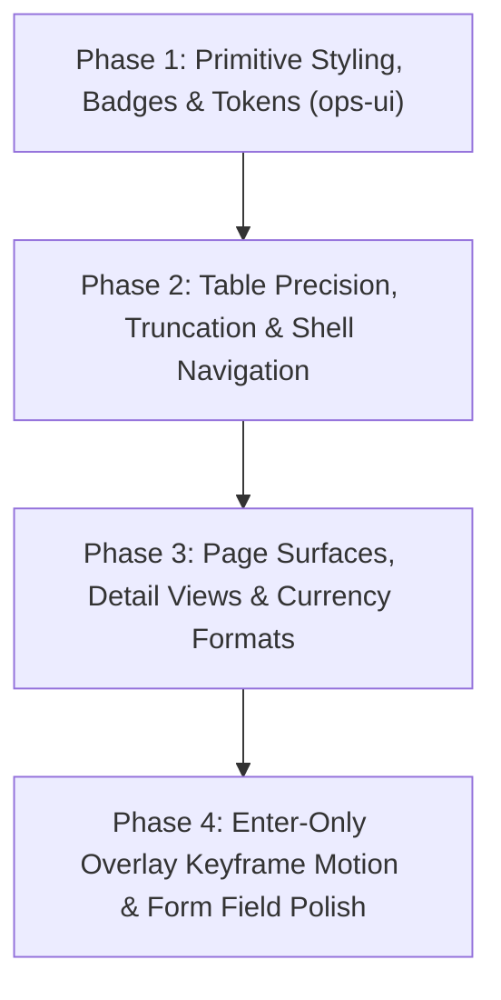

# Platform Admin Visual Design Upgrade Plan

**Document Version:** 2.3  
**Target Application:** `apps/platform-admin`  
**Target Codebase:** `C:\Lakshya\Coding\EquinoLabs\restaurant-ops-system`  
**Scope Directive:** STRICT DESIGN-ONLY (Visual and Presentational)  
**Governing Specification:** `docs/design/DESIGN.md` (Operations Console)  
**Agent Skill Directives:** `AGENTS.md`  

---

## Changelog
- **Version 2.3 (Current):**
  - **Re-baselined against upstream commits (`dfa6faf`, `b027bb9`, `0bdba8a`) and Phase 3 subscription work:** Re-audited all pages and test suites. Current test suite has 12 files and 194 passing tests (0 failures).
  - **Audited new components & pages:** Added design-only audit items for `NotFoundPage.tsx`, `ServerErrorPage.tsx`, `AppErrorBoundary.tsx`, `AddOperatorModal.tsx`, and `PlatformOwnerTransferModal.tsx`.
  - **Phase 1 Progress Honest Assessment:**
    - `1.1 StatusBadge`: Normalized key mapping with raw fallback implemented.
    - `1.2 Button`: Secondary hover border contrast reviewed (no darker border token exists; redundant no-op removed).
    - `1.3 StatBlock`: Pending Phase 1 completion.
    - `1.4 Tabs`: Evaluated tab panel mounting. Panels unmount across tab switches in parent page consumers (`BusinessDetailPage.tsx`, `OutletDetailPage.tsx`), but `Tabs.tsx` itself conditionally renders its single child slot. In accordance with design review, keyframe fade on tab panel was reverted.
    - **Keyframes & Motion:** Added `tailwind.config.js` keyframes (`ops-drawer-enter`, `ops-dialog-enter`, `ops-fade-in`). Added `motion-reduce:animate-none` to animation elements. Focus ring specifications verified as all-focus (`focus:ring-2` with `focus:ring-offset-1`).
  - **Reiterated strict boundary:** No functional, state, or API changes. Backlog items (owner transfer safeguard, ConfirmDialog double-submit guard, dirty-form warning, keyboard row navigation, audit date-range filter, entitlements category grouping) explicitly tracked in Section 2.

---

## 1. Executive Summary & Goals

This plan defines a **strict, design-only visual upgrade** of the `apps/platform-admin` portal. 

### Hard Boundary
* **No Functional Changes:** Existing APIs, data-fetching flows, event handlers, business validation, filtering/searching algorithms, pagination mechanics, and authentication/permissions remain 100% untouched.
* **Visual Scope:** Colors, typography, spacing, border radii, shadows, tabular numeric figures, display formatting, focus rings, hover/active states, visual layout alignment, responsive wrapping, and subtle CSS keyframe utility transitions.
* **Source Code Boundary:** No source code under `apps/` or `packages/` is modified except within explicitly approved phases.

### Core Objectives
1. **100% `DESIGN.md` Alignment:** Reconcile all screens with the "Operations Console" design specification (strictly light mode, 40px table rows, 32px buttons, 6px radii, tabular numerals, 1px `#E3E6EA` flat borders, no decorative novelty).
2. **Defensive Layout Robustness via `break-ui`:** Ensure visual containers gracefully accommodate worst-case data (ultra-long tenant/outlet names, large numbers, multi-line notes, zero items) via CSS truncation and wrapping on name-like columns without altering data or behavior.
3. **Tactile Craftsmanship via `emil-design-eng`:** Elevate interaction quality strictly through visual cues: high-contrast focus rings (`0 0 0 2px rgba(37, 84, 199, 0.24)`), tactile button active states, and sub-100ms hover feedback.
4. **Enter-Only Overlay Motion via `animate`:** Utilize subtle, composite-only CSS keyframe animations (<= 150ms ease-out) on mount for slide-over drawers and dialogs. Unmount on close remains instantaneous to guarantee synchronous testability and zero callback regressions.
5. **Display Formatting Standardization:** Standardize Indian Rupee values to `en-IN` format (`₹1,50,000.00`) when the currency is INR; for non-INR outlets, format using the appropriate currency symbol with Western grouping. Normalize status badge display labels via a display-label normalizer in `StatusBadge.tsx` with fallback to raw values for unknown inputs.

---

## 2. Removed from Scope (Functionality Backlog)

The following items have been **completely excised** because they alter application behavior, state management, or network contracts. They are cataloged here solely for future architectural tracking:

| Previous Item | Why Removed (Functional Violation) | Future Backlog Notes |
| :--- | :--- | :--- |
| **Column Sorting Logic** | Modifies `DataTable` click handlers, state management, and re-orders data rows. | Belongs in future data-layer refactor. |
| **Integrated Pagination Logic** | Modifies row slicing, page-state calculations, and event dispatching. | Belongs in future API/pagination refactor. |
| **Debounced Search Hook** | Introduces asynchronous timers and alters the timing of state dispatch. | Belongs in future query-layer optimization. |
| **`AbortController` Request Cancellation** | Alters API client calls, network handling, and promise resolution. | Belongs in future network-resilience sprint. |
| **Interactive Collapsible JSON Tree** | Adds interactive state management and expand/collapse DOM nodes. | Replaced with pure CSS word-break and monospace styling. |
| **KPI Sparkline Charts (`pick-ui-library`)** | Requires time-series data aggregation, historical array inputs, and visualization logic. | Deferred to Phase 7 Owner Reporting milestone. |
| **Table Virtualization (`@tanstack/react-virtual`)** | Adds heavy runtime scrolling calculations, DOM recycling, and third-party dependency. | Deferred until tenant count demonstrably warrants virtualization. |
| **`<AuthorizePlatform>` RBAC Component** | Alters permission evaluation and access-control rendering logic. | Belongs in security/governance milestone. |
| **Automated Background Polling** | Introduces `setInterval` polling, network overhead, and state syncing. | Belongs in real-time sync milestone. |
| **Owner-Transfer Multi-Step Safeguard** | Alters the transfer modal workflow, adding verification steps and state checks. | Belongs in platform security milestone. |
| **ConfirmDialog Double-Submit Guard** | Adds state tracking or event cancellation to prevent duplicate clicks. | Belongs in form submission/network milestone. |
| **Dirty-Form Navigation Warning** | Adds navigation blocking (`useBlocker` or unload listeners) on unsaved inputs. | Belongs in UX routing milestone. |
| **Keyboard Row Navigation in Tables** | Adds arrow-key state management and roving focus between `<tr>` elements. | Belongs in accessibility keyboarding milestone. |
| **Audit Date-Range Filter** | Adds date-picker state, range validation, and API query parameters. | Belongs in audit logging feature milestone. |
| **Entitlements Category Grouping** | Re-groups and filters the raw entitlements array into accordion/category structures. | Belongs in subscription presentation milestone. |

---

## 3. Visual Design Audit (DESIGN.md Alignment)

### 3.1 Design Primitives (`apps/platform-admin/src/components/ops-ui`)

| Component | `DESIGN.md` Specification | Current State | Status / Visual Defect / Gap |
| :--- | :--- | :--- | :--- |
| **`DataTable.tsx`** | • Row height: exactly 40px (`h-10`) • Header: 36px (`h-9`), `#F6F7F9` • Dividing borders: `1px solid #E3E6EA` • Row Hover: `#F6F7F9` (100ms ease) • Typography: 13px Inter with `tabular-nums` • Overflow: Single-line `truncate` with `title` tooltip on name columns | Row height is 40px, header is 36px. | **Still Valid:** • Numeric columns only apply `tabular-nums` if explicitly aligned right; left-aligned numeric strings, dates, and IDs lack tabular styling. • Sticky Header Feasibility: Vertical scrolling occurs on `<main class="overflow-y-auto">` in `PlatformShell.tsx`. Inside `DataTable.tsx`, the table is wrapped by `
` and `
`. In standard CSS, `overflow: hidden` on parent containers breaks `position: sticky; top: 0;` relative to an outer vertical ancestor (`<main>`). Therefore, making table headers stick to the top of `<main>` is **NOT FEASIBLE without structural layout changes** (e.g. giving `DataTable` an explicit internal max-height with `overflow-y-auto`). Per the design-only scope, this is documented and omitted. • Text overflow in name-like cells wraps unevenly rather than using clean CSS ellipsis truncation and native `title` inspection. |
| **`Drawer.tsx`** | • Surface: `#FFFFFF`, `1px solid #E3E6EA` • Elevation: Level 2 (`shadow-ops-l2`) • Scrim: `rgba(31, 41, 51, 0.40)` without blur • Utility Motion: Enter-only CSS keyframe slide (<=150ms ease-out) | Scrim and surface colors match. Width is `w-[460px]`. Keyframes added to `tailwind.config.js`. | **Still Valid:** • Header divider and footer padding have inconsistent vertical spacing (p-5 vs p-4). • Close button lacks visible 2px focus ring on keyboard navigation. • Content container lacks custom thin scrollbar styling. • Missing CSS enter slide keyframe on mount (`animate-ops-drawer-enter motion-reduce:animate-none`). |
| **`ConfirmDialog.tsx`** | • Max width: 480px • Surface: `#FFFFFF`, `1px solid #E3E6EA` • Scrim: `rgba(31, 41, 51, 0.40)` without blur • Utility Motion: Enter-only keyframe scale-fade (0.98 to 1.0, <=120ms) | Max width 480px, Level 2 shadow. Keyframes added to `tailwind.config.js`. | **Still Valid:** • Destructive banner uses non-standard red background opacity. • Cancel button lacks explicit secondary hover border. • Missing CSS enter scale-fade keyframe on mount (`animate-ops-dialog-enter motion-reduce:animate-none`). |
| **`Button.tsx`** | • Height: 32px (`h-8`), padding: 12px (`px-3`) • Radius: 6px (`rounded-md`), font: 13px weight 500 • Focus ring: `0 0 0 2px rgba(37, 84, 199, 0.24)` with 1px offset | Strictly matches dimensions and radii. | **Phase 1 In Progress:** • Hover duration set to 100ms ease. • Disabled visual state has `disabled:cursor-not-allowed`. • Redundant hover border removed. |
| **`FormField.tsx`** | • Height: 32px (`h-8`), padding: 10px (`px-2.5`) • Font: 13px Inter, radius: 6px • Focus ring: `2px rgba(37, 84, 199, 0.24)` | Input classes match 32px height. | **Still Valid:** • Select dropdown arrows use browser defaults on some platforms instead of a uniform custom SVG chevron. • Textareas lack consistent font styling and min-height constraint. |
| **`StatBlock.tsx`** | • Radius: 6px, padding: 16px (`p-4`), flat Level 0 border • Caption: 12px `#616E7C` • Value: 20px weight 600 `#1F2933` with tabular figures | Uses tabular figures and 20px font. | **Still Valid:** • Vertical alignment between integer value and status badge has slight baseline drift. • Missing subtle visual divider when stacked in single-column responsive view. |
| **`StatusBadge.tsx`** | • Height: 20px, padding: 6px (`px-1.5`) • Radius: 4px (`rounded`), font: 11px weight 500 • Strict semantic colors • Typography: Title Case normalized via display mapping | Uses 4px radius and correct background tokens. Normalizer function and dictionary map implemented. | **Phase 1 Done:** Label normalizer cleans strings and maps to canonical Title Case, falling back cleanly to raw label for unmapped inputs. |
| **`Tabs.tsx`** | • Border bottom: `1px solid #E3E6EA` • Active indicator: 2px `#2554C7` bottom bar • Font: 13px weight 500 | Uses clean tablist layout with 2px indicator bar. | **Phase 1 Done:** Fade-in on tab panel was audited and removed because consumer views conditionally render tab panels on switch. Bottom indicator and focus ring adhere to spec. |

---

### 3.2 Page-Level Design & Layout Gaps

#### 1. Shell & Navigation (`PlatformShell.tsx`)
* **Status:** Still Valid.
* **Current Issue:** Sidebar navigation buttons have `text-[13px]`, but active state lacks the required 2px brand accent indicator bar specified in `DESIGN.md` Section "Accent & Interaction".
* **Visual Fix:** Add a crisp 2px left border (`border-ops-accent`) to the active navigation item. Ensure sidebar surface is strictly `#FFFFFF` with `1px solid #E3E6EA` right border. Header height strictly 48px (`h-12`).

#### 2. Dashboard Overview (`DashboardOverview.tsx`, `DashboardPage.tsx`)
* **Status:** Still Valid.
* **Current Issue:** "Needs attention" list items wrap inconsistently when business names are long; badge baseline drifts on mobile viewports.
* **Visual Fix:** Apply CSS grid layout with fixed metadata column widths and text truncation on business titles (`truncate max-w-[240px]`). Ensure metrics cards sit flush with zero shadow.

#### 3. Business Directory (`BusinessDirectory.tsx`, `BusinessDirectoryPage.tsx`)
* **Status:** Changed by upstream agent & Still Valid.
* **Upstream Changes:** Upstream agent updated Business creation modal with owner email, display name, and password fields.
* **Visual Defect / Fix:** Align filter bar spacing to the strict 8px baseline grid (16px padding). Force `tabular-nums` (using 13px Inter, NOT `font-mono`) on outlet counts and date columns. Truncate long business names with native `title` tooltips.

#### 4. Business & Outlet Detail Pages (`BusinessDetailPage.tsx`, `OutletDetailPage.tsx`)
* **Status:** Changed by upstream agent / Phase 3 & Still Valid.
* **Changes:** Upstream agent removed primary outlet fields; Phase 3 added outlet subscription drawer and confirmation modal.
* **Visual Fix:** Standardize definition list rows: exact `36px` minimum height, uniform `w-36` label column, and high-contrast `#1F2933` value color.
* **Hex Color Swatch:** In `OutletDetailPage.tsx`, add a pure CSS 16x16px rounded-sm color swatch preview alongside the text input without altering form state.

#### 5. Subscriptions Overview (`SubscriptionsOverview.tsx`, `SubscriptionsOverviewPage.tsx`)
* **Status:** Still Valid.
* **Visual Fix:** Apply 13px Inter with `tabular-nums` (NOT `font-mono`) to all date and currency columns. Format currency displays using the outlet's currency code: apply `en-IN` grouping and `₹` symbol when currency is INR (`₹1,50,000.00`); for non-INR outlets, format using the appropriate currency symbol and Western grouping. Standardize table cell padding to `0 12px`.

#### 6. Audit Logs (`PlatformAuditLogs.tsx`, `AuditLogsPage.tsx`)
* **Status:** Still Valid.
* **Visual Fix:** Restyle the JSON inspector using the newly added `DESIGN.md` Technical Metadata spec: 12px monospace typography, `#F6F7F9` surface with `1px solid #E3E6EA` border, CSS `whitespace-pre-wrap break-all`, and a constrained max-height scroll viewport.

#### 7. Error Pages & Modals (New - Added in v2.3)
* **`NotFoundPage.tsx` / `ServerErrorPage.tsx`:** Verified cleanly styled in neutral ops palette. Ensure technical error details disclosure uses Inter 12px with monospace technical stack trace formatting.
* **`AddOperatorModal.tsx` / `PlatformOwnerTransferModal.tsx`:** Standardize input padding, ensure 32px button geometry, and apply `shadow-ops-l2` with `#FFFFFF` background.

---

## 4. Skills Application (Visual Scope Only)

### `break-ui` (Visual Layout Stress-Testing Only)
* **Usage:** Verify visual containers defend against extreme content without writing functional code.
* **Checks:**
  * Render 100-character business names: Confirm CSS `truncate` on name-like columns displays ellipsis and does not blow out table column widths.
  * Render large numeric counts (e.g., 99,999 outlets): Confirm `StatBlock` numerals do not wrap or overlap badges.
  * Render extreme multi-line audit JSON: Confirm drawer scroll container retains sticky headers and does not clip the close button.
  * Render 0-row states: Confirm `StateBlock` centers cleanly within the 8px grid.

### `emil-design-eng` (Tactile Precision & Micro-Polish)
* **Usage:** Elevate purely visual and tactile interaction details.
* **Checks:**
  * Enforce standard focus halo: `0 0 0 2px rgba(37, 84, 199, 0.24)` with 1px base offset on all interactive elements.
  * Enforce tabular numerals (`tabular-nums`) with Inter 13px across all dates, currency displays, IDs, and counts (no `font-mono` on table dates/currencies).
  * Ensure buttons have distinct active state feedback (`active:bg-ops-accent-active` for primary, `active:bg-ops-canvas` for secondary).
  * Ensure hover state transitions use exactly 100ms ease (`transition-colors duration-100 ease-in-out`).

### `animate` (Utility Motion via Tailwind Keyframes)
* **Design Specification Authority:** `DESIGN.md` Section "Utility Motion" permits subtle, composite-only CSS keyframe animations (<= 150ms ease-out) for overlay enter states.
* **Tailwind Config Extensions:**
  * `ops-drawer-enter`: `from: { transform: 'translateX(100%)' } to: { transform: 'translateX(0)' }` (150ms ease-out).
  * `ops-dialog-enter`: `from: { transform: 'scale(0.98)', opacity: '0' } to: { transform: 'scale(1)', opacity: '1' }` (120ms ease-out).
  * `ops-fade-in`: `from: { opacity: '0' } to: { opacity: '1' }` (100ms ease-out).
* **Accessibility Rule:** All animation classes must be accompanied by `motion-reduce:animate-none`.
* **Scope:**
  * `Drawer.tsx`: CSS keyframe enter slide (`animate-ops-drawer-enter motion-reduce:animate-none`) on mount. Immediate unmount on close preserved.
  * `ConfirmDialog.tsx`: CSS keyframe scale-fade (`animate-ops-dialog-enter motion-reduce:animate-none`) on mount. Immediate unmount on close preserved.
  * `DataTable.tsx`: Row hover background transition via CSS `transition-colors duration-100`.

### `pick-ui-library`
* **Status:** **NOT APPLIED.** All visual enhancements use native Tailwind CSS and `DESIGN.md` tokens. No third-party UI, chart, or icon libraries will be added.

---

## 5. Phased Implementation Plan (Visual Only)

---

### Phase 1: `ops-ui` Primitive Styling, Badges & Tokens
**Goal:** Fix core visual primitives so all downstream pages inherit correct styling without changing any component props or callbacks.

| Item | Description | Files Affected | Skill | Status | Visual Acceptance Criteria | Behavior Unchanged Check |
| :--- | :--- | :--- | :--- | :---: | :--- | :--- |
| **1.1** | `StatusBadge` display-label mapping. | `apps/platform-admin/src/components/ops-ui/StatusBadge.tsx` | `emil-design-eng` | **DONE** | Height is 20px, radius 4px, font 11px weight 500. Uses a label normalizer and concise dictionary mapping known tokens, falling back to raw `label` for unknown inputs. | Raw prop `label` and `tone` remain unchanged. Filtering, comparisons, and test role assertions stay identical. |
| **1.2** | Button visual states & focus rings. | `apps/platform-admin/src/components/ops-ui/Button.tsx` | `emil-design-eng` | **DONE** | Primary hover is `#1D44A6`, active is `#183A8F`. Focus ring is 2px `rgba(37, 84, 199, 0.24)` with 1px offset. Disabled button has `cursor-not-allowed`. Redundant no-op secondary hover border removed. | Button props, `onClick`, `type`, and disabled attributes remain identical. |
| **1.3** | StatBlock typography & alignment. | `apps/platform-admin/src/components/ops-ui/StatBlock.tsx` | `DESIGN.md` | **PENDING** | Value uses 20px font-semibold with `tabular-nums`. Baseline aligns with supporting badge. Container has flat 1px `#E3E6EA` border with zero drop shadow. | Component accepts identical `caption`, `value`, `badge` props. |
| **1.4** | Tabs visual indicator & panel fade. | `apps/platform-admin/src/components/ops-ui/Tabs.tsx` | `animate` | **DONE** | Active tab has crisp 2px `#2554C7` bottom border. Tabpanel container does not force keyframe animation because consumers unmount conditionally. | Roving tabindex, keyboard arrow keys, and `onChange` callback remain completely untouched. |

---

### Phase 2: `DataTable` Precision, Truncation & Shell Navigation
**Goal:** Align data tables and navigation layout with strict 8px grid, name truncation rules, and tabular figures.

| Item | Description | Files Affected | Skill | Status | Visual Acceptance Criteria | Behavior Unchanged Check |
| :--- | :--- | :--- | :--- | :---: | :--- | :--- |
| **2.1** | Table cell typography & tabular numbers. | `apps/platform-admin/src/components/ops-ui/DataTable.tsx` | `DESIGN.md` | **PENDING** | Row height is exactly 40px (`h-10`). Header height is 36px (`h-9`). All cell dividers use `1px solid #E3E6EA`. Standardize Inter 13px with `tabular-nums` (NOT `font-mono`) across all numeric, ID, and date cells, whether left or right aligned. Note: sticky header omitted due to ancestor scroll clipping. | Table rows, column render callbacks, `rowKey`, and `onRowClick` operate identically. |
| **2.2** | Name-column text truncation & native `title` tooltip. | `apps/platform-admin/src/components/ops-ui/DataTable.tsx` | `break-ui` | **PENDING** | Name-like columns apply CSS `truncate max-w-[240px]` with native `title` attribute for browser hover. Non-name columns retain normal cell wrapping. Exact 40px row height is preserved. | Row content and DOM structure remain accessible to test queries. |
| **2.3** | Sidebar active navigation indicator. | `apps/platform-admin/src/features/platform-admin/PlatformShell.tsx` | `DESIGN.md` | **PENDING** | Active navigation item features a solid 2px `#2554C7` left indicator bar and `#F6F7F9` background. Header matches exact 48px height (`h-12`). | Navigation links, route changes, and mobile drawer toggle work identically. |

---

### Phase 3: Page Surfaces, Detail Views & Currency Formats
**Goal:** Clean up spacing, alignments, metadata definition lists, and currency formatting across all primary pages.

| Item | Description | Files Affected | Skill | Status | Visual Acceptance Criteria | Behavior Unchanged Check |
| :--- | :--- | :--- | :--- | :---: | :--- | :--- |
| **3.1** | Currency display formatting. | `apps/platform-admin/src/features/platform-admin/SubscriptionsOverview.tsx` `apps/platform-admin/src/features/platform-admin/PlansCatalog.tsx` | `DESIGN.md` | **PENDING** | Read currency code from data. If INR, format with `₹` and `en-IN` grouping (`₹1,50,000.00`). If non-INR (USD, EUR, GBP, etc.), format with that currency's symbol and Western grouping (`$150,000.00`). Use Inter 13px with `tabular-nums` (no `font-mono`). | Underlying numeric values and data flow stay identical. |
| **3.2** | Dashboard metric grid & attention item styling. | `apps/platform-admin/src/features/platform-admin/DashboardOverview.tsx` | `DESIGN.md` | **PENDING** | 4-column metric grid maintains uniform 16px gaps (`gap-4`). Attention list items truncate business names with clean badge alignments. | Metric calculation function `calculateDashboardMetrics` and navigation callbacks remain untouched. |
| **3.3** | Business Directory filter bar styling. | `apps/platform-admin/src/features/platform-admin/BusinessDirectory.tsx` | `emil-design-eng` | **PENDING** | Filter container uses flat Level 0 border (`1px solid #E3E6EA`). Outlet counts and creation dates render with Inter 13px `tabular-nums`. | Search filtering logic `filterBusinesses` and state remain 100% identical. |
| **3.4** | Detail page definition lists & color preview swatch. | `apps/platform-admin/src/features/platform-admin/BusinessDetailPage.tsx` `apps/platform-admin/src/features/platform-admin/OutletDetailPage.tsx` | `emil-design-eng` | **PENDING** | Definition list items (`<dt>`, `<dd>`) use standard 36px height and `#616E7C` / `#1F2933` contrast. In Outlet profile, add visual 16x16px swatch next to `#hex` inputs. | Form inputs, state bindings, `onChange`, and API submit functions remain completely untouched. |

---

### Phase 4: Enter-Only Overlay Keyframe Motion & Form Field Polish
**Goal:** Implement CSS keyframe enter-only motion on mount and polish form fields without affecting unmounting timing.

| Item | Description | Files Affected | Skill | Status | Visual Acceptance Criteria | Behavior Unchanged Check |
| :--- | :--- | :--- | :--- | :---: | :--- | :--- |
| **4.1** | `Drawer.tsx` enter-only keyframe motion. | `tailwind.config.js` `apps/platform-admin/src/components/ops-ui/Drawer.tsx` | `animate` | **PENDING** | Drawer slides in from right via CSS keyframe `animate-ops-drawer-enter motion-reduce:animate-none` (150ms ease-out) on mount. **Synchronous unmount preserved:** `if (!open) return null` remains immediate on close with zero delay. Header padding normalized to 20px (`p-5`). | Tests asserting `queryByRole('dialog') === null` immediately after close click pass with zero regression. |
| **4.2** | `ConfirmDialog.tsx` enter-only keyframe motion. | `tailwind.config.js` `apps/platform-admin/src/components/ops-ui/ConfirmDialog.tsx` | `animate` | **PENDING** | Dialog scales from 0.98 to 1.0 with subtle opacity fade via CSS keyframe `animate-ops-dialog-enter motion-reduce:animate-none` (120ms ease-out) on mount. **Synchronous unmount preserved:** Closes immediately on cancel or confirm. | Confirmation string validation, `canConfirm`, and `onConfirm` callbacks stay untouched. |
| **4.3** | `FormField.tsx` input styling & custom select chevron. | `apps/platform-admin/src/components/ops-ui/FormField.tsx` | `emil-design-eng` | **PENDING** | All text inputs have 32px height, 6px radius, and 10px horizontal padding. Select inputs render a unified SVG chevron. Labels use 12px weight 500 `#616E7C`. | Accessibility helpers (`getFormFieldControlAriaProps`, `id`, `aria-describedby`) remain identical. |
| **4.4** | Audit Log JSON viewer styling. | `apps/platform-admin/src/features/platform-admin/PlatformAuditLogs.tsx` | `break-ui` | **PENDING** | Metadata JSON container uses 12px monospace font, 16px padding, `#F6F7F9` surface, `1px solid #E3E6EA` border, and CSS `whitespace-pre-wrap break-all`. Constrained max-height scroll viewport. | No interactive tree collapse logic added. Data display is purely presentational. |

---

## 6. Verification & Regression Plan

### 6.1 Automated Vitest Baseline (Updated v2.3)
* **Current Baseline:** 194 total tests across 12 test suites, **100% passing (0 failures)**.
  * `PlatformDashboard.test.tsx`: 14 passed
  * `PlatformPhase3Features.test.tsx`: 5 passed
  * `PlatformAuthIntegration.test.tsx`: 7 passed
  * `PlatformAuditLogs.test.tsx`: 6 passed
  * `PlatformNotFoundPage.test.tsx`: 6 passed
  * `PlatformDirectory.test.tsx`: 24 passed
  * `PlatformSubscriptions.test.tsx`: 27 passed
  * `PlatformDetailPages.test.tsx`: 18 passed
  * `PlatformAdmins.test.tsx`: 15 passed
  * `OpsUiComponents.test.tsx`: 53 passed
  * `PlatformOutletSubscription.test.tsx`: 13 passed
  * `PlatformServerErrorPage.test.tsx`: 6 passed
* **Zero Regression Standard:** All 12 suites (194 tests) must remain 100% passing across all design phases.

### 6.2 Visual Verification Checklist
* [ ] **Strict Light Mode:** Verify that no component or page introduces dark backgrounds (`bg-slate-900`/`bg-slate-950`) or dark floating pills into `platform-admin`.
* [ ] **Geometry:** Verify with browser inspector that all buttons are exactly 32px height, table rows are 40px, and corner radii are 6px (or 4px for status pills).
* [ ] **Focus Visibility:** Navigate entire portal using only the `Tab` key. Verify that every input, button, select, and tab displays a crisp 2px focus ring (`rgba(37, 84, 199, 0.24)`).
* [ ] **Tabular Numerals:** Inspect outlet counts, currency figures, and dates in DevTools to confirm `tabular-nums` is active with Inter font (no `font-mono` on dates/currencies).
* [ ] **Name Truncation:** Inspect long names with `break-ui` simulated strings to ensure clean CSS truncation with native hover `title`.
* [ ] **Synchronous Unmount:** Verify dialogs and drawers unmount immediately on Escape or close button click.
