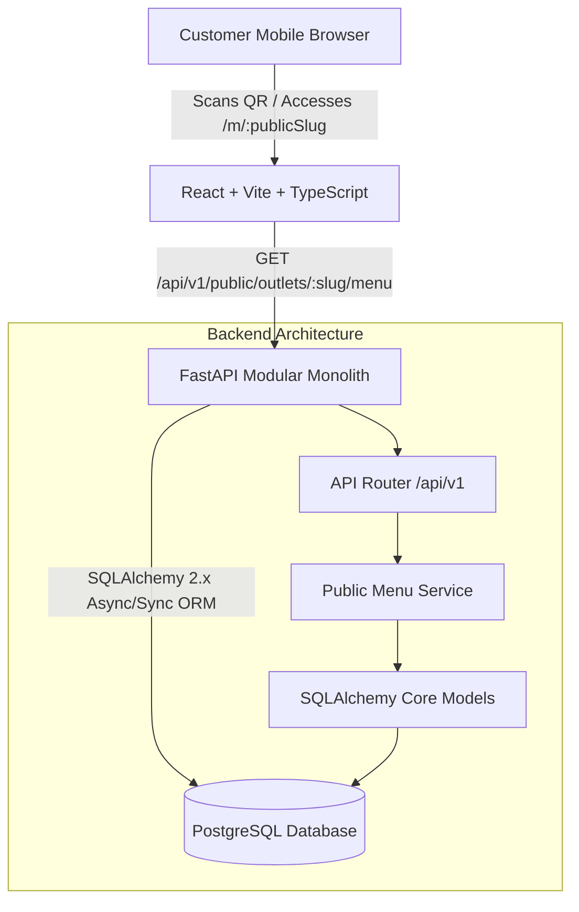
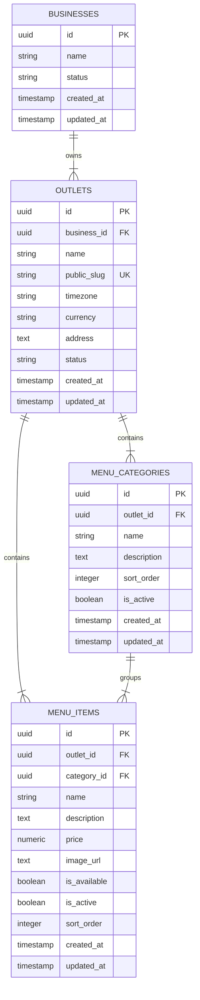

# ROMS Release 1 (R1) Implementation Plan: Technical Foundation & Public Digital Menu

## Goal Description
Establish the initial technical foundation for the **Restaurant Operations Management System (ROMS)** and implement **Release 1 (R1 - Public Digital Menu)** as defined in the PRD and Technical Specification. 

R1 provides a mobile-responsive, public-facing digital menu accessible via outlet-specific QR code URLs (`/m/:publicSlug`). The system is architected as a **Modular Monolith** using **FastAPI (Python)**, **SQLAlchemy 2.x + Alembic**, **PostgreSQL**, and **React + Vite + TypeScript**.

In accordance with the PRD/Tech Spec guidelines, R1 strictly excludes customer ordering, cart submission, table sessions, payments, kitchen displays, and billing workflows, while ensuring the database schema natively supports multi-tenant hierarchy (`Business` -> `Outlet` -> `Categories/Items`).

---

## User Review Required

> [!IMPORTANT]
> **Key Decisions & Stack Confirmation**
> 1. **Dependency Management**: We will use `pyproject.toml` with standard Python `pip` & virtual environment for backend dependencies, pinned in `requirements.txt`.
> 2. **Styling & UI**: We will use **Tailwind CSS** alongside React for rapid, clean, mobile-first responsive UI development (or standard CSS Modules if preferred).
> 3. **Pilot Seed Data**: We will include a database seed script (`backend/app/db/seed.py`) pre-populating sample menus for the pilot outlets (e.g. *Riverside Camp* and *Traditional Restaurant* in Himachal Pradesh).

---

## Open Questions

> [!NOTE]
> **Questions for User Confirmation**
> 1. **Port Mapping**: Default local ports planned:
>    - Backend API: `http://localhost:8000` (OpenAPI Docs at `/docs`)
>    - Frontend App: `http://localhost:5173`
>    - PostgreSQL: `localhost:5432` (User: `roms_user`, Pass: `roms_password`, DB: `roms_db`)
>    Does this port arrangement fit your local development environment?
> 2. **Public Slug Format**: The URL structure for scanning QR codes will be `http://localhost:5173/m/<public-slug>` (e.g., `http://localhost:5173/m/riverside-camp`). Is this slug structure aligned with your expectations?

---

## Architecture & System Overview



### Logical Database Schema for R1



---

## Proposed Changes

### Component 1: Repository Configuration & Docker Environment

#### `[NEW]` `.gitignore`
- Exclude `__pycache__`, `.venv`, `node_modules`, `dist`, `.env`, `coverage`, etc.

#### `[NEW]` `.env.example`
- Environment variable defaults for Postgres connection, API host, CORS origins.

#### `[NEW]` `docker-compose.yml`
- Docker Compose service definition for PostgreSQL 16 (with persistent volume) and backend container for local development.

---

### Component 2: Backend Scaffolding & Database Schema (`/backend`)

#### `[NEW]` `backend/pyproject.toml` & `backend/requirements.txt`
- Core dependencies: `fastapi`, `uvicorn[standard]`, `sqlalchemy>=2.0`, `alembic`, `psycopg2-binary` (or `asyncpg`), `pydantic>=2.0`, `pydantic-settings`, `pytest`, `httpx`.

#### `[NEW]` `backend/app/core/config.py`
- Pydantic Settings for Database URL, API prefix (`/api/v1`), CORS origins.

#### `[NEW]` `backend/app/db/session.py` & `backend/app/db/base.py`
- SQLAlchemy engine initialization, `sessionmaker`, Base declarative model with common mixins (`UUID` primary key, `created_at`, `updated_at`).

#### `[NEW]` Domain Models (`backend/app/modules/.../models.py`)
- `businesses/models.py`: `Business` model.
- `outlets/models.py`: `Outlet` model with `public_slug` index.
- `menus/models.py`: `MenuCategory` and `MenuItem` models with numerical price precision (`NUMERIC(12,2)`).

#### `[NEW]` `backend/alembic/` & `backend/alembic.ini`
- Migration environment setup and initial migration creating `businesses`, `outlets`, `menu_categories`, and `menu_items` tables.

#### `[NEW]` API Schemas & Routers (`backend/app/api/v1/public_menu.py`)
- Pydantic Schemas: `PublicMenuItemSchema`, `PublicMenuCategorySchema`, `PublicOutletMenuResponse`.
- API Endpoint: `GET /api/v1/public/outlets/{public_slug}/menu`:
  - Fetches outlet by `public_slug`.
  - Filters active categories (`is_active == True`).
  - Filters active & available menu items (`is_active == True`, `is_available == True`).
  - Orders by `sort_order`.
  - Handles 404 cleanly when slug is invalid/inactive.
- API Endpoint: `GET /api/v1/health` for health checks.

#### `[NEW]` Seed Script (`backend/app/db/seed.py`)
- Script to populate test business ("Equino Hospitality"), outlets ("Riverside Camp", "Traditional Restaurant"), and rich categories/menu items ( हिमाचली Thali, Trout Fish, Beverages, Snacks) with prices and descriptions.

---

### Component 3: Frontend Web Application (`/frontend`)

#### `[NEW]` `frontend/package.json` & `frontend/vite.config.ts`
- React 18+, TypeScript, Vite, React Router DOM, Lucide Icons (for mobile UI badges/icons), Tailwind CSS / PostCSS setup.

#### `[NEW]` Frontend App Structure & Public Menu View (`frontend/src/`)
- `src/api/client.ts`: Axios/Fetch API wrapper for `/api/v1`.
- `src/types/menu.ts`: TypeScript interfaces for outlet public menu API response.
- `src/features/public-menu/`:
  - `PublicMenuView.tsx`: Main page layout, category tabs/chips, sticky header with outlet info.
  - `CategorySection.tsx`: Category header & list of menu items.
  - `MenuItemCard.tsx`: Mobile-friendly card showing item name, description, price ( formatted in INR `₹`), out-of-stock badge if applicable, image placeholder.
  - `MenuSkeleton.tsx`: Clean loading state skeleton.
  - `NotFoundView.tsx`: Graceful 404 screen when invalid QR code / slug is scanned.
- `src/routes/AppRoutes.tsx`: Route setup with `/m/:publicSlug` pointing to `PublicMenuView`.

---

## Verification Plan

### Automated Tests
1. **Backend API Integration Tests (`backend/tests/test_public_menu.py`)**:
   - Test `GET /api/v1/health` returns status `ok`.
   - Test `GET /api/v1/public/outlets/riverside-camp/menu` returns 200 with structured categories & items.
   - Test `GET /api/v1/public/outlets/non-existent-slug/menu` returns 404 JSON error matching Tech Spec error shape.
   - Verify inactive categories and inactive items are omitted from public menu response.
   - Verify prices match exact decimal output.
   - Run tests command:
     ```bash
     cd backend && pytest
     ```

2. **Frontend UI Tests (`frontend/src/__tests__/PublicMenu.test.tsx`)**:
   - Verify categories render correctly as navigation tabs.
   - Verify menu items render with correct prices and INR formatting.
   - Verify error UI when API returns 404.
   - Run tests command:
     ```bash
     cd frontend && npm test
     ```

### Manual Verification Steps
1. **Database & API Scaffolding**:
   - Start PostgreSQL and Backend using Docker / local python environment.
   - Run Alembic migration: `alembic upgrade head`.
   - Run seed script: `python -m app.db.seed`.
   - Open browser or curl: `http://localhost:8000/api/v1/public/outlets/riverside-camp/menu`.
2. **Mobile Web UI Verification**:
   - Launch Vite dev server: `npm run dev`.
   - Navigate to `http://localhost:5173/m/riverside-camp` in browser developer tools (Mobile Device Emulation - iPhone 14 / Pixel 7).
   - Test smooth scrolling across categories, category filter pill navigation, item description readability without horizontal scroll.
   - Test invalid slug `http://localhost:5173/m/unknown-outlet` to verify custom 404 page.

---
